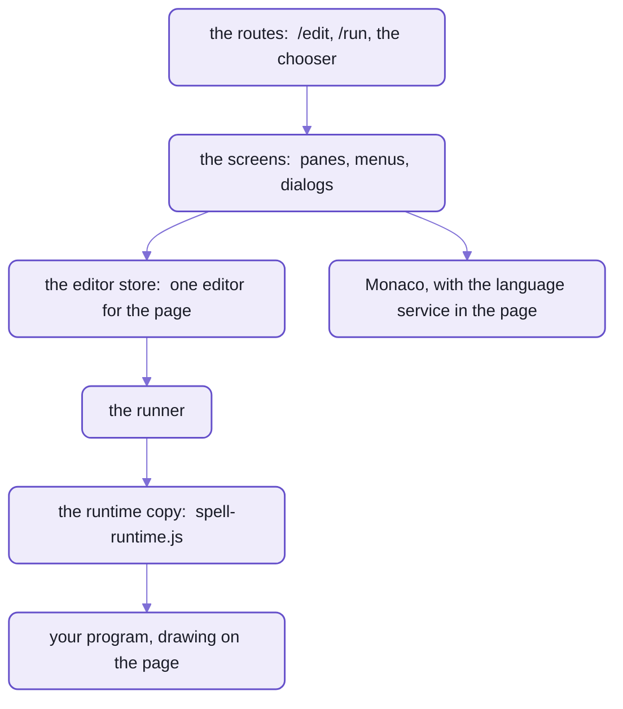

# The editor and the runners

The [app](app/) folder is Spell's editor:  a web app where you write spell on one side and watch it run on the other.
It's built on [Solid](https://docs.solidjs.com/) 2 and [Spell UI](../spell-ui/README.md)'s components,
with [Monaco](https://microsoft.github.io/monaco-editor/), the code editor inside VS Code, for the text.

- If you know React:  Solid looks the same in JSX,
  but a component runs once, and only what reads a changed value updates.
- The same code that runs a program in the editor runs it in VS Code's Run Project panel and inside `<spell-app>`,
  an element any page can hold.
- Four web components come out of this folder:  `<spell-app>`, `<spell-editor>`, `<spell-code>` and `<spell-markdown>`.
- Its server isn't here:  it's [spaces'](README-spaces.md#the-servers), a route module on the page server.



_One editor store holds what the app shows;  the runner runs each compile on its own copy of the runtime._

## The editor store

All of the app's state, and everything it does, lives in ONE object, `editor`
([editor.ts](src/app/editor.ts)):  think of it as the app's controller and its store in one.

- What it holds:  the project group, the project, the file, the selection, notices and errors.
- What it does:
  - shows a page (`showEditor()`, `showRunner()`, `selectPath()`)
  - makes, copies, renames and deletes projects and files, through [spaces'](README-spaces.md#the-models) models
  - compiles (`compileApp()`, and `compileAppSoon()` two seconds after typing stops), restarts, runs
  - asks and tells:  `alert`, `confirm`, `prompt`, `choose`, `showNotice()`, `showError()`
- Its fields are spell CELLS:  values that know who read them, from the kit's reactive engine.
  A bridge makes Solid follow them, so a component that reads `editor.project` draws again when it changes.
- It's on the page as a debug global:  `editor` in the browser's console.

## The runner

The runner takes what a compile wrote and runs it, the same way in all three places it runs:

1. the editor's App pane
2. VS Code's Run Project panel, built by `yarn build:runner`
3. the `<spell-app>` element

How it works:
- `runCompiled()` ([runCompiled.ts](src/app/runner/runCompiled.ts)) points the program's imports at real addresses:
  - `@spell/core` at the runtime
  - another project, `@spell/project/<address>`, at that project's compiled file
  - no import map:  each program gets its own
- Programs run on `spell-runtime.js`, the program's own copy of spell's runtime
  ([spell-lang's core](../spell-lang/README.md)), never the page's:  so apps on one page don't share their things.
- `keepThings`:  a recompile of the same program carries its things over, so the game in progress survives an edit.
  - It starts afresh when you press Restart, when the edit changed the line that starts the app,
    or when a thing can't come over.
- A drawable thing draws as its own element, with its `<css>` inside it
  ([SpellElement.tsx](src/app/runner/SpellElement.tsx)).
  So `a card is a drawable thing` draws as `<solitaire-card>`.
  - Each drawn thing has its own error boundary:
    one that fails shows an error in its place, and the rest keeps drawing.
- What the explorers read:
  - the Thing Explorer, the runtime's list of things, labelled in spell's words from `<Project>.en.js`
  - the Type Explorer, the project's scope pack, `<Project>.scopes.js`:  so a page needs no parser to show types

## The components

Spell UI-style web components, each in [src/app/components/](src/app/components/), each with its own docs page.

| Tag | What it is |
| --- | --- |
| `<spell-app>` | runs a project, with an optional toolbar and explorers;  a root of its own, so a page needs nothing around it |
| `<spell-editor>` | Monaco with tabs, editing a project on the server and feeding the `<spell-app>`s it names what it compiles |
| `<spell-code>` | Spell UI's `<ui-code>`, colouring spell |
| `<spell-markdown>` | Spell UI's `<ui-markdown>`, drawn by spell-lang's markdown engine, spell blocks coloured |

Put one on a page either way:

```html
<!-- by itself -->
<script type="module" src="/element/spell-app.js"></script>
<spell-app project="@spell/examples/calculator" toolbar></spell-app>

<!-- or, on a page with Spell UI, as a component pack -->
<ui-components source="/element/spell.pack.js"></ui-components>
```

- `/element/...` is served by the page server, from the app's `dist-element/`.
  Build it with `yarn build:element`.
- A page with only `<spell-app>`s never downloads the editor:
  each tag loads its own script the first time it appears.
- The demos:  `/demo/spell-app.html` and `/demo/spell-editor.html` on the editor's server.

<details>
<summary>The builds, and one Solid per page</summary>

| Script | Folder | What it builds |
| --- | --- | --- |
| `yarn build` | `app/dist/` | the editor app |
| `yarn build:runner` | `app/dist-runner/` | VS Code's Run Project panel |
| `yarn build:element` | `app/dist-element/` | `spell-app.js`, `spell-editor.js`, `spell-code.js`, `spell-markdown.js`, `spell-language.js` and the pack, `spell.pack.js` |
| `yarn build:page` | `app/dist-page/` | the page side of a Python spell app, which [Python's web server](README-spaces.md#the-python-server) serves |

- ONE copy of Solid per page, across every bundle:
  [vite.solid.config.ts](app/vite.solid.config.ts) builds `spell-solid.js` (Solid, Spell UI's element core)
  and `spell-ui.js` first, and the other builds share them.
  - On a page with Spell UI of its own (a docs page), they take Solid and the core from the page instead.
- `<spell-editor>` has a build of its own, so Monaco's styles stay out of `<spell-app>`'s;
  Monaco itself (about 4.4 MB) loads only when an editor opens.
- `spell-language.js` registers spell's colours alone, no element:
  the page server adds it to the docs pages, so epic pages and guides colour spell blocks.
- The build tests pin all of this:  no React in any chunk, one Solid, Monaco lazy.

</details>

## App UI

The app's own components (the panes, menus, dialogs, explorers) have docs pages, in Spell UI's page shape:
App UI, in [app/docs/](app/docs/), served at `/components/app/` by the page server.

- One page per component, with its props, attributes and where it's used, made from the code by `yarn site:data`.
- Components that need the whole editor around them are shown by pictures, `yarn site:pictures`:
  headless screenshots of the running editor.
- The runner's pieces and the web components are shown live, inside a `<spell-app>`:  they need `yarn build:element`.

<details>
<summary>The routes and the chooser</summary>

| Address | Page |
| --- | --- |
| `/edit/<address>` | the editor, on a project or one file:  `/edit/@spell/examples/drawable-solitaire/Card.spell` |
| `/run/<address>` | the app alone, full size, with its console:  `/run/@spell/examples/calculator` |
| anything else | the chooser:  every project group and its projects, and "Create" |

- One page per route:  moving between files of a project changes the address and keeps the page.
- The app navigates through `editor`, never through links:  a running program's own links stay the program's.

The editor's shortcuts, with Command on a Mac or Control elsewhere:

| Keys | What it does |
| --- | --- |
| `Mod+S` | save the file |
| `Mod+Shift+R` | reload it from the server |
| `Mod+Enter` | compile and run |
| `Mod+N` | a new file |

</details>

<details>
<summary>The Monaco plumbing</summary>

- [src/app/ui/monaco/](src/app/ui/monaco/) wires Monaco to spell:
  the language's colours, and its errors, hover, completion and the rest,
  from the [language service](README-lsp.md), called in the page itself.
- That's why the language service must stay safe to run in a browser.
- Each file is a Monaco model, at an address like `spell:/@spell/examples/drawable-solitaire/Card.spell`.
- The editors on it are Solid components, `MonacoEditor` and `FileEditor`,
  and Monaco loads lazily, the first time one opens.

</details>

## Working on it

- Start it:  `yarn start` in spell-app ([setup](README.md#setup-from-zero)).
  The editor is Vite, so an edit to the app's code shows at once.
- Its tests are in [tests/app/](tests/app/):
  node tests, and browser tests (`*.browser.test.tsx`) in headless Chromium.
  `yarn vp test run --project app:node --project app:browser` runs them.
- The rules for working in the folder:  [app's AGENTS.md](src/app/AGENTS.md).

## See also

- [The Spell app](README.md):  this repo's front page, and the live loop
- [Spaces](README-spaces.md):  where the projects come from, and the server the editor saves through
- [The example apps](README-examples.md), [the language server](README-lsp.md),
  [spell-app's page server](README-page-server.md)
- [Spell UI](../spell-ui/README.md):  the components the app is built from
- [The kit](../README.md), and its [element framework](../README-element.md),
  which every Spell UI-style component is built on
