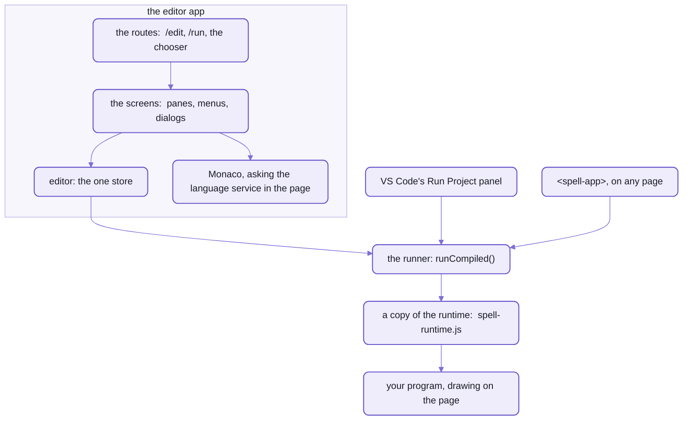
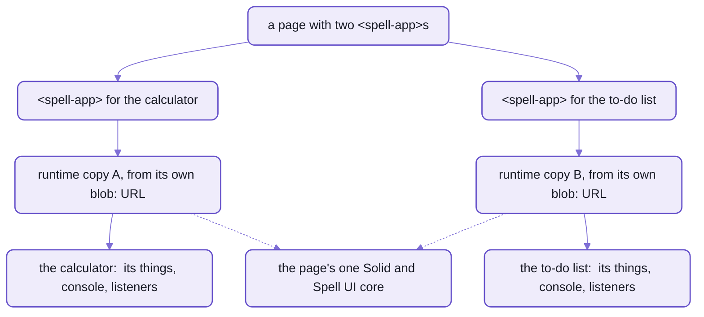
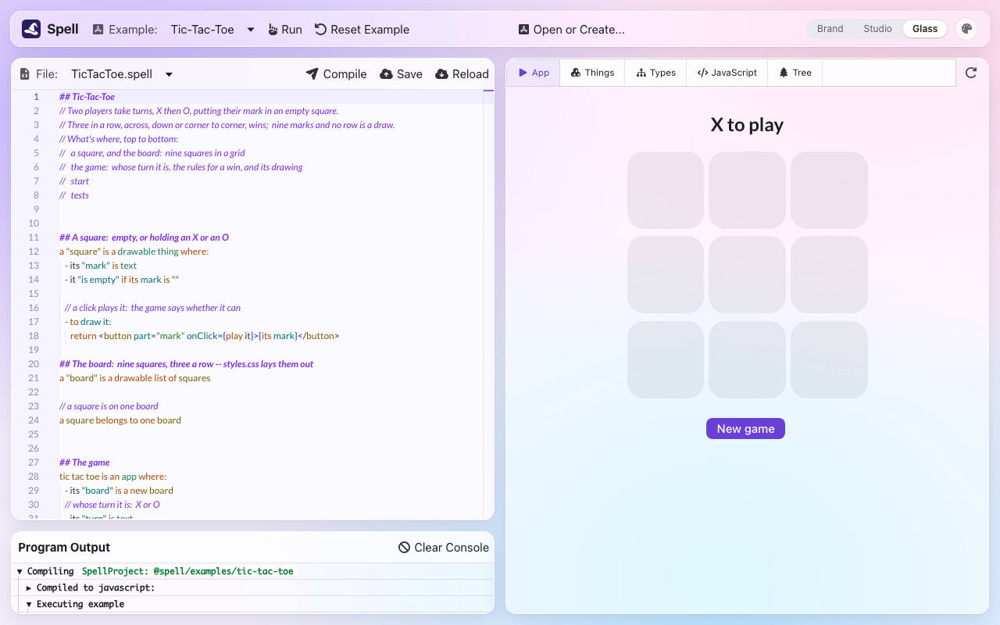

# The editor and the runners

```html
<script type="module" src="/element/spell-app.js"></script>
<spell-app project="@spell/examples/calculator" toolbar></spell-app>
```

_From [the `<spell-app>` demo page](app/demo/spell-app.html), which puts five apps on one page this way;
the calculator's `width` left out._

A page needs nothing more:  no framework, no build step of its own, nothing wrapped around the tag.
It runs [the Calculator example](README-examples.md), a program written in English,
inside the element's own shadow root, with a toolbar holding Restart and Debug.

- The page loads about 590 KB of JavaScript, as built and before compression:
  the element, Solid and Spell UI's core, and the app's own copy of Spell's runtime.
  After that it loads only the Spell UI widgets the calculator draws, each the first time one appears.
- It never loads the editor.
  Monaco, the code editor inside VS Code, is a 4.2 MB file of its own, and only a `<spell-editor>` asks for it.
- The JavaScript comes from the page server, which compiles
  [Calculator.spell](spaces/@spell/examples/calculator/Calculator.spell) when it starts, or the first time it's asked.

The same code runs that calculator in three places:  in this element, in the editor in your browser,
and in VS Code's Run Project panel.
It all lives in [src/app/](src/app/), Spell's editor:
the web app where you write Spell on one side and watch it run on the other.
It's [Solid](https://docs.solidjs.com/) 2 on [Spell UI](https://github.com/spell-app/spell-ui/blob/main/README.md)'s components,
with [Monaco](https://microsoft.github.io/monaco-editor/) for the text.

Its server isn't in this folder:
it's [spaces'](README-spaces.md#the-servers--an-api-that-nothing-starts), a route module on the page server.
Vite builds the app from [app/](app/), which also holds the demo pages and App UI's docs pages;
the rules for working in either are [app's AGENTS.md](src/app/AGENTS.md).



_Three hosts, one runner:  every program runs on a copy of the runtime, never on the page's own._

## Four elements, for any page

Each one is a real tag, with attributes, events and a script API,
written on [the kit's element framework](https://github.com/spell-app/spell/blob/main/README-element.md);
each has a folder of its own in [src/app/components/](src/app/components/).
So a plain HTML page can hold one, as the demos below do.
Inside a framework's page is another matter:  Spell UI's `<ui-dropdown>` has been checked in React, Solid and Vue
([Spell UI and frameworks](https://github.com/spell-app/spell-ui/blob/main/README-frameworks.md)), and these four haven't been yet.

| Tag | What it does | What you set |
| --- | --- | --- |
| `<spell-app>` | runs a project, with an optional toolbar and a debug pane below it:  the Type Explorer, the Thing Explorer and the console;  a root of its own, so the page needs nothing around it | `project` or `src`:  what to run;  `editor`:  a `<spell-editor>` to take programs from;  `toolbar`;  `debug`:  the pane's first tab |
| `<spell-editor>` | Monaco with tabs, editing a project on the page server;  it compiles as it opens, two seconds after typing stops and on Cmd+Enter, and hands what it compiled to its apps | `project`;  `file`:  the one to show first;  `app`:  a selector for the apps it feeds |
| `<spell-code>` | Spell UI's `<ui-code>`, colouring Spell with Spell's own parser;  once it loads, every `<ui-code language="spell">` on the page is coloured too | `language`:  `spell` unless it says otherwise |
| `<spell-markdown>` | Spell UI's `<ui-markdown>`, drawn by spell-parser's own markdown engine, its Spell blocks coloured | `editable`:  Write and Preview tabs |

Put them on a page either way:

```html
<!-- by itself:  a <spell-app> is a root, and loads what it draws -->
<script type="module" src="/element/spell-app.js"></script>
<spell-app project="@spell/examples/Solitaire" toolbar debug="explorer" height="640px"></spell-app>

<!-- as a component pack, under a <ui-root>:  here an editor beside the app it feeds -->
<script type="module" src="/element/spell-ui.js"></script>
<ui-root>
  <ui-components source="/element/spell.pack.js"></ui-components>
  <spell-editor project="@spell/examples/calculator" app="#calculator" height="420px"></spell-editor>
  <spell-app id="calculator" project="@spell/examples/calculator" toolbar></spell-app>
</ui-root>
```

_From the two demo pages, [spell-app.html](app/demo/spell-app.html) and [spell-editor.html](app/demo/spell-editor.html),
their styles and headings left out._

- `/element/...` is the page server's:  it serves the app's `dist-element/`, which `yarn build:element` builds.
  It serves it under every worktree's address too (the settings' `engineRoutes`), so App UI's pages find `spell.pack.js` there.
- The demos are on the editor's own server, port 3000 when it's free:
  `/demo/spell-app.html`, `/demo/spell-editor.html`, and two more below.
  To see them, from spell-app's folder:  `yarn build:element`, then `yarn start`.
- A `<spell-app>` loads each tag inside it the first time it appears, from beside its own script:
  a `<spell-editor>` inside one brings `spell-editor.js`, and a page of apps loaded this way never does.
- An editor and its apps link from either side:  the editor's `app="#calculator"`, or an app's `editor="#todos"`.
  Two apps may follow one editor;  an app that names only its editor waits for the editor's first compile.
- On a page with Spell UI of its own, like a docs page, they use that page's Solid and Spell UI core:
  never a second copy.
  How a component pack loads, and why one Solid matters:
  [the element framework](https://github.com/spell-app/spell/blob/main/README-element.md), "Packs and `<ui-root>`".

Where it stops:
- **An editor saves.**
  Every compile saves the files edited since, and Cmd+S saves, back to the project on disk,
  through the page server's API, which has no sign-in.
  A page with a `<spell-editor>` is for your own machine, not the open web.
- The pack defines all four tags as it registers, so it fetches `spell-editor.js`, 2.0 MB, even where no editor is.
  Monaco still waits for an editor to open.
  A page of apps alone is lighter loading `spell-app.js` by itself.
- Only a checkout's page server serves the elements today:  `spell-app` is a private package, not on npm,
  and `dist-element/` is never committed, so a fresh checkout serves nothing there until it's built.
  `src` runs a compiled program from any address;  `dist-element/` copied to another host hasn't been tried.

<details>
<summary>Every attribute, event and script call of the app and the editor</summary>

`<spell-app>` takes `<ui-root>`'s attributes too, since it is one;  where both name one, these win.

| `<spell-app>` | What it does |
| --- | --- |
| `project` | what to run, from the page server's `/api`, sources and all:  `@spell/examples/Solitaire`;  its Type Explorer then shows each declaration's Spell and compiled code |
| `src` | what to run, from anywhere:  `apps/Solitaire.spell.js`, with its scope pack, declarations, words and the projects it imports beside it |
| `scopes` | where its scope pack is, if not where `project` or `src` says |
| `name` | its name in the toolbar;  default, its project's |
| `editor` | a CSS selector for a `<spell-editor>` in the same document or shadow root:  it runs what that editor compiles, and what it compiled already |
| `toolbar` | shows the toolbar:  its name, Restart, Debug |
| `debug` | opens the debug pane to start, on `explorer`, `things` or `console` |
| `width`, `height` | `fluid`, the default, or a CSS length (`50%`, `30em`), set as its inline style;  a fluid height is the app's, plus the debug pane if it's open |
| `assets` | where Semantic UI, Lato, `spell-app.css` and the icon packs are;  default, beside its script |
| `display` | while its widgets load, as `<ui-root>`'s:  `immediately`, the default, draws them as they arrive;  `when-ready` keeps the space empty till they're all in;  `skeleton` draws placeholders |
| `icons` | the icon packs for everything inside it;  default `fomantic`, the names its toolbar and panes use.  The page's own icons, outside it, keep theirs |
| `run(compiled)` | runs code pushed to it, a `SpellCompiled`:  `{ projectId, compiled }`, and the scope pack, declarations and words if you have them.  Pushed code wins over `project` and `src`, and works before the element joins the page |
| `restart()` | runs it again afresh:  the toolbar's Restart |
| `pushed` | the property holding the code pushed to it last;  dropped when `project`, `src`, `scopes`, `name` or `editor` changes |
| `spell-open` | the event a Type Explorer link sends:  `detail.href` is the source it points at, `spell:/@spell/examples/Solitaire/Solitaire.spell#L12` |

| `<spell-editor>` | What it does |
| --- | --- |
| `project` | what to edit, from the page server's `/api`, as `<spell-app project>` names it;  edits save back to it |
| `file` | which file to show first, `Card.spell`;  default, its first Spell file, with tabs for the others |
| `app` | a CSS selector for the `<spell-app>`s it runs what it compiles in, `#game`;  an app can name the editor instead |
| `width`, `height` | a CSS length, set as its inline style |
| `assets` | where `spell-editor.css` and Lato are;  default, beside its script |
| `compile()` | saves the files edited since, then compiles now;  resolves with what it compiled, or `undefined` when there were errors |
| `save()` | saves the files edited since the last save |
| `compiled` | the property holding what it last compiled with no parse errors |
| `spell-compiled` | the event it sends after each such compile, bubbling out of its shadow root:  `detail` is what it made, its project, JavaScript, scope pack and declarations |

- An editor compiles without Monaco, so its apps run before Monaco has arrived.
- Several editors on one page edit several projects;  two editors of one project share its files,
  so typing in one shows in the other.
- Leaving the page releases an element a moment later;  a move in one go keeps it.
- On a page with Spell UI of its own, they borrow its copies through `SpellUI.packModules`.
  `<spell-code>` and `<spell-markdown>` borrow the families they extend too, so that page's `packModules`
  must also name `spell-ui/components/ui-code` and `spell-ui/components/ui-markdown`,
  or they stop with an error saying so.

</details>

### Its markup can be the app's drawing

Put markup inside a `<spell-app>`, and that markup is what the app draws, with the program's things in it:

```html
<spell-app project="@spell/examples/Solitaire" name="Solitaire">
  <div class="row">
    <div class="title">Klondike Solitaire</div>
    <div class="score">Score {the score of the solitaire}</div>
    <button on-click="{auto play}">AutoPlay</button>
  </div>
  <div class="row">
    <solitaire-discard-pile id="discards"></solitaire-discard-pile>
    <solitaire-stock-pile>
      <spell>
        when double clicked
          play from the stock
      </spell>
    </solitaire-stock-pile>
    <div></div>
    <solitaire-foundation id="clubs"></solitaire-foundation>
    <!-- diamonds, hearts and spades the same -->
  </div>
  <div class="row">
    <solitaire-tableau id="T1"></solitaire-tableau>
    <!-- T2 to T7 the same -->
  </div>
  <div>{the number of cards in the stock of the solitaire} cards left in the stock</div>
</spell-app>
```

_Trimmed from [the Klondike layout demo](app/demo/klondike-layout.html):  the game's own drawing isn't drawn;
this markup is._

- `{the score of the solitaire}` is a hole:  Spell, read against the running program, its value kept live.
- `on-click="{auto play}"`, and a `<spell>` block inside any element, are its handlers.
- Each drawable tag is the program's thing its `id` names:  `<solitaire-tableau id="T1">` is the game's `Tableau#T1`.
  With no `id`, it's the program's one thing of that type, like the stock.
- A `<markdown>` block draws as formatted text, its holes live too.
- Holes and handlers compile in the page, so a layout with Spell in it loads Spell's parser,
  about 390 KB more;  a layout without any doesn't.
- Quote an attribute's Spell.
  Unquoted, the browser splits it into words, and a word used twice is lost:  `{the score of the game}` loses a `the`.
- Spell that doesn't read shows ⚠ where it was, and the rest of the page draws.

## One runner, three places

What the three hosts share is [the runner](src/app/runner/).
What differs is who compiles, and what runs a program again:

| Where it runs | Who compiles | Its copy of the runtime | What runs the program again |
| --- | --- | --- | --- |
| the editor's App pane | the page itself:  `editor.compileApp()` | ONE for the page, `editor.loadRuntime()`:  the editor runs one program at a time | a compile, two seconds after typing stops;  `Mod+Enter`;  Restart |
| VS Code's Run Project panel | the language server, asked by the panel | the panel's own | each compile, a save, and `<Project>.spell.js` changing on disk;  a failed compile sends nothing, so the last good app keeps running |
| `<spell-app>` | the page server, when the compiled file isn't there yet;  or the `<spell-editor>` it follows | its OWN, one per element | its editor's next compile;  Restart, which fetches the program afresh |

A program isn't a component, and it doesn't run in an iframe.
It's an ES module, and `runCompiled()` ([runCompiled.ts](src/app/runner/runCompiled.ts)) runs it in the page itself:

1. It takes down the app the last run started, and resets the runtime.
2. It points the program's imports at real addresses:
   - `@spell/core` at the runtime copy this host loaded
   - each other project it imports, `@spell/project/<address>`, at a `blob:` URL of that project's compiled file:
     fetched afresh once per run, deepest first, so a recompiled library shows at once
3. It imports the program from a NEW `blob:` URL every time.
   The browser caches a module by its address:  the same one twice would hand back the old program, unrun.
4. It hands the program's top-level things to `core.things`, for the Thing Explorer.
5. It answers the error message if the program threw, else `undefined`;  the stack goes to devtools too.

No import map:  a page has only one, and each `<spell-app>` needs its own `@spell/core`.

The edges:
- Two projects that import each other stop the run:  `Projects import each other: ...`, naming the loop.
- VS Code's runner asks its extension for each project the program imports, which asks the language server
  (`spell/compiledImport`):  that project's compiled file, compiled first if it has none yet.

### Every program gets its own runtime

Programs run on `spell-runtime.js`, a copy of [spell-parser's core](https://github.com/spell-app/spell-parser/blob/main/README-core.md) built into each bundle,
never on one the page itself imported.
Each `<spell-app>` loads a copy of its own.



_Each app has a runtime, and so things, of its own;  they all draw with the page's one Solid._

- Each `<spell-app>` fetches the runtime's text once per page, about 140 KB, then imports a fresh copy per element
  from a `blob:` URL of its own ([loadRuntime.ts](src/app/runner/loadRuntime.ts)).
  So two apps on a page share no things, no console, no event listeners and no mount point.
- The program draws with the page's Solid, into a `<div>` its host hands it and never touches again.
- `core` lives in `spell-runtime.js` alone:  the build tests fail if any other chunk of the app holds it.

### A recompile keeps what the program made

Change a rule while a game is on the table, and the game stays on the table, drawn the new way.

The runner asks the runtime to carry the last run's things over (`keepThings`, then `core.carryOver()`):
each top-level thing, matched by name and type, takes the old one's state, as a thing of the NEW class.
It also skips the program's start, so nothing deals again.
The console says what came over:  `Kept ... from the last run:  Restart starts afresh.`

It starts afresh instead, and says why on the console, when:
- you press Restart:  a new deal, on purpose
- the edit changed the program's start
  - in a project of several files:  the file that starts its app, like Drawable Solitaire's,
    which ends `start the game`;  an edit to a file of types, like the card's, keeps the game
  - in a project of one file:  the lines that start its app or run its tests
  - either way, a file more or less
- one of the last run's things can't come over:  its type changed, say
- it's a different program:  the editor carries things over only for the project it ran last

And a run that throws doesn't cost you the game:
the next good compile carries over the things of the last run that finished.
How a thing comes over (a property added, dropped or retyped):  [spell-parser's core](https://github.com/spell-app/spell-parser/blob/main/README-core.md).

### A drawable thing is its own element

Declare a type `drawable`, and each of its things draws as a custom element of its own, named after the project.
Here's the card, every line of it;  in a project named `solitaire`, it draws as `<solitaire-card>`:

```spell
a "card" is a drawable thing:
	- its "suit" is one of clubs, diamonds, hearts or spades
	- its "color" is:
		red if its suit is diamonds or hearts
		black otherwise

	- its "rank" is one of ace, 2 ... 10, jack, queen, king
	- it "is a face card" if its rank is jack, queen or king
	- it "is a (rank)"
	- it "is the (rank) of (suit)"
```

Compiled to TypeScript, it's two classes:  the card, and the element that draws it.

```ts
export class Card extends Drawable {
  static elementTag = core.defineElement(this, "solitaire")
  // ... its suit, color, rank and phrases
}

export class CardElement extends SpellElement<Card> {
  @E.proto static vocabulary = SpellElement.vocabularyFor("solitaire-card", "card", [
    { name: "suit", kind: "string", description: "Its suit." },
    { name: "rank", kind: "string", description: "Its rank." }
  ])

  isARank(rank: (typeof Card.Ranks)[number]) {
    return this.currentThing?.isARank(rank)
  }

  isTheRankOfSuit(rank: (typeof Card.Ranks)[number], suit: (typeof Card.Suits)[number]) {
    return this.currentThing?.isTheRankOfSuit(rank, suit)
  }
}
core.useElement(Card, CardElement)
```

_Trimmed from `spell compile --stdout --target ts/solid`:
the card's members, its types and its JSX declaration left out._

- The element is a Spell UI component, [SpellElement](src/app/runner/SpellElement.tsx):
  a shadow root with the page's theme, then the type's own `<css>` block.
- Its outside is its type's.
  Each property is an attribute and a property, kept the same on the element and its thing, both ways;
  each of the type's methods is a method of the element, so a page's script can ask `card.isARank("ace")`.
- A property holding a thing shows as that thing's reference:  `<solitaire-card pile="Tableau#T1">`.
- Each drawn thing is its own error boundary:  one that fails shows a stand-in and sends `ui-error`,
  and the rest keeps drawing.
- There's ONE tag per type per page, shared by every runtime copy on it.
- Compiled to JavaScript, the card names its tag and no more, and the page builds the element from the type,
  adding what TypeScript writes out:  so both targets draw the same element.

Because it's a real tag, a plain page can write one by hand.
[The drawable elements demo](app/demo/drawable-elements.html) runs Drawable Solitaire in a hidden `<spell-app>`,
which defines its tags, and then:

```html
<solitaire-card class="ace" rank="ace" suit="spades" direction="up"></solitaire-card>
<solitaire-tableau id="T1"></solitaire-tableau>
<button onclick="document.querySelector('.ace').turnOver()">ace.turnOver()</button>
```

_Trimmed from the demo.
`direction` is Drawable Solitaire's card's own, up or down;  the card above has none._

- A tag written by hand with no `id` makes its own thing:  a new ace of spades.
- `<solitaire-tableau id="T1">` is the hidden game's own tableau, its cards and all.
- `turnOver()` changes the ace's `direction` attribute too, so the browser's inspector shows the change.
- **Not yet:**  attribute and method names come in English only.

### The explorers read files, not the parser

A `<spell-app>` can show what a program made and what it declares without the parser on the page:
each explorer reads something the program or its compile left behind.

- The **Thing Explorer** reads the runtime copy's `core.things`:
  every thing, and every list, registers itself as it's made, and the program's exports are its top-level things.
  - It labels their members in Spell's words, `move (a card) to (a pile)`,
    from the project's words file, `<Project>.en.js`, committed beside its source.
  - With no words file, each goes by its name:  `move to pile`.
- The **Type Explorer** reads the project's scope pack, `<Project>.scopes.js`.
  - In a `<spell-app>` it's read-only, and a link in it sends `spell-open`.
  - In the editor, its Types tab has the parser at hand, so it asks the language service in the page instead
    ([the right column](#the-right-column--the-app-and-four-ways-to-look-inside-it)).
  - Who writes the packs, and what's in one:
    [scope packs](README-lsp.md#scope-packs--the-type-explorer-without-a-parser).

## The editor:  one object behind every pane


_The editor on the Calculator:  the code and the compile log on the left;
the running app, its compiled JavaScript and the Spell tree of the cursor's line on the right._

Here is the whole of the Restart button over the App pane, and the whole of what it calls:

```tsx
<Action title={appTexts.text("restart")} icon="redo" onClick={() => editor.restartApp()} {...props} />
```

```ts
async restartApp(): Promise<void> {
  editor.startAfresh = true
  await editor.compileApp()
}
```

_From [Actions.tsx](src/app/solid/Actions.tsx) and [editor.ts](src/app/editor.ts), docstrings left out._

That's the shape of the whole app.
All of its state, and everything it does, lives in ONE object, `editor`:  its store and its controller in one.
The panes read it;  the buttons and the keys call it, and do nothing else.

If you know React, there's no `useStore` hook and no selector.
`editor`'s fields are cells, from [the kit's reactive engine](https://github.com/spell-app/spell/blob/main/README-util.md):  values that know who read them.
A bridge makes Solid follow them, so a pane that reads `editor.project` draws again when it changes,
and a read right after a write sees the new value.
The panes themselves are Solid, which looks like React in JSX but runs a component once:
after that, only what read a changed value updates.

- What it holds:  the project group, the project, the file, the selection, a notice and an error.
- What it does:
  - shows a page:  `showEditor()`, `showRunner()`, `selectPath()`
  - makes, copies, renames and deletes projects and files,
    through [spaces' models](README-spaces.md#the-models--making-projects-not-compiling-them)
  - compiles and runs:  `compileApp()`, `compileAppSoon()`, `restartApp()`
  - asks and tells:  `alert()`, `confirm()`, `prompt()`, `choose()`, `showNotice()`, `showError()`
  - makes a property editor page for one of the project's types, `Card.editor.html`:  `createPropertyEditor()`
- Two habits make it easy to extend:
  - Its methods say `editor.x`, never `this`, so they can be handed around unbound:  `setTimeout(editor.compileApp)`.
  - A method reports its own failure with `showError()`, rather than throwing at the button that called it.
- It's a debug global:  type `editor` in the browser's console.
  There `core` is the running program's runtime, and `parse()`, `compile()` and `tokenize()` are Spell's parser's.

A compile, in the order the console in the picture shows it:
1. `compileApp()` clears the console, and compiles the project in the page with spell-parser's parser and writers.
   It saves the result, `<Project>.spell.js`, through the page server's API.
2. It logs that JavaScript, its lines numbered, under "Compiled to javascript".
3. `executeCompiledApp()` runs it on the runtime, carrying things over when it's the project it ran last.
4. The console ends "Example executed without errors.", or with the error.

**Not yet:**  the About Spell, Docs, Help and Publish buttons are there, but each only logs a TODO
to the browser's console.

### Three looks, and Purple code

The top bar's three-way switch of looks changes the whole editor, and the palette button beside it picks
light, dark or auto, and any of Spell UI's 28 themes.

| Look | Its Spell UI theme | What it looks like |
| --- | --- | --- |
| Glass, the default | `fruity` | frosted panels over a soft wallpaper, as macOS draws them |
| Studio | `studio` | flat panels on hairlines, in Shades of Purple's navy and yellow, or lavender and violet in light |
| the third | Spell's own, with warm surfaces | the white cards of Spell's own pages |

- In a look, the top bar floats as a rounded bar, and the code, the console and the app sit in rounded panels
  with gaps between them.
  Any other theme brings back the editor's older violet bars.
- The editor remembers its own theme, apart from the docs site's;  light or dark is ONE choice for every Spell site.
- The code itself is always Shades of Purple, the VS Code theme, ported to Monaco with a matching light version.
  It follows the page's light or dark, under any theme, and colours Spell's headings, keywords, types, properties,
  actions and constants from the parse.
- A theme made with Spell UI's theme editor and kept in the browser is worn over its base,
  while that base is the look chosen.
- All of it is [EditorTheme.tsx](src/app/solid/EditorTheme.tsx) and [the code themes](src/app/ui/monaco/themes/).
- **Not yet:**  a menu entry for that kept theme, and a design pass on the two looks besides Glass,
  which were built to their first drawings with no round of polish.

### The right column:  the app, and four ways to look inside it

The editor's right column is one pane of five tabs:  App, Things, Types, JavaScript and Tree.

- App is the running program.
  It stays running, never redrawn, while another tab shows.
- Things is what the program has made, live:  [the Thing Explorer](#the-explorers-read-files-not-the-parser).
- Types is every type the code knows, worked out after each compile by the language service the code editor runs;
  a link goes to its line.
- JavaScript is what the project compiled to;  Tree is the Spell tree of the cursor's line.
- Restart and Publish sit at the tab bar's right, whatever tab shows.
- It's the same pane VS Code's Run Project panel and `<spell-app>` use, `RunnerPane`:
  in a narrow pane its tabs scroll sideways with ‹ › keys instead of wrapping.

<details>
<summary>The routes, and the keys</summary>

| Address | Page |
| --- | --- |
| `/edit/<address>` | the editor, on a project or one file:  `/edit/@spell/examples/Solitaire/Solitaire.spell` |
| `/run/<address>` | the app alone, full size, with its console:  `/run/@spell/examples/calculator` |
| anything else | the chooser:  your projects, the examples and the guides side by side, each with a Create button;  in dev, the frozen test projects too |

- One route per page:  moving between files of a project changes the address and keeps the page.
- The app navigates through `editor`, never through links.
  The router takes only `<a link>` clicks, so a running program's own links stay the program's.

The editor's keys, with Command on a Mac or Control elsewhere (either works on both):

| Keys | What it does |
| --- | --- |
| `Mod+S` | save the file |
| `Mod+Shift+R` | reload it from the server |
| `Mod+Enter` | compile and run |
| `Mod+N` | a new file |

- Inside Monaco, its own commands run the same keys;  outside it, one listener on the page does.

</details>

<details>
<summary>The editor's words, in the page's language</summary>

The editor speaks the page's language:  the document's `lang`, else the browser's.
A Spanish browser gets "Guardar" where an English one gets "Save":

```tsx
<Action title={appTexts.text("save")} icon="cloud upload" onClick={() => editor.saveFile()} {...props} />
```

- Every word the app shows people is a key in [AppTexts.en.ts](src/app/ui/AppTexts.en.ts):  menus, panes, notices.
  - Read with `appTexts.text(key, params)` ([AppTexts.ts](src/app/ui/AppTexts.ts)), through Spell UI's `UI.i18n`.
  - A sentence that names something takes it as a param:  `Created {type} {name}.`, `Se creó {theType} {name}.`
- Spanish is [AppTexts.es.ts](src/app/ui/AppTexts.es.ts), with every key:  a chunk only a Spanish page loads.
  - The web components' own Spanish is beside each one:
    - [SpellApp.es.ts](src/app/components/spell-app/SpellApp.es.ts)
    - [SpellEditor.es.ts](src/app/components/spell-editor/SpellEditor.es.ts)
  - A Spanish page loads Spell UI's own Spanish too, so its dialogs' buttons match.
- The language server's labels follow the language of the FILE they're about instead, by its name ([README-lsp.md](README-lsp.md)):
  a Spanish program's hover says "declarado en" in any editor.
- Still English:  the spaces' prompts (a new project's name), Monaco's own menus, the dev-only dialog demos.

</details>

<details>
<summary>Monaco, and the language service in the page</summary>

- [src/app/ui/monaco/](src/app/ui/monaco/) wires Monaco to Spell:  the colours, and the errors, hover, completion
  and the rest, from [the language service](README-lsp.md#what-it-answers-request-by-request),
  called in the page itself.
  - That's why the language service must stay safe to run in a browser.
- Each file is a Monaco model at an address like `spell:/@spell/examples/Solitaire/Solitaire.spell`,
  a view of its file:  the project's files stay the source of truth, and each edit re-parses as little as it can.
- A rename saves every file it touched.
- The editors on it are Solid components, `MonacoEditor` and `FileEditor`.
- Monaco loads lazily, the first time an editor opens:
  through `LazyMonaco` in the app, and `loadMonaco()` in `<spell-editor>`.

</details>

## The public preview:  the editor as plain files

```sh
spell app preview build
```

<details>
<summary>What it printed</summary>

```text
✓ @spell/examples/bill-splitter  up to date
✓ @spell/examples/calculator  up to date
...
✓ @spell/guides/how-tic-tac-toe-works  up to date
✓ Building the static editor  .../spell-app/app/dist-static
@spell/examples:  @spell/examples/bill-splitter, @spell/examples/calculator, @spell/examples/fizzbuzz, ...
@spell/guides:  @spell/guides/a-first-spell, @spell/guides/a-tour-of-spell, ...
`spell app preview serve` shows it as a host would
```

</details>

That folder, `app/dist-static/`, is the whole editor with the ten examples and twelve guides in it:
2,737 files, 27 MB, and nothing that needs a server.
Put it on any static host and anyone can open an example, change it and run it, with nothing to install.



_The preview on Tic-Tac-Toe, served by `spell app preview serve`:  Reset Example beside Run, and no Projects._

```sh
spell app preview serve
```

<details>
<summary>What it printed</summary>

```text
http://127.0.0.1:4848/
The static editor (.../spell-app/app/dist-static) is at http://127.0.0.1:4848/ -- Ctrl-C to stop
```

</details>

It serves the folder as a host would, with no page server behind it, and opens your browser (`--headless` doesn't;
`--port` picks another port).

How a page with no server reads and saves files:
- Every file the editor reads or saves goes through one hook, `LoadableFile.fetch`.
  In the preview, [StaticFiles](src/app/static/StaticFiles.ts) answers it in place of the page server:
  - a group's list and a project's index:  JSON files the build wrote, at the URLs the server would answer
  - a file:  the visitor's edit if there is one, else the build's copy
  - a save:  kept in the browser's `localStorage` as the visitor types, until "Reset Example" asks and forgets it
  - creating, renaming or deleting anything:  refused, with an error that says why
- ONE flag hides what needs a server:  `isStaticBuild` in code, `:root.spell-static` in CSS
  ([staticBuild.ts](src/app/static/staticBuild.ts)).
  Gone in the preview:  the Projects column, the You panel, About, Help, Publish, Settings, the "..." menus,
  the console's test buttons and the debug globals.
- The build is Vite's, in its `static` mode, so no other build carries any of this.
- Every unknown page goes to the editor, for the hosts that read these:  `404.html` (GitHub Pages) and
  `_redirects` (Netlify, Cloudflare Pages).

**Not yet:**  it's built, not deployed anywhere.
And it must be served at a domain's root:  the editor's routes and files are absolute paths.
"Open or Create...", Save and Reload are still in the top bar, and read oddly when nothing goes to a server.

## The builds:  one Solid per page, however many bundles

Five builds, each run from spell-app's folder, each into a folder of [app/](app/), and none committed:

| Script | Into | What it builds |
| --- | --- | --- |
| `yarn build` | `app/dist/` | the editor app, after a type check |
| `yarn build:runner` | `app/dist-runner/` | VS Code's Run Project panel |
| `yarn build:element` | `app/dist-element/` | `spell-app.js`, `spell-editor.js`, `spell-code.js`, `spell-markdown.js`, `spell-language.js`, and the pack, `spell.pack.js` |
| `spell app preview build` | `app/dist-static/` | the public preview:  the editor in Vite's `static` mode, with the examples and guides compiled in ([above](#the-public-preview--the-editor-as-plain-files)) |
| `yarn build:page` | `app/dist-page/` | `spell-page.js`, the page side of a Python Spell app, which [spaces' Python server](README-spaces.md#the-python-server) serves |

Two copies of Solid on one page break silently, so however many of these bundles a page loads,
it gets ONE Solid.
What each bundle costs is the other half of the design:
- Monaco loads only when an editor opens:  4.2 MB as `<spell-editor>` builds it, 5.5 MB in the app's own build.
- `<spell-editor>` has a build of its own, so Monaco's styles stay out of `<spell-app>`'s:
  `spell-app.css` is 8 KB, `spell-editor.css` 188 KB.
- `spell-language.js` is 611 bytes:  it registers Spell's colours with the page's `<ui-code>`, no element,
  and fetches Spell's parser to colour with the first time a Spell block appears.
  spell-app's part of the page server's settings ([README-page-server.md](README-page-server.md)) adds it to the docs
  pages the server serves, so epic pages and guides colour their Spell.
- `spell-page.js` is the page's `@spell/core` for a Python Spell app:
  it exports what `spell-runtime.js` does, and a test fails on one it leaves out.
- The build tests pin all of it:  no React in any chunk, the runtime's included;  one Solid;
  `core` in `spell-runtime.js` alone;  Monaco in chunks of its own, loaded lazily.

You pay for that split at build time:  `yarn build:element` is four Vite builds in a row, `spell-solid.js` first.

<details>
<summary>How the bundles share one Solid</summary>

- `spell-solid.js`, built first into each folder by [its own config](app/vite.solid.config.ts),
  holds Solid, Spell UI's element core and its root, and the `h()` compiled Spell draws with.
  `spell-ui.js` holds the rest of Spell UI, in chunks it loads as they're needed.
- Every other bundle reaches them through `spell-solid-shared.js`:
  the page's own copies when it has them all, else `spell-solid.js`.
- The runtime does too, since compiled Spell draws with Solid;  it never takes `spell-ui.js`.
- `<spell-code>` and `<spell-markdown>` reach the Spell UI families they extend the same way,
  through `spell-ui-shared.js`.

</details>

## App UI:  a page for every component

The app's own components have docs pages, in Spell UI's page shape:
App UI, at `/components/app/` on the page server, from [app/docs/](app/docs/), a component set spell-app's settings
declare ([README-page-server.md](README-page-server.md)).
It's 31 pages in seven groups, from the four web components through the panes and dialogs to the runner's pieces.

- Each page's props, attributes and "Used in" tables are made from the code:  `yarn site:data`.
  - It writes the set's data, committed:  `components.json5` and `search.json5`, in `app/docs/__data/`.
  - Its test fails while they're stale, while a listed page is missing or unlinked from the home page,
    or while a component's banner doesn't point at its page.
    So rerun it after changing a documented component's banner, props or uses.
- What needs the whole editor around it is shown by pictures:
  `yarn site:pictures [name...]`, headless screenshots of this checkout's running editor, into `app/docs/_images/`.
  - Check `git status` after:  opening the editor compiles its project,
    which may rewrite its declarations and words files.
- The web components and the runner's pieces are shown live, inside a `<spell-app>`:
  they need `yarn build:element`, since every page loads `/element/spell.pack.js`.

<details>
<summary>Adding a page</summary>

1. Add its entry to [the hand-kept facts](app/docs/__data/pages.json5), then run `yarn site:data`.
2. Copy a page like it:  [Notice.html](app/docs/Notice.html) for one shown by a picture,
   [spell-app.html](app/docs/spell-app.html) for a live one.
3. Link it from [the home page](app/docs/index.html).

</details>

## Working on it

- Start the editor from spell-app's folder, `yarn start`
  ([what it prints](README.md#setup-from-zero), on the front page).
  - The editor is Vite, so an edit to the app's own code shows at once.
  - `yarn stop` stops a Vite left running.
- The tests are in [tests/app/](tests/app/), at the same paths as the code:
  node tests, and `*.browser.test.tsx` in headless Chromium.

  ```sh
  cd ~/www/spell/spell-app
  yarn vp test run --project app:node --project app:browser
  ```

- Two rules that bite:
  - Never import Monaco statically outside its two folders, types aside:  one static import puts it in the main bundle.
  - Only `spellRuntime.ts` imports `spell-parser/core` as a value:
    anywhere else, it lands in a chunk every app on the page shares, and the build tests fail.
- The rest of the folder's rules:  [app's AGENTS.md](src/app/AGENTS.md).
  The checks every repo shares:  [README-development.md](https://github.com/spell-app/spell/blob/main/README-development.md).

## See also

- [The Spell app](README.md):  this repo's front page, with the live loop drawn for people who don't program
- [Spaces](README-spaces.md):  where the projects come from, and the server the editor saves through
- [The element framework](https://github.com/spell-app/spell/blob/main/README-element.md):  what all four elements are written on, and how a pack loads
- [The language server](README-lsp.md):  the service Monaco asks in the page, and VS Code asks over stdio
- [Spell in VS Code](https://github.com/spell-app/spell/blob/main/README-vscode.md):  Run Project, the third place the runner runs
