# The example apps, and ideas for yours

```spell
// a tableau:  a column, built down from king to ace, red and black in turn
a "tableau" is a pile where:
	- it can give up a card if: the card is face up
	- it can take a card if:
		if it is empty
			return the card is a king
		return its color is not the color of the card and its value is the value of the card + 1
```

_Real Spell, from the Solitaire example:  the rule for one column of Klondike._

If you've played Klondike, you just read the rule for a column:
a king on an empty one, and after that, one card lower, in the other color.

That isn't a comment above the code that checks a move.
It IS the check:  click a card, and the game moves it to the first pile that says it can take it.

Six example apps ship with the Spell editor, from FizzBuzz up to that solitaire, and two libraries to build on.
Each one is a real project:  open it, and its app runs beside its text;  change a line, and the app follows.
Here to make your own?  [Skip to the ideas](#ideas-for-your-own).

## Six apps, simplest first

Open them in this order:  each one adds an idea or two to the one before.
Each picture is the example open in the editor:
its program on the left, the app it makes on the right, and the JavaScript it compiles to under the app.

<!-- The table below is made from the projects themselves:  run `yarn examples:readme` in spell-app (see below). -->
<!-- examples:start -->

| Example | Address | What it shows | Running |
| --- | --- | --- | --- |
| FizzBuzz | [`@spell/examples/fizzbuzz`](spaces/@spell/examples/fizzbuzz/) | Counting to 100 with fizz and buzz:  a loop, `if` and `otherwise`, and `print`, in eight lines | <a href="docs/images/examples/fizzbuzz.png"></a> |
| Calculator | [`@spell/examples/calculator`](spaces/@spell/examples/calculator/) | A pocket calculator on Spell UI:  an app with text properties, actions like `to clear (a calculator)`, and a keypad of buttons whose clicks are Spell | <a href="docs/images/examples/calculator.png"></a> |
| Task List | [`@spell/examples/TaskList`](spaces/@spell/examples/TaskList/) | A to-do list in the outline style:  each task its own element, with Spell UI's controls;  `where` filters it, and a click selects tasks (shift and command for more) for a property editor that changes them all at once | <a href="docs/images/examples/TaskList.png"></a> |
| Lista de tareas | [`@spell/examples/ListaDeTareas`](spaces/@spell/examples/ListaDeTareas/) | Task List's Spanish twin:  a to-do list in the outline style, in Spanish, each task its own element with Spell UI's controls, a click selecting tasks for a property editor that changes them all at once | <a href="docs/images/examples/ListaDeTareas.png"></a> |
| Solitaire | [`@spell/examples/Solitaire`](spaces/@spell/examples/Solitaire/) | Klondike solitaire in the outline style:  its own cards, deck and piles (`Card`, `Deck`, `Pile`), then the game, its kinds of piles (`a "tableau" is a pile where:`), their moves, layout and CSS;  `pause for` animates the deal | <a href="docs/images/examples/Solitaire.png"></a> |
| Solitario | [`@spell/examples/Solitario`](spaces/@spell/examples/Solitario/) | Solitaire's Spanish twin:  Klondike in the outline style, in Spanish, with its own cards, deck and piles (`Carta`, `Mazo`, `Pila`), as Solitaire has | <a href="docs/images/examples/Solitario.png"></a> |
| People | [`@spell/library/people`](spaces/@spell/library/people/) | People, orgs, notes and relationships, each saved in a readable JSON5 file;  compiled to TypeScript for the app's "You" panel and the people store | a library:  no app of its own |

<!-- examples:end -->

They're two groups in Spell's own space:
`@spell/examples`, and `@spell/library`, whose library is for other projects to import.

### Opening one

With Spell set up ([setup from zero](https://github.com/spell-app/spell/blob/main/README.md#setup-from-zero)) and `spell` on your PATH
([setting it up](https://github.com/spell-app/spell/blob/main/README-cli.md#setting-it-up)), one command opens the editor on an example:

```sh
spell app serve @spell/examples/calculator
```

- It opens your browser on the example, until Ctrl-C ([its options](https://github.com/spell-app/spell/blob/main/README-cli.md#spell-app)).
- In the editor, **Open or Create...** in the top bar lists every project, these among them.
- `/run/` in place of `/edit/` shows the app alone, full size, with its console
  ([the editor's routes](README-app.md#the-editor--one-object-behind-every-pane)).
- `spell run @spell/examples/fizzbuzz` compiles one and runs it:  in your terminal,
  or, for one with an app, in your browser until Ctrl-C.
- `spell projects @spell/examples` lists them, alphabetically, which is not the order to open them in.

<details>
<summary>How the table is made, and adding an example</summary>

The table and its pictures come from the example projects, so a new example shows up by running one command.
Everything else on this page is written by hand.

1. Make the project in `spaces/@spell/examples/<name>/`:  a `__project.json5` and its `.spell` files.
   `spell app create <name> --in spaces/@spell/examples` writes a first one.
2. Give its project file a `"description"`:  one line of what it shows.
   - Without one, the table takes the first comment of its first Spell file.
   - A `"title"` names it, when its folder's name can't (`ListaDeTareas` is "Lista de tareas").
3. Add its name to the learning order at the top of [the script](scripts/examples-readme.ts), where it fits;
   one not listed comes after the listed ones, by name.
4. Start the editor, `yarn start` in spell-app, and leave it running.
5. In spell-app's folder, `yarn examples:readme`:
   it opens each example in the editor, headless, in a window 1280 by 800,
   gives it 5 seconds after the page goes quiet to compile, run and draw,
   saves a picture of it into [the pictures folder](docs/images/examples/),
   and rewrites the table between the page's two marker comments.

   ```text
   docs/images/examples/fizzbuzz.png
   docs/images/examples/calculator.png
   ...
   README-examples.md:  7 projects
   ```

- `yarn examples:readme --no-pictures` rewrites only the table, without a browser;
  `yarn examples:readme calculator` takes only that example's picture.
- `yarn examples:readme --check` writes nothing:
  it fails while the table is out of date, or an example has no picture.
  spell-app's tests run it, so a new example fails `yarn test` until the page is made again.
- The table draws each picture 360 pixels wide;  a click opens it whole.
- Opening a project in the editor compiles it, which may rewrite its declarations and words files beside its source:
  look at `git status` after.

</details>

## Every app here has four parts

FizzBuzz only prints.
The other five draw an app, and each is built the same way:
what its things ARE, what they DO, how they DRAW, and one line that starts it.
If you know React, you know all four already, under other names.

The Calculator shows them plainest, in 113 lines, because it keeps each part in a block of its own:

| Part | In the Calculator | In React |
| --- | --- | --- |
| what its things are | `a calculator has a total as a number`, one of its six properties | the component's state |
| what they do | `to clear (a calculator):`, and four more actions | its event handlers |
| how they draw | `to draw (a calculator)`:  a keypad of Spell UI buttons, each with a click like `onClick={append "7" to it}` | its JSX |
| the start | `start the calculator`, which puts its drawing on the page | `createRoot(root).render(<App />)` |

<details>
<summary>The four parts, in the Calculator's own lines</summary>

```spell
a calculator is an app
a calculator has an input as text
a calculator has an output as text
a calculator has a left as text
a calculator has a right as text
a calculator has a total as a number
a calculator has an operator as text
```

```spell
to clear (a calculator):
	set its input to ""
	set its output to ""
	set its left to ""
	set its operator to ""
	set its right to ""
	set its total to 0
```

```spell
to draw (a calculator)
	...
		<div class="Keypad">
			...
			<ui-button onClick={append "7" to it}>7</ui-button>
			<ui-button onClick={append "8" to it}>8</ui-button>
			<ui-button onClick={append "9" to it}>9</ui-button>
			<ui-button primary onClick={apply "×" to it}>×</ui-button>
	...
```

```spell
set calculator to a new calculator
clear the calculator
start the calculator
```

- The whole program, its other four actions too:
  [Calculator.spell](spaces/@spell/examples/calculator/Calculator.spell).
- The keypad's grid, four keys a row, is its own CSS:
  [styles.css](spaces/@spell/examples/calculator/styles.css).

</details>

The difference that matters:  a click handler is a sentence.
`onClick={clear it}` on the C key clears the calculator, and `it` is the calculator being drawn.

So the wording counts.
The operator keys say `apply "+" to it`, the calculator's own action:
a sum already typed carries its total on as the next sum's left number, and the second number starts afresh.

- `set its operator to "+"` would read as well, and only set the property:
  press 7, +, 5, and the 5 would join the 7, for 7 + 75.
- Its action was once named `set the operator of (a calculator) to (op as text)`:
  then `set the operator of it to "+"` ran it, and `set its operator to "+"`, one word apart, set only the property.
  So the action has a name no property has.

Two more things the picture won't tell you:
- The total appears as you type the second number;  the = key makes it the next sum's start.
- The display and the keypad are plain `<div>`s, laid out by the project's own stylesheet;
  the keys are Spell UI's `<ui-button>`, `primary` for an operator, `negative` for C.

## FizzBuzz:  a loop, and printing

The classic programming exercise:
count to 100, saying "fizz" for multiples of 3, "buzz" for multiples of 5, and "fizzbuzz" for both.
Here's all of [FizzBuzz.spell](spaces/@spell/examples/fizzbuzz/FizzBuzz.spell), not an excerpt:

```spell
## File FizzBuzz.spell
to play fizzbuzz
	for each number from 1 to 100
		if the number divided by 15 is an integer: print the number, "fizzbuzz"
		otherwise if the number divided by 3 is an integer: print the number, "fizz"
		otherwise if the number divided by 5 is an integer: print the number, "buzz"
		otherwise print the number

play fizzbuzz
```

- It's a program in two parts, not four:  `to play fizzbuzz` defines a new phrase, and `play fizzbuzz` says it.
- `for each number from 1 to 100` names its loop variable, `number`, and later lines call it "the number".
- It draws nothing, so the editor's App pane stays empty (the picture below):
  what it prints goes to the program's output, under the text, or to your terminal.

```sh
spell run @spell/examples/fizzbuzz
```

<details>
<summary>Output</summary>

```text
✓ Compiling @spell/examples/fizzbuzz
1
2
3 fizz
...
15 fizzbuzz
...
100 buzz
```

</details>

With `--target py`, the same hundred lines come from Python ([the targets](https://github.com/spell-app/spell-parser/blob/main/README-targets.md)).

<details>
<summary>What it compiles to, in JavaScript</summary>

```js
core.heading("File FizzBuzz.spell")
/** File FizzBuzz.spell */
export function playFizzbuzz() {
  core.getRange(1, 100).forEach((number) => {
    if (core.isOfType(number / 15, "integer")) core.console.log(number, "fizzbuzz")
    else if (core.isOfType(number / 3, "integer")) core.console.log(number, "fizz")
    else if (core.isOfType(number / 5, "integer")) core.console.log(number, "buzz")
    else core.console.log(number)
  })
}

playFizzbuzz()
```

- From `spell compile @spell/examples/fizzbuzz --stdout`, its import line left out.
- The new phrase is a function, `playFizzbuzz()`;  "the number" is the loop's `number`.
- `core` is [the runtime](https://github.com/spell-app/spell-parser/blob/main/README-core.md) compiled Spell runs on.

</details>


_FizzBuzz in the editor:  nothing to draw, so the App pane stays empty, and the output starts at the bottom left._

## Task List:  things that draw themselves, a list, and a property editor

Every framework has its to-do list, and this is Spell's:
[Task List](spaces/@spell/examples/TaskList/), 147 lines of Spell in two files, and a style sheet.
- [Task.spell](spaces/@spell/examples/TaskList/Task.spell):  what a task is, and how it draws.
- [TaskList.spell](spaces/@spell/examples/TaskList/TaskList.spell):  the list of tasks, then the app around it.

It's written in the OUTLINE style:  a heading line, then what's true of it, as bullets.
First, what a task IS:

```spell
a "task" is a drawable thing where:
	- its "title" is text
	- its "notes" is text
	- its "priority" is one of low, normal or high
	- its "done" is yes or no
	- it "is done" if its done is yes
	- it "is active" if its done is no
	- its "priority color" is:
		red if its priority is high
		grey otherwise
	- it can be selected
	- it can be dragged
```

- `a "task" is a drawable thing` declares a new type;  each `its` line gives it a property, with its kind.
- `one of low, normal or high` is a choice of three values.
- The quoted phrases are new ways to talk about a task:  later lines can say `where it is active`.
- `drawable` makes each task an element of its own on the page, `<task-list-task>`.
- `it can be selected`:  a click selects a task, and shift or command (ctrl) selects more.
- `it can be dragged`:  by its grip, to another place in its list (below).

Then how a task draws, with [Spell UI](https://github.com/spell-app/spell-ui/blob/main/README.md)'s elements:
a form of its own, bound to the task.

```spell
- to draw it:
	return <ui-form value={it}>
		<div part="row">
			<ui-icon part="grip" name="grip vertical" aria-label="Drag"/>
			<ui-checkbox name="done" aria-label="Done"/>
			<ui-input part="title" name="title" aria-label="Task" transparent/>
			<ui-label part="priority" size="tiny" color={its priority color}>{its priority}</ui-label>
		</div>
	</ui-form>
```

- There's no change handler anywhere.
  The form is bound to the task (`value={it}`):
  each named field shows its task's property, and writes it back as you type or tick.
- The style sheet shows the priority label only when it isn't normal, and fades a task that's done.
- A press in the title field or on the checkbox is theirs:  a drag starts from the grip, or the task's bare row.

Then the list, which decides which tasks to show:

```spell
a "checklist" is a drawable list of tasks where:
	- its "showing" is one of all, active or done
	- its items can be reordered immediately
	- to draw each item:
		if its showing is "active" and the task is done return nothing
		if its showing is "done" and the task is active return nothing
		return draw the task
	- to draw its placeholder:
		return <div part="placeholder">Nothing to do</div>
```

- A drawable list is an element too, `<task-list-checklist>`, around its tasks' elements.
- Each task draws itself;  the list only says which to leave out, and what to show when it's empty.
- `its items can be reordered immediately`:  drag a task, and it moves as the pointer goes, dimmed, each task gliding
  to its new place.
  - Without `immediately`, it stays put while a blue line shows where it would go:
    rest the pointer there 2 seconds (or `after 1 second`), and it moves;  let go, and it moves at once.
  - Drag a selected task, and every selected one goes with it.
  - The page's `move-delay="0.5"` on the list sets the wait for that one list.

<details>
<summary>What the checklist compiles to</summary>

```js
export class Checklist extends DrawableList {
  static instanceType = Task
  static elementTag = core.defineElement(this, "TaskList")

  // ... its showing:  all, active or done

  // each task, unless the filter hides it
  drawEachItem(item) {
    if (this.showing == "active" && item.isDone) return undefined
    if (this.showing == "done" && item.isActive) return undefined
    return core.drawThing(item)
  }

  // empty:  says so
  drawItsPlaceholder() {
    return h("div", { part: "placeholder" }, "Nothing to do")
  }

  static exclusive = true
}
```

- Trimmed from `spell compile @spell/examples/TaskList --stdout`.
- The two phrases became getters on the task, `isDone` and `isActive`:  `the task is done` reads `item.isDone`.
- `static exclusive` is the line `a task belongs to one checklist`:  a task is in one checklist at a time.

</details>

And last, the app:  `task list is an app`, with its tasks, the new task's field, and what its buttons do.

```spell
- to add the draft:
	if its draft is "" return
	add (a new task with title = its draft, priority = normal) to its tasks
	clear its draft

- to remove the done tasks:
	remove tasks in its tasks where it is done
```

How it draws:
- a menu across the top:  how many tasks are left to do, then four icon buttons, each with a tooltip:
  All, To do, Done, and Remove the done tasks
- the new task's field, and its Add button, which stays disabled while the field is empty
- the list, and beside it a property editor, `<ui-property-editor>`, bound to `the selection of its tasks`

The property editor edits every selected task at once.
Select three tasks, set the priority to high, and all three change;
a property they disagree on shows "Mixed".

```mermaid
%%{init: {"theme":"base","themeVariables":{"fontFamily":"-apple-system, BlinkMacSystemFont, Segoe UI, Helvetica, Arial, sans-serif","fontSize":"15px","primaryColor":"#EFECFB","primaryBorderColor":"#6550CA","primaryTextColor":"#1A1C27","secondaryColor":"#F4F1E9","tertiaryColor":"#F7F6FC","lineColor":"#7F6FD6","textColor":"#7F6FD6","clusterBkg":"#F7F6FC","clusterBorder":"#B9B0E8","titleColor":"#1A1C27","edgeLabelBackground":"#F7F6FC","actorBkg":"#EFECFB","actorBorder":"#6550CA","actorTextColor":"#1A1C27","actorLineColor":"#9C90DE","signalColor":"#7F6FD6","signalTextColor":"#7F6FD6","labelBoxBkgColor":"#EFECFB","labelBoxBorderColor":"#6550CA","labelTextColor":"#1A1C27","loopTextColor":"#7F6FD6","noteBkgColor":"#F1E7D4","noteBorderColor":"#C9B48A","noteTextColor":"#1A1C27","activationBkgColor":"#DCD6F7","activationBorderColor":"#6550CA","sequenceNumberColor":"#FFFFFF"},"flowchart":{"curve":"basis","padding":12,"nodeSpacing":40,"rankSpacing":44}}}%%
flowchart LR
  app["the task list app"] -->|has| list["a checklist:  all, active or done"]
  app -->|has| draft["the new task's field"]
  draft -->|Add| task
  list -->|holds| task["a task:  title, notes, priority, done"]
  task -->|draws itself as| form["its own form:  a checkbox, its title"]
  form -.->|a tick writes back| task
  list -->|its selection| editor["the property editor"]
  editor -.->|edits every selected task| task
  %% the Spell look:  yarn mermaid:pretty
  classDef default fill:#EFECFB,stroke:#6550CA,stroke-width:1.5px,color:#1A1C27,rx:8px,ry:8px
```



_The app keeps a checklist of tasks;  each task draws its own form, and the property editor changes the selected ones._

Its tests are written in Spell, at the bottom of each file:

```sh
spell test @spell/examples/TaskList
```

<details>
<summary>Output</summary>

```text
✓ Compiling @spell/examples/TaskList
✓ test tasks  (2 checks)
✓ test the filter  (1 check)

2 passed
```

</details>

Nothing is saved, though.
The tasks last as long as the program runs, and Restart starts again from the four it makes.


_Task List in the editor:  the first task is ticked, because the program makes it with `done = yes`._

### Lista de tareas:  the same list, in Spanish

[Lista de tareas](spaces/@spell/examples/ListaDeTareas/) is Task List written in Spanish, line for line,
as Solitario is Solitaire (below):  its own `tarea`, in `Tarea.es.spell`.

```spell
una "tarea" es una cosa dibujable donde:
	- su "título" es texto
	- su "nota" es texto
	- su "prioridad" es una de baja, normal o alta
	- su "hecha" es sí o no
	- "está hecha" si su hecha es sí
	- "está pendiente" si su hecha es no
```

_A task, in Spanish:  the same seven lines, their comments left out._

- Its tests are the same two, in Spanish:  `spell test @spell/examples/ListaDeTareas` runs them.
- It draws with Spell UI's Spanish tags (`<es-formulario>`, `<es-casilla>`), and its menu says "3 pendientes".


_Lista de tareas in the editor:  the same list, its words in Spanish._

## Solitaire:  a game in outlines, and things that draw themselves

Klondike in four files, written in the outline style, as Task List is.
Its cards, its deck and its piles are its own files, before the game, in its project file's order:

```json5
[{ "path": "/Card.spell" }, { "path": "/Deck.spell" }, { "path": "/Pile.spell" }, { "path": "/Solitaire.spell" }]
```

_From [its project file](spaces/@spell/examples/Solitaire/__project.json5), shortened:  each file sees the ones before it._

So [Solitaire.spell](spaces/@spell/examples/Solitaire/Solitaire.spell) is only the game:
the solitaire itself, how a click plays a card, and its kinds of pile, each saying what it may take or give up.

```spell
solitaire is an app where:
	- its "score" is a number
	- its "deck" is a new deck

	// one of each pile, made with the solitaire
	- its "stock" is a new stock pile with name = "stock"
	- its "discards" is a new discard pile with name = "discards"
	- its "clubs" is a new foundation with name = "clubs", suit = clubs
```

- The same sentences as the Calculator's, without "a solitaire" at the start of every line.
- It isn't a second language:  the bullets are more ways to write the same rules
  ([the language, sentence by sentence](https://github.com/spell-app/spell-parser/blob/main/README-spell.md)).
- `##` lines are headings, as in Markdown:  comments a person reads, which the editor shows in bold.
- [Card.spell](spaces/@spell/examples/Solitaire/Card.spell) says what its suits, ranks and colors are:
  `suit = clubs` reads one, and a foundation draws its suit's `symbol`, which the card defines.

The deal is a loop with a pause in it, so you watch it happen:

```spell
- animation deal the cards:
	for each card in its deck
		set start pile to the pile of the card
		turn the card face down
		if start pile is not the stock of the solitaire
			add the card to the stock of the solitaire
			pause for 50 msec
	shuffle its stock

	for row from 1 to 7
		turn the last card of its stock face up
		for column from row to 7
			add the last card of its stock to item column of the tableaus
			pause for 50 msec

	wait for: play from the stock
```

- `pause for 50 msec` lets the page draw before the next line runs:  28 cards dealt, 50 ms apart.
- Written `animation` instead of `to`, an action runs one at a time:
  asking for it again while it runs does nothing, so a second Restart can't deal on top of the first.
- A card is in one pile at a time, as Card.spell says (`a card belongs to one pile`):
  adding it to the stock takes it off the pile it was in.

What you see:
- Each card is one character, from Unicode's playing cards:  the queen of spades is 🂭, and the card's test checks it.
- Each card is its own element, `<solitaire-card>`;
  each pile is a drawable list, its own element (`<solitaire-tableau>` and the rest), holding its cards' elements.
- Each kind of pile styles itself, in the `<css>` block inside its own definition:
  a tableau shows the top of each card below the one before;  a stacked pile, the stock, the discards and the
  foundations, shows its last card, over a dashed place for its first.
- AutoPlay, Cheat, Debug and Restart run across the top;  a card onto a foundation scores 10, one from the discards 5.
  Cheat turns up a random face-down card:  `set the pile to a random pile in remaining piles`.

Its tests are written in Spell, beside what they test, and run from the command line:
the tests of its card, deck and piles, then the game's own, of what each pile may take.

```sh
spell test @spell/examples/Solitaire
```

<details>
<summary>Output</summary>

```text
✓ Compiling @spell/examples/Solitaire
✓ test card setup  (25 checks)
✓ test jokers  (15 checks)
✓ test deck creation  (10 checks)
✓ test deck with jokers  (5 checks)
✓ test piles  (9 checks)
✓ test the moves  (11 checks)

6 passed
```

</details>


_Solitaire in the editor, dealt:  its Spell on the left, the game on the right._

### Solitario:  the same game, in Spanish

Spell reads Spanish too, a file at a time, by its name:  `Solitario.es.spell` is Spanish, `Solitaire.spell` English
([Spell in Spanish](https://github.com/spell-app/spell-parser/blob/main/README-spanish.md)).
[Solitario](spaces/@spell/examples/Solitario/) is Solitaire written in it, line for line, cards and all:
its own `Carta`, `Mazo` and `Pila`, as Solitaire has its `Card`, `Deck` and `Pile`, so all of it reads in Spanish.

```spell
// una columna:  se arma hacia abajo, del rey al as, rojo y negro alternados
una "columna" es una pila donde:
	- puede soltar una carta si: la carta está boca arriba
	- puede tomar una carta si:
		si la columna está vacía
			devolver la carta es un rey
		devolver su color no es el color de la carta y su valor es el valor de la carta + 1
```

_The tableau's rule, in Spanish:  a column, `columna`._

- Its tests are the same six, in Spanish:  `spell test @spell/examples/Solitario` runs them.
- Where the two differ, a Spanish word does:  the queen is `dama`, so its short name is D, and the king's R.


_Solitario open in the editor, dealt:  the same board, its menu in Spanish, drawn with Spell UI's Spanish tags (`<es-menu>`, `<es-cuadricula>`)._

## Ideas for your own

Eight programs worth writing next, each built from what an example already does.
The last column says where to borrow from;  where a part isn't in the language yet, the row says so.

| Idea | What it is | Borrow from |
| --- | --- | --- |
| Flashcards | a deck of question cards, one at random, each turning over on a click, and a score | the solitaires:  `a random card in the deck`, `to turn it over`;  the card-and-deck idea, for learning |
| A habit or chore tracker | tasks with yes/no done flags, drawn as a table | Task List's `where` filters;  **not yet** "today's chores":  a date has a year and a day, no month yet, and no word means today |
| A recipe scaler | ingredients with amounts, scaled to a number of servings | numbers, derived properties, `to scale (a recipe) to (servings as a number)` |
| Dice games (Yahtzee, Pig) | a drawable die, rolled with an animation, scored by phrases | Solitaire's card:  `a "die" is a drawable thing`, Solitaire's piles' `<css>`, `pause for`;  Task List's phrases:  `a roll "is a full house" if ...` |
| Memory | cards face up and face down in a grid | Solitaire's `Card`, `Deck` and `Pile`, copied in or imported from it;  a drawable grid |
| A collection catalogue | movies, baseball cards:  items with categories, and filter buttons | `one of ...` kinds and Task List's filter;  `it is saved in its own file`, as the people library's person is |
| A sign-up sheet | people and a list of slots, in a form | `@spell/library/people` and Task List's forms and property editor;  🌱 a natural first program to share, once editing together arrives |
| A text adventure | rooms as things, and each way out a button | Task List's clicks, and `print`;  **not yet** typed commands (below) |

**Not yet:  reading what someone types.**
`prompt "Where now?"` shows a dialog in the editor, but the program can't read the answer:
it compiles to `await core.prompt(...)`, and what was typed is dropped.
- In a terminal, `prompt` only prints its question;  Python's runtime hasn't ported it.
- `choose one of ... with prompt`, the natural way to pick a room, is written down in the prompt rule and commented out:
  `spell lint` answers "Don't understand".

Start one, and it runs at once:

```sh
spell app create Flashcards
```

<details>
<summary>What it printed</summary>

```text
<your space>/Flashcards
Made Flashcards:  try  spell run <your space>/Flashcards
```

</details>

- It writes a project file and Flashcards.spell, a comment and one line that prints "hello from Flashcards".
- With no `--in`, it goes in your own space:  [setting one up](README-spaces.md#setting-up-spaces-for-your-own-project)
  says where that is, and how a project imports a library.
- Then, in its folder, `spell app serve` opens the editor on it.

## The frozen test projects

FizzBuzz and the to-do list Task List grew from have frozen twins beside them,
[`@spell/test`](spaces/@spell/test/),
which the tests in [tests/spell/](tests/spell/) compile and compare line for line
([how they're checked](https://github.com/spell-app/spell-parser/blob/main/README-spell.md#the-frozen-test-projects)).
Open them like any other project (`/edit/@spell/test/fizzbuzz`), but change the examples here instead:
even `spell format` leaves the test projects alone.

## See also

- [The editor and the runners](README-app.md):  how the editor runs an example as you type,
  and keeps a game going across an edit
- [Spaces](README-spaces.md):  addresses, your own space, and importing a library into a project
- [The language, sentence by sentence](https://github.com/spell-app/spell-parser/blob/main/README-spell.md):  every kind of sentence these examples use,
  and how the frozen test projects are checked
- [spell-app's commands](https://github.com/spell-app/spell/blob/main/README-cli.md#spell-app):  `spell app create`, `spell app serve` and `spell projects`,
  in full
- [Spell UI's components](https://github.com/spell-app/spell-ui/blob/main/README-components.md):
  the `<ui-*>` elements Task List and Solitaire draw with
