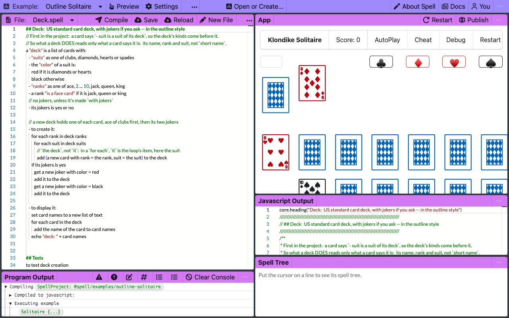
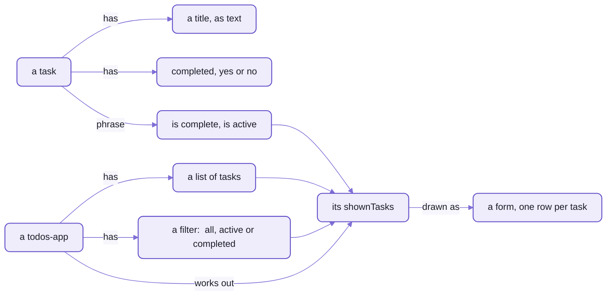

# The example apps, and ideas for yours

The example projects that ship with the Spell app, each one worth opening:
what each shows, a picture of it running, and ideas for what to build next.
- They're the `@spell/examples` group, plus two libraries other projects import (`@spell/library`).
- The editor's [chooser](README-app.md#app-ui) lists them, and so does `spell projects @spell/examples`.

Open one in the editor by its address, with the editor running (`yarn start`):
go to `http://localhost:3000/edit/@spell/examples/fizzbuzz`, or pick it under "Open or Create...".
On the command line, `spell run @spell/examples/fizzbuzz` runs it, and one with an app opens it in your browser.

## The examples

In the order to open them, simplest first.
Each picture is the example open in the editor:  its spell on the left, the app it makes running on the right.

<!-- The table below is made from the projects themselves:  run `yarn examples:readme` in spell-app (see below). -->
<!-- examples:start -->

| Example | Address | What it shows | Running |
| --- | --- | --- | --- |
| FizzBuzz | [`@spell/examples/fizzbuzz`](spaces/@spell/examples/fizzbuzz/) | Counting to 100 with fizz and buzz:  a loop, `if` and `otherwise`, and `print`, in eight lines | <a href="docs/images/examples/fizzbuzz.png"></a> |
| Calculator | [`@spell/examples/calculator`](spaces/@spell/examples/calculator/) | A working calculator:  an app with text properties, actions like `to clear (a calculator)`, and buttons whose clicks are spell;  its first lines list ideas for extending it | <a href="docs/images/examples/calculator.png"></a> |
| Todos - Form Based | [`@spell/examples/todos-form-based`](spaces/@spell/examples/todos-form-based/) | A to-do list:  yes/no properties, phrases like `a task "is complete" if ...`, a list filtered with `where`, and a form drawn with click handlers written in spell | <a href="docs/images/examples/todos-form-based.png"></a> |
| Outline Solitaire | [`@spell/examples/outline-solitaire`](spaces/@spell/examples/outline-solitaire/) | Klondike solitaire in the outline style, `a "deck" is a list of cards with:` and its facts as bullets:  kinds (`one of clubs, diamonds ...`), derived properties, phrases, tests and `pause for` | <a href="docs/images/examples/outline-solitaire.png"></a> |
| Drawable Solitaire | [`@spell/examples/drawable-solitaire`](spaces/@spell/examples/drawable-solitaire/) | The same game, each card its own web component:  `a card is a drawable thing` with a `<css>` block draws as `<solitaire-card>`;  piles laid out by their children, a shuffled stock | <a href="docs/images/examples/drawable-solitaire.png"></a> |
| Cards | [`@spell/library/cards`](spaces/@spell/library/cards/) | A library other projects import:  cards, decks and piles, at version 1.0.0 | a library:  no app of its own |
| People | [`@spell/library/people`](spaces/@spell/library/people/) | People, orgs, notes and relationships, each saved in a readable JSON5 file;  compiled to TypeScript for the app's "You" panel and the people store | a library:  no app of its own |

<!-- examples:end -->

<details>
<summary>How this table is made, and adding an example</summary>

The table and its pictures come from the example projects, so a new example shows up by running one command.
The walkthroughs below are written by hand.

1. Make the project in `spaces/@spell/examples/<name>/`:  a `__project.json5` and its `.spell` files.
   `spell app create <name> --in spaces/@spell/examples` writes a first one.
2. Give its project file a `"description"`:  one line of what it shows.
   - Without one, the table takes the first comment of its first spell file.
   - A `"title"` names it, when its folder's name can't (`todos-form-based` is "Todos - Form Based").
3. Add its name to the learning order at the top of [the script](scripts/examples-readme.ts), where it fits;
   one not listed comes last.
4. Start the editor, `yarn start`, and leave it running.
5. In spell-app's folder, `yarn examples:readme`:
   it opens each example in the editor, headless,
   saves a picture of it into [the pictures folder](docs/images/examples/),
   and rewrites the table between the page's two marker comments.

   ```text
   docs/images/examples/fizzbuzz.png
   docs/images/examples/calculator.png
   ...
   README-examples.md:  7 projects
   ```

- `yarn examples:readme --no-pictures` rewrites only the table, without a browser;
  `yarn examples:readme calculator` takes only that example's picture.
- `yarn examples:readme --check` writes nothing:
  it fails while the table is out of date, or an example has no picture.
  spell-app's tests run it, so a new example fails `yarn test` until the page is made again.
- Opening a project in the editor compiles it, which may rewrite its declarations and words files beside its source:
  look at `git status` after.

</details>

## Three walkthroughs

### FizzBuzz:  a loop, and printing

The classic programming exercise:
count to 100, saying "fizz" for multiples of 3, "buzz" for multiples of 5, and "fizzbuzz" for both.
The whole program, [`FizzBuzz.spell`](spaces/@spell/examples/fizzbuzz/FizzBuzz.spell):

```text
to play fizzbuzz
	for each number from 1 to 100
		if the number divided by 15 is an integer: print the number, "fizzbuzz"
		otherwise if the number divided by 3 is an integer: print the number, "fizz"
		otherwise if the number divided by 5 is an integer: print the number, "buzz"
		otherwise print the number

play fizzbuzz
```

- `to play fizzbuzz` defines a new phrase, and `play fizzbuzz` uses it:  the program reads the way you'd say it.
- `for each number from 1 to 100` names its loop variable, `number`, and later lines call it "the number".
- It has no app, so it draws nothing:  what it prints goes to the editor's console, or your terminal.

  ```sh
  spell run @spell/examples/fizzbuzz
  ```

  ```text
  1
  2
  3 fizz
  ...
  15 fizzbuzz
  ```


### Todos:  types, phrases, a list and a form

A to-do list, [`todo.spell`](spaces/@spell/examples/todos-form-based/todo.spell), in four parts.
First, what a task IS, sentence by sentence:

```text
a task is a thing
a task has a title as text
a task has a property completed as yes or no
a task "is complete" if its completed is yes
a task "is active" if its completed is no
```

- `a task is a thing` declares a new type;  each `has` line gives it a property, with its kind.
- The quoted phrases are new ways to talk about a task:  later lines can say `where it is complete`.

Then the app, which holds the tasks and decides which to show:

```text
a todos-app is an app
a todos-app has a property tasks as a new list of tasks
a todos-app has a filter as one of all, active or completed

the shownTasks of a todos-app is:
	if its filter is "active" return tasks in its tasks where it is active
	if its filter is "completed" return tasks in its tasks where it is complete
	return its tasks
```

- `one of all, active or completed` is a choice of three values, and the app starts on `all`.
- `shownTasks` is worked out each time it's read, with `where` and the phrases above:
  change a task or the filter, and what's drawn follows.

Then how it draws:  markup with [Spell UI](../spell-ui/README.md)'s elements,
where a click runs a line of spell:

```text
<ui-item onClick={set the filter of the app to "active"} selected={the filter of the app is "active"}>Active</ui-item>
...
<ui-button disabled={the newTaskName of the app is ""} onClick={create a new task}>Add Task</ui-button>
```

And last, `start the app`.

The picture of the whole flow, as the program's sentences say it:



_A todos-app keeps its tasks and a filter;  what it shows is worked out from both, and drawn as a form._


### Outline Solitaire:  the outline style, and things that draw themselves

Klondike solitaire in four files, written in the OUTLINE style:
a heading line, then what's true of it as bullets.
The start of [`Card.spell`](spaces/@spell/examples/outline-solitaire/Card.spell):

```text
a "card" is a thing where:

	## suit and rank
	- suit is a suit of its deck
	- its "rank" is a rank of its deck
	- it "is a face card" if its rank is a face card

	## direction
	- its direction is up or down
	- it "is face up" if its direction is up
```

- The same sentences as the to-do list's, without repeating "a card has ..." on every line.
- `##` lines are headings, as in Markdown:  comments a person reads, and the editor shows bold.

A card turns over with a pause, so you see it move:

```text
	to turn it over:
		if its direction is up: turn it face down
		otherwise: turn it face up
		pause for 50 msec
```

- Each pile draws itself, styled by a `<css>` block inside its own definition.
- `pause for 50 msec` lets the page draw before the next line runs:  that's how a deal animates.
- Its sister example, [Drawable Solitaire](spaces/@spell/examples/drawable-solitaire/), goes one step further:
  `a card is a drawable thing` makes every card a real web component, `<solitaire-card>`,
  that a plain page could use too.


## Ideas for your own

Each idea uses what the language does today, and says what it would exercise.
Start one with `spell app create <name>` ([setting up a space](README-spaces.md#setting-up-spaces-for-your-own-project)),
then open it in the editor.

| Idea | What it is | What it exercises |
| --- | --- | --- |
| Flashcards | a deck of question cards, a random one at a time, a score | `a random card in the deck`, `prompt` for the answer;  the card-and-deck idea, for learning |
| A habit or chore tracker | tasks with yes/no done flags, "today's chores", drawn as a table | `where` filters:  the to-do pattern with dates, once dates arrive |
| A recipe scaler | ingredients with amounts, scaled to a number of servings | numbers, derived properties, `to scale (a recipe) to (servings)` |
| Dice games (Yahtzee, Pig) | a drawable die, rolled with an animation, scored by phrases | `a die is a drawable thing` with `<css>`, `pause for`, `a roll "is a full house" if ...` |
| Memory | cards face up and face down in a grid, built on the cards library | importing `@spell/library/cards`;  a drawable grid |
| A collection catalogue | movies, baseball cards:  items with categories, filter buttons | `one of ...` kinds, filters, saved per person as the people library is |
| A sign-up sheet | people and a list of slots, in a form | `@spell/library/people`;  a natural first program to share, once shared editing arrives |
| A text adventure | rooms as things, choices at a prompt | `choose one of ... with prompt`, `print`;  runs in the terminal, and as Python with `spell run --target py` |

## The frozen test projects

Spell's own tests compile a set of projects and compare what comes out with saved copies, for every output language.
- They're spell-lang's, frozen so the tests stay steady:
  [`@spell/test`](../spell-lang/tests/spaces/@spell/test/),
  with versions of FizzBuzz, the to-do list and the solitaires among them.
- Open them like any other project (`/edit/@spell/test/fizzbuzz`), but change the examples here instead.

## See also

- [The Spell app](README.md):  this repo's front page
- [The editor and the runners](README-app.md):  how the editor runs an example as you type
- [Spaces](README-spaces.md):  addresses, groups, and setting up your own projects
- [The language server](README-lsp.md) and [spell-app's page server](README-page-server.md)
- [spell-lang](../spell-lang/README.md):  the language itself
- [The kit](../README.md):  every repo, setup from zero, the command line
