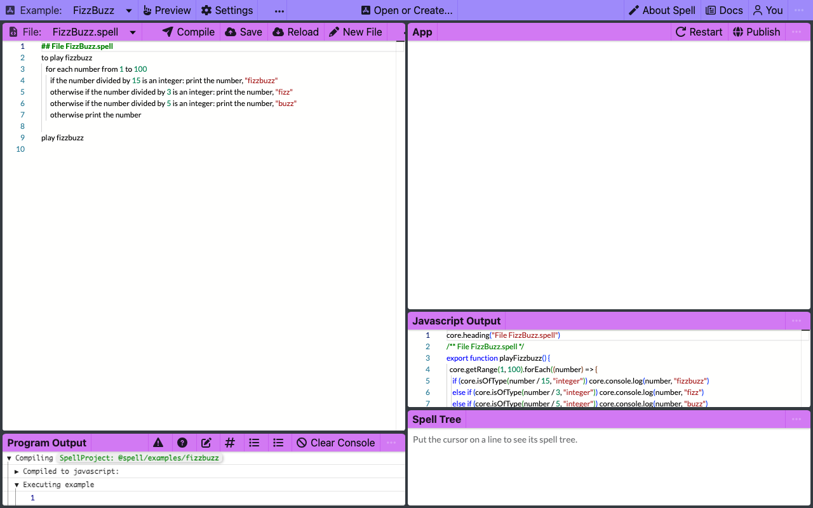
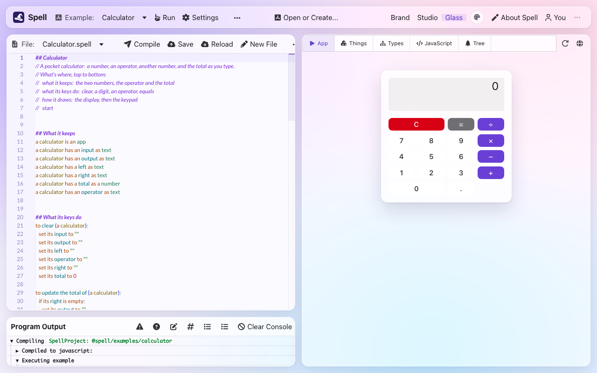
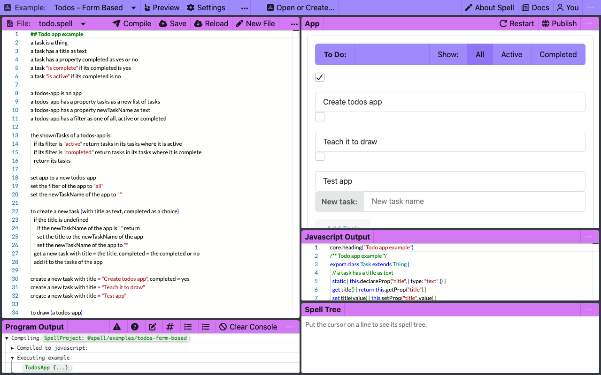
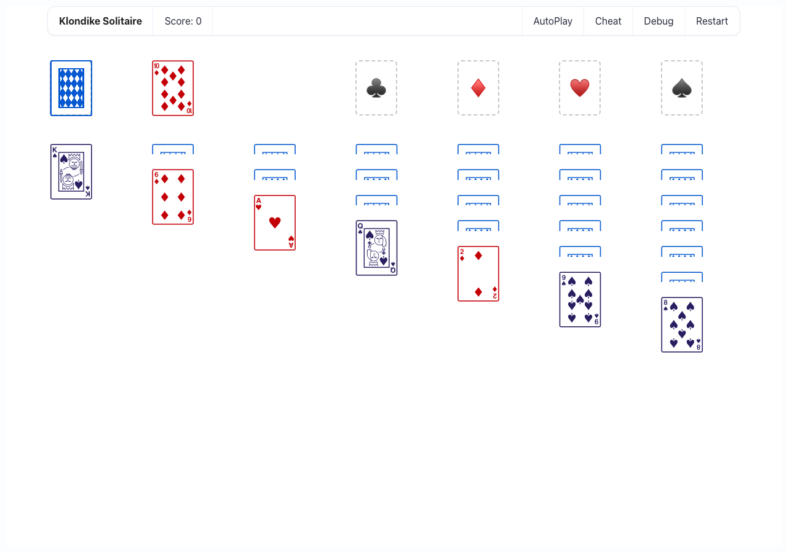
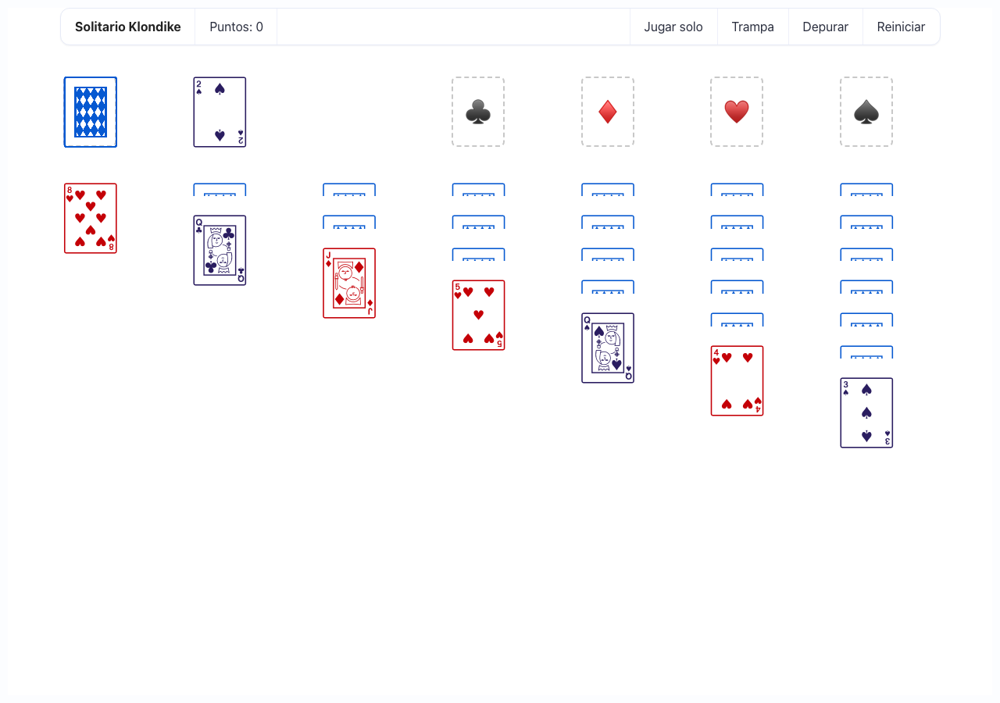
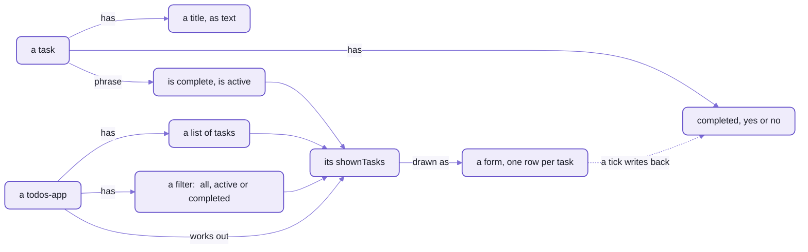

# The example apps, and ideas for yours

```spell
// a tableau:  a column, built down from king to ace, red and black in turn
a "tableau" is a pile where:
	- it can give up a card if: the card is face up
	- it can take a card if:
		if it is empty
			return the card is a king
		return its color is not the color of the card and its value is the value of the card + 1
```

_Real Spell, from the Solitaire example:  the rule for one column of Klondike._

If you've played Klondike, you just read the rule for a column:
a king on an empty one, and after that, one card lower, in the other color.

That isn't a comment above the code that checks a move.
It IS the check:  click a card, and the game moves it to the first pile that says it can take it.

Five example apps ship with the Spell editor, from FizzBuzz up to that solitaire, and two libraries to build on.
Each one is a real project:  open it, and its app runs beside its text;  change a line, and the app follows.
Here to make your own?  [Skip to the ideas](#ideas-for-your-own).

## Five apps, simplest first

Open them in this order:  each one adds an idea or two to the one before.
Each picture is the example open in the editor:
its program on the left, the app it makes on the right, and the JavaScript it compiles to under the app.

<!-- The table below is made from the projects themselves:  run `yarn examples:readme` in spell-app (see below). -->
<!-- examples:start -->

| Example | Address | What it shows | Running |
| --- | --- | --- | --- |
| FizzBuzz | [`@spell/examples/fizzbuzz`](spaces/@spell/examples/fizzbuzz/) | Counting to 100 with fizz and buzz:  a loop, `if` and `otherwise`, and `print`, in eight lines | <a href="docs/images/examples/fizzbuzz.png"></a> |
| Calculator | [`@spell/examples/calculator`](spaces/@spell/examples/calculator/) | A working calculator:  an app with text properties, actions like `to clear (a calculator)`, and buttons whose clicks are Spell;  its first lines list ideas for extending it | <a href="docs/images/examples/calculator.png"></a> |
| Todos - Form Based | [`@spell/examples/todos-form-based`](spaces/@spell/examples/todos-form-based/) | A to-do list:  yes/no properties, phrases like `a task "is complete" if ...`, a list filtered with `where`, and a form drawn with click handlers written in Spell | <a href="docs/images/examples/todos-form-based.png"></a> |
| Solitaire | [`@spell/examples/Solitaire`](spaces/@spell/examples/Solitaire/) | Klondike solitaire in the outline style, on the cards library:  `import`s its cards, deck and piles, and adds the game, its kinds of piles (`a "tableau" is a pile where:`), their moves, layout and CSS;  `pause for` animates the deal | <a href="docs/images/examples/Solitaire.png"></a> |
| Solitario | [`@spell/examples/Solitario`](spaces/@spell/examples/Solitario/) | Solitaire's Spanish twin:  Klondike in the outline style, in Spanish, on its own Spanish cards (`Carta`, `Mazo`, `Pila`) rather than the cards library | <a href="docs/images/examples/Solitario.png"></a> |
| Cards | [`@spell/library/cards`](spaces/@spell/library/cards/) | A library other projects import:  cards, decks and piles, at version 1.0.0 | a library:  no app of its own |
| People | [`@spell/library/people`](spaces/@spell/library/people/) | People, orgs, notes and relationships, each saved in a readable JSON5 file;  compiled to TypeScript for the app's "You" panel and the people store | a library:  no app of its own |

<!-- examples:end -->

They're two groups in Spell's own space:
`@spell/examples`, and `@spell/library`, whose two libraries are for other projects to import.

### Opening one

With Spell set up ([setup from zero](https://github.com/spell-app/spell-kit/blob/main/README.md#setup-from-zero)) and `spell` on your PATH
([setting it up](https://github.com/spell-app/spell-kit/blob/main/README-cli.md#setting-it-up)), one command opens the editor on an example:

```sh
spell app serve @spell/examples/calculator
```

- It opens your browser on the example, until Ctrl-C ([its options](https://github.com/spell-app/spell-kit/blob/main/README-cli.md#spell-app)).
- In the editor, **Open or Create...** in the top bar lists every project, these among them.
- `/run/` in place of `/edit/` shows the app alone, full size, with its console
  ([the editor's routes](README-app.md#the-editor--one-object-behind-every-pane)).
- `spell run @spell/examples/fizzbuzz` compiles one and runs it:  in your terminal,
  or, for one with an app, in your browser until Ctrl-C.
- `spell projects @spell/examples` lists them, alphabetically, which is not the order to open them in.

<details>
<summary>How the table is made, and adding an example</summary>

The table and its pictures come from the example projects, so a new example shows up by running one command.
Everything else on this page is written by hand.

1. Make the project in `spaces/@spell/examples/<name>/`:  a `__project.json5` and its `.spell` files.
   `spell app create <name> --in spaces/@spell/examples` writes a first one.
2. Give its project file a `"description"`:  one line of what it shows.
   - Without one, the table takes the first comment of its first Spell file.
   - A `"title"` names it, when its folder's name can't (`todos-form-based` is "Todos - Form Based").
3. Add its name to the learning order at the top of [the script](scripts/examples-readme.ts), where it fits;
   one not listed comes after the listed ones, by name.
4. Start the editor, `yarn start` in spell-app, and leave it running.
5. In spell-app's folder, `yarn examples:readme`:
   it opens each example in the editor, headless, in a window 1280 by 800,
   gives it 5 seconds after the page goes quiet to compile, run and draw,
   saves a picture of it into [the pictures folder](docs/images/examples/),
   and rewrites the table between the page's two marker comments.

   ```text
   docs/images/examples/fizzbuzz.png
   docs/images/examples/calculator.png
   ...
   README-examples.md:  7 projects
   ```

- `yarn examples:readme --no-pictures` rewrites only the table, without a browser;
  `yarn examples:readme calculator` takes only that example's picture.
- `yarn examples:readme --check` writes nothing:
  it fails while the table is out of date, or an example has no picture.
  spell-app's tests run it, so a new example fails `yarn test` until the page is made again.
- The table draws each picture 360 pixels wide;  a click opens it whole.
- Opening a project in the editor compiles it, which may rewrite its declarations and words files beside its source:
  look at `git status` after.

</details>

## Every app here has four parts

FizzBuzz only prints.
The other four draw an app, and each is built the same way:
what its things ARE, what they DO, how they DRAW, and one line that starts it.
If you know React, you know all four already, under other names.

The Calculator shows them plainest, in 111 lines, because it keeps each part in a block of its own:

| Part | In the Calculator | In React |
| --- | --- | --- |
| what its things are | `a calculator has a total as a number`, one of its six properties | the component's state |
| what they do | `to clear (a calculator):`, and three more actions | its event handlers |
| how they draw | `to draw (a calculator)`:  a table of buttons, each with a click like `onClick={append "7" to it}` | its JSX |
| the start | `start the calculator`, which puts its drawing on the page | `createRoot(root).render(<App />)` |

<details>
<summary>The four parts, in the Calculator's own lines</summary>

```spell
a calculator is an app
a calculator has an input as text
a calculator has an output as text
a calculator has a left as text
a calculator has a right as text
a calculator has a total as a number
a calculator has an operator as text
```

```spell
to clear (a calculator):
	set its input to ""
	set its output to ""
	set its left to ""
	set its operator to ""
	set its right to ""
	set its total to 0
```

```spell
to draw (a calculator)
	...
		<tr>
			<td><button className="ui button fluid" onClick={append "7" to it}>7</button></td>
			<td><button className="ui button fluid" onClick={append "8" to it}>8</button></td>
			<td><button className="ui button fluid" onClick={append "9" to it}>9</button></td>
			<td><button className="ui button fluid orange" onClick={set its operator to "+"}>+</button></td>
		</tr>
	...
```

```spell
set calculator to a new calculator
clear the calculator
start the calculator
```

- The whole program, its other three actions too:
  [Calculator.spell](spaces/@spell/examples/calculator/Calculator.spell).

</details>

The difference that matters:  a click handler is a sentence.
`onClick={clear it}` on the C key clears the calculator, and `it` is the calculator being drawn.

So the wording counts, and the Calculator shows how much.
**Press 7, +, 5, and it says 82.**
Its + key says `set its operator to "+"`, which only sets the property.
`set the operator of it to "+"` would run the calculator's own action, which starts the second number afresh;
without it, the 5 joins the 7, and the sum is 7 + 75.
The –, x and ÷ keys say it the same way.

<details>
<summary>The test that catches it, and the one-line fix</summary>

Added to the end of a copy of the Calculator, a test that presses the keys the way the buttons do:

```spell
// as the + key does it:  onClick={set its operator to "+"}
to press plus on (a calculator):
	set its operator to "+"

to test seven plus five
	set sum to a new calculator
	clear sum
	append "7" to sum
	press plus on sum
	append "5" to sum
	expect the right of sum to be "5"
	expect the output of sum to be " = 12"
```

```sh
spell test
```

<details>
<summary>What it printed</summary>

```text
✓ Compiling @local/scratchpad/calc
✗ test seven plus five  (2 checks)
    ❌ Unexpected: `the right of sum` should be `"5"` but is actually `75`
    ❌ Unexpected: `the output of sum` should be `" = 12"` but is actually ` = 82`

0 passed, 1 failed
```

</details>

- Change `press plus` to say `set the operator of it to "+"`, and the same test passes:  1 passed.
- In JavaScript, the two sentences are `this.operator = "+"` and `this.setTheOperatorOfCalculatorToOp("+")`.

</details>

Three more things the picture won't tell you:
- There's no = key:  the total appears as you type the second number.
- DEL is drawn, though its button is marked `hidden`, and does nothing yet:  `append` skips it, at a `// TODO`.
- Its first seven lines are a to-do list of its own:  six ideas for extending it,
  from a check for NaN to a tape of past results.

## FizzBuzz:  a loop, and printing

The classic programming exercise:
count to 100, saying "fizz" for multiples of 3, "buzz" for multiples of 5, and "fizzbuzz" for both.
Here's all of [FizzBuzz.spell](spaces/@spell/examples/fizzbuzz/FizzBuzz.spell), not an excerpt:

```spell
## File FizzBuzz.spell
to play fizzbuzz
	for each number from 1 to 100
		if the number divided by 15 is an integer: print the number, "fizzbuzz"
		otherwise if the number divided by 3 is an integer: print the number, "fizz"
		otherwise if the number divided by 5 is an integer: print the number, "buzz"
		otherwise print the number

play fizzbuzz
```

- It's a program in two parts, not four:  `to play fizzbuzz` defines a new phrase, and `play fizzbuzz` says it.
- `for each number from 1 to 100` names its loop variable, `number`, and later lines call it "the number".
- It draws nothing, so the editor's App pane stays empty (the picture below):
  what it prints goes to the program's output, under the text, or to your terminal.

```sh
spell run @spell/examples/fizzbuzz
```

<details>
<summary>Output</summary>

```text
✓ Compiling @spell/examples/fizzbuzz
1
2
3 fizz
...
15 fizzbuzz
...
100 buzz
```

</details>

With `--target py`, the same hundred lines come from Python ([the targets](https://github.com/spell-app/spell-lang/blob/main/README-targets.md)).

<details>
<summary>What it compiles to, in JavaScript</summary>

```js
core.heading("File FizzBuzz.spell")
/** File FizzBuzz.spell */
export function playFizzbuzz() {
  core.getRange(1, 100).forEach((number) => {
    if (core.isOfType(number / 15, "integer")) core.console.log(number, "fizzbuzz")
    else if (core.isOfType(number / 3, "integer")) core.console.log(number, "fizz")
    else if (core.isOfType(number / 5, "integer")) core.console.log(number, "buzz")
    else core.console.log(number)
  })
}

playFizzbuzz()
```

- From `spell compile @spell/examples/fizzbuzz --stdout`, its import line left out.
- The new phrase is a function, `playFizzbuzz()`;  "the number" is the loop's `number`.
- `core` is [the runtime](https://github.com/spell-app/spell-lang/blob/main/README-core.md) compiled Spell runs on.

</details>


_FizzBuzz in the editor:  nothing to draw, so the App pane stays empty, and the output starts at the bottom left._

## Todos:  types, phrases, a list and a form

Every framework has its to-do list, and this is Spell's:
[todo.spell](spaces/@spell/examples/todos-form-based/todo.spell), 72 lines, in the four parts above.
First, what a task IS, sentence by sentence:

```spell
a task is a thing
a task has a title as text
a task has a property completed as yes or no
a task "is complete" if its completed is yes
a task "is active" if its completed is no
```

- `a task is a thing` declares a new type;  each `has` line gives it a property, with its kind.
- The quoted phrases are new ways to talk about a task:  later lines can say `where it is complete`.

Then the app, which holds the tasks and decides which to show:

```spell
a todos-app is an app
a todos-app has a property tasks as a new list of tasks
a todos-app has a property newTaskName as text
a todos-app has a filter as one of all, active or completed

the shownTasks of a todos-app is:
	if its filter is "active" return tasks in its tasks where it is active
	if its filter is "completed" return tasks in its tasks where it is complete
	return its tasks
```

- `one of all, active or completed` is a choice of three values;  the program sets it to `all` before it starts.
- `shownTasks` is worked out each time it's read, with `where` and the phrases above:
  a getter, not a second list, so there's nothing to keep in step.

<details>
<summary>What <code>shownTasks</code> compiles to</summary>

```js
export class TodosApp extends App {
  // ... its tasks, newTaskName and filter
  get shownTasks() {
    if (this.filter == "active") return core.filter(this.tasks, (task) => task.isActive)
    if (this.filter == "completed") return core.filter(this.tasks, (task) => task.isComplete)
    return this.tasks
  }
}
```

- Trimmed from `spell compile @spell/examples/todos-form-based --stdout`.
- The two phrases became getters, `isComplete` and `isActive`:  `where it is active` reads `task.isActive`.
  The task's whole class is on [the front page](README.md), folded under its first picture.

</details>

Then how it draws, with [Spell UI](https://github.com/spell-app/spell-ui/blob/main/README.md)'s elements, where a click runs a line of Spell:

```spell
<ui-item onClick={set the filter of the app to "active"} selected={the filter of the app is "active"}>Active</ui-item>
...
<ui-form debug value={the app}>
	<ui-repeat items={the shownTasks of the app}>
		<ui-fields>
			<ui-field width="1"><ui-checkbox name="completed" aria-label="Done"/></ui-field>
			<ui-field width="10"><ui-input name="title" aria-label="Task"/></ui-field>
		</ui-fields>
	</ui-repeat>
	<ui-fields>
		<ui-field width="11"><ui-input name="newTaskName" placeholder="New task name" label="New task:"/></ui-field>
		<ui-field><ui-button disabled={the newTaskName of the app is ""} onClick={create a new task}>Add Task</ui-button></ui-field>
	</ui-fields>
</ui-form>
```

- There's no change handler anywhere.
  The form is bound to the app (`value={the app}`):  one row per task in `shownTasks`,
  and each named field shows its task's property and writes it back as you type or tick.
- So with Active showing, a task you tick is no longer in the list `shownTasks` returns.
- `debug` shows the app as JSON under the form, redrawn as it changes:
  the quickest way to watch a click change the data.
- A Test menu under the form changes the list from outside it,
  as in `remove items in (the tasks of the app) where it is complete`, and the form follows.

And last, `start the app`, then `print the app`, which shows `TodosApp {...}` in the program's output.



_A todos-app keeps its tasks and a filter;  what it shows is worked out from both, and the form writes back._

Nothing is saved, though.
The tasks last as long as the program runs, and Restart starts again from the three it makes.


_The to-do list beside its 72 lines:  the first task is ticked, because the program makes it with `completed = yes`._

## Solitaire:  the outline style, a library, and things that draw themselves

Klondike in one file, written in the OUTLINE style:  a heading line, then what's true of it as bullets.
Its cards, its deck and its piles aren't in it:  it imports them, from the card library.

```json5
{ "path": "@spell/library/cards", "active": true, "import": ["Card", "Deck", "Pile", "Suit"] }
```

_From [its project file](spaces/@spell/examples/Solitaire/__project.json5):  the library's types, by name._

So [Solitaire.spell](spaces/@spell/examples/Solitaire/Solitaire.spell) is only the game:
the solitaire itself, how a click plays a card, and its kinds of pile, each saying what it may take or give up.

```spell
solitaire is an app where:
	- its "score" is a number
	- its "deck" is a new deck

	// one of each pile, made with the solitaire
	- its "stock" is a new stock pile with name = "stock"
	- its "discards" is a new discard pile with name = "discards"
	- its "clubs" is a new foundation with name = "clubs", suit = clubs
```

- The same sentences as the to-do list's, without "a solitaire" at the start of every line.
- It isn't a second language:  the bullets are more ways to write the same rules
  ([the language, sentence by sentence](https://github.com/spell-app/spell-lang/blob/main/README-spell.md)).
- `##` lines are headings, as in Markdown:  comments a person reads, which the editor shows in bold.
- The library's card says what its suits, ranks and colors are:
  `suit = clubs` reads one, and a foundation draws its suit's `symbol`, which the card defines.

The deal is a loop with a pause in it, so you watch it happen:

```spell
- animation deal the cards:
	for each card in its deck
		set start pile to the pile of the card
		turn the card face down
		if start pile is not the stock of the solitaire
			add the card to the stock of the solitaire
			pause for 50 msec
	shuffle its stock

	for row from 1 to 7
		turn the last card of its stock face up
		for column from row to 7
			add the last card of its stock to item column of the tableaus
			pause for 50 msec

	wait for: play from the stock
```

- `pause for 50 msec` lets the page draw before the next line runs:  28 cards dealt, 50 ms apart.
- Written `animation` instead of `to`, an action runs one at a time:
  asking for it again while it runs does nothing, so a second Restart can't deal on top of the first.
- A card is in one pile at a time, as the library says (`a card belongs to one pile`):
  adding it to the stock takes it off the pile it was in.

What you see:
- Each card is one character, from Unicode's playing cards:  the queen of spades is 🂭, and the card's test checks it.
- Each card is its own element, the library's `<cards-card>`;
  each pile is a drawable list, its own element (`<solitaire-tableau>` and the rest), holding its cards' elements.
- Each kind of pile styles itself, in the `<css>` block inside its own definition:
  a tableau shows the top of each card below the one before;  a stacked pile, the stock, the discards and the
  foundations, shows its last card, over a dashed place for its first.
- AutoPlay, Cheat, Debug and Restart run across the top;  a card onto a foundation scores 10, one from the discards 5.
  Cheat turns up a random face-down card:  `set the pile to a random pile in remaining piles`.

Its tests are written in Spell, beside what they test, and run from the command line:
the library's tests of its card, deck and piles, then Solitaire's own, of what each pile may take.

```sh
spell test @spell/examples/Solitaire
```

<details>
<summary>Output</summary>

```text
✓ Compiling @spell/examples/Solitaire
✓ test card setup  (30 checks)
✓ test jokers  (15 checks)
✓ test deck creation  (7 checks)
✓ test deck with jokers  (5 checks)
✓ test piles  (8 checks)
✓ test the moves  (11 checks)

6 passed
```

</details>


_Solitaire, dealt:  every card on the table one Unicode character, drawn large._

### Solitario:  the same game, in Spanish

Spell reads Spanish too, a file at a time, by its name:  `Solitario.es.spell` is Spanish, `Solitaire.spell` English
([Spell in Spanish](https://github.com/spell-app/spell-lang/blob/main/README.md#spell-in-spanish)).
[Solitario](spaces/@spell/examples/Solitario/) is Solitaire written in it, line for line, cards and all:
its own `Carta`, `Mazo` and `Pila`, rather than the English library's, so all of it reads in Spanish.

```spell
// una columna:  se arma hacia abajo, del rey al as, rojo y negro alternados
una "columna" es una pila donde:
	- puede soltar una carta si: la carta está boca arriba
	- puede tomar una carta si:
		si la columna está vacía
			devolver la carta es un rey
		devolver su color no es el color de la carta y su valor es el valor de la carta + 1
```

_The tableau's rule, in Spanish:  a column, `columna`._

- Its tests are the same six, in Spanish:  `spell test @spell/examples/Solitario` runs them.
- Where the two differ, a Spanish word does:  the queen is `dama`, so its short name is D, and the king's R.


_Solitario, dealt:  the same board, its menu in Spanish._

## Ideas for your own

Eight programs worth writing next, each built from what an example already does.
The last column says where to borrow from;  where a part isn't in the language yet, the row says so.

| Idea | What it is | Borrow from |
| --- | --- | --- |
| Flashcards | a deck of question cards, one at random, each turning over on a click, and a score | the solitaires:  `a random card in the deck`, `to turn it over`;  the card-and-deck idea, for learning |
| A habit or chore tracker | tasks with yes/no done flags, drawn as a table | the to-do list's `where` filters;  **not yet** "today's chores":  a date has a year and a day, no month yet, and no word means today |
| A recipe scaler | ingredients with amounts, scaled to a number of servings | numbers, derived properties, `to scale (a recipe) to (servings as a number)` |
| Dice games (Yahtzee, Pig) | a drawable die, rolled with an animation, scored by phrases | the card library's card:  `a "die" is a drawable thing`, Solitaire's piles' `<css>`, `pause for`;  the to-do list's phrases:  `a roll "is a full house" if ...` |
| Memory | cards face up and face down in a grid | importing `@spell/library/cards`, as Solitaire does;  a drawable grid |
| A collection catalogue | movies, baseball cards:  items with categories, and filter buttons | `one of ...` kinds and the to-do list's filter;  `it is saved in its own file`, as the people library's person is |
| A sign-up sheet | people and a list of slots, in a form | `@spell/library/people` and the to-do list's form;  🌱 a natural first program to share, once editing together arrives |
| A text adventure | rooms as things, and each way out a button | the to-do list's clicks, and `print`;  **not yet** typed commands (below) |

**Not yet:  reading what someone types.**
`prompt "Where now?"` shows a dialog in the editor, but the program can't read the answer:
it compiles to `await core.prompt(...)`, and what was typed is dropped.
- In a terminal, `prompt` only prints its question;  Python's runtime hasn't ported it.
- `choose one of ... with prompt`, the natural way to pick a room, is written down in the prompt rule and commented out:
  `spell lint` answers "Don't understand".

Start one, and it runs at once:

```sh
spell app create Flashcards
```

<details>
<summary>What it printed</summary>

```text
<your space>/Flashcards
Made Flashcards:  try  spell run <your space>/Flashcards
```

</details>

- It writes a project file and Flashcards.spell, a comment and one line that prints "hello from Flashcards".
- With no `--in`, it goes in your own space:  [setting one up](README-spaces.md#setting-up-spaces-for-your-own-project)
  says where that is, and how a project imports a library.
- Then, in its folder, `spell app serve` opens the editor on it.

## The frozen test projects

FizzBuzz, the to-do list and Solitaire have frozen twins beside them,
[`@spell/test`](spaces/@spell/test/),
which the tests in [tests/spell/](tests/spell/) compile and compare line for line
([how they're checked](https://github.com/spell-app/spell-lang/blob/main/README-spell.md#the-frozen-test-projects)).
Open them like any other project (`/edit/@spell/test/fizzbuzz`), but change the examples here instead:
even `spell format` leaves the test projects alone.

## See also

- [The editor and the runners](README-app.md):  how the editor runs an example as you type,
  and keeps a game going across an edit
- [Spaces](README-spaces.md):  addresses, your own space, and importing a library into a project
- [The language, sentence by sentence](https://github.com/spell-app/spell-lang/blob/main/README-spell.md):  every kind of sentence these examples use,
  and how the frozen test projects are checked
- [spell-app's commands](https://github.com/spell-app/spell-kit/blob/main/README-cli.md#spell-app):  `spell app create`, `spell app serve` and `spell projects`,
  in full
- [Spell UI's components](https://github.com/spell-app/spell-ui/blob/main/README-components.md):
  the `<ui-*>` elements the to-do list and Solitaire draw with
