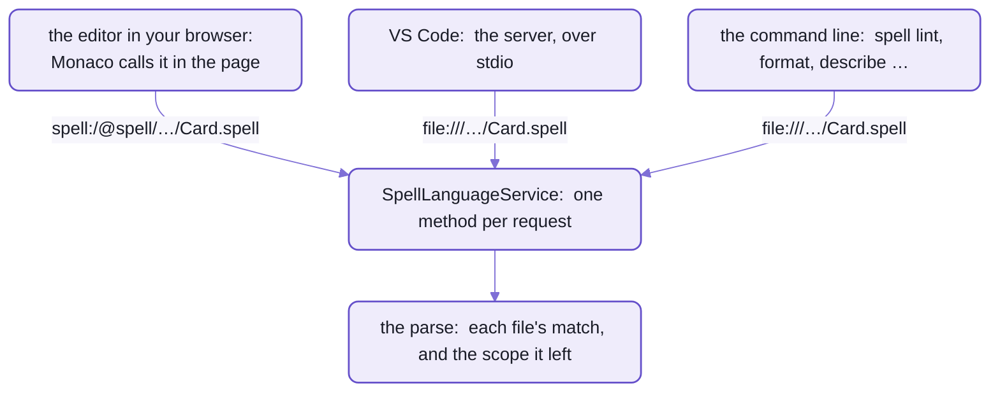
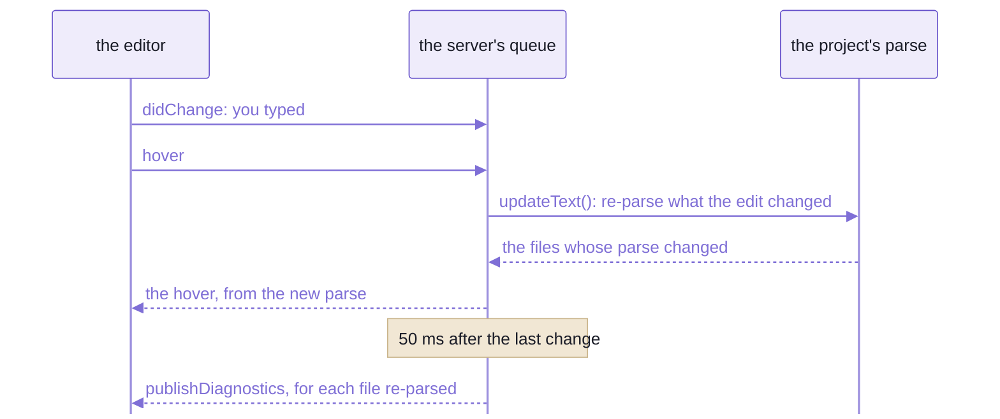

# The language server

```spell
a "card" is a drawable thing:
	- its "suit" is one of clubs, diamonds, hearts or spades
	- its "color" is:
		red if its suit is diamonds or hearts
		black otherwise

	- its "rank" is one of ace, 2 ... 10, jack, queen, king
	- it "is a face card" if its rank is jack, queen or king
	- it "is a (rank)"
	- it "is the (rank) of (suit)"
```

Hover over `suit` on the fourth line, and this is what the language server sends back:

````md
**member_words**  
e.g. `rank`

---

property **suit** of Card

declared in [Card.spell:2](file:///…/solitaire/Card.spell#L2)

---

```js
if (core.includes(["diamonds", "hearts"], this.suit)) return "red"
```
````

_A real reply to `textDocument/hover`, its Markdown as sent, the link's path shortened:
the rule that matched, what the word is and where it was declared, and the JavaScript that one line compiles to._

Nothing in that reply was worked out for the hover.
The parser had already matched `suit` against a rule, tied it to the card's property, and compiled the line;
the hover reads what the parse left behind.

That's the whole design.
Most language servers carry a second copy of the language:  a grammar of their own, an index to keep in step.
This one has neither.
It answers from the parse the compiler makes, the same one the browser editor makes as you type.

A LANGUAGE SERVER is the program behind an editor's red squiggles, hover text and completions.
Editors talk to it over the [Language Server Protocol](https://microsoft.github.io/language-server-protocol/) (LSP),
so one server serves every editor that speaks it;
VS Code's [Language Server Extension Guide](https://code.visualstudio.com/api/language-extensions/language-server-extension-guide)
shows the shape.

Spell's is ONE class, `SpellLanguageService`, with a method per request,
imported as `spell-app/lsp`.
Three places call it:  the editor in your browser, VS Code, and the `spell` command line.

## The command line and the editor can't disagree

Make two mistakes in the card:  misspell `suit` on line 4, and add a line at the end that Spell can't read.

```diff
 	- its "color" is:
-		red if its suit is diamonds or hearts
+		red if its siut is diamonds or hearts
 		black otherwise
 ...
 	- it "is the (rank) of (suit)"
+deal the card face up
```

The editor underlines both, 50 ms after you stop typing:

| At | What | Message |
| --- | --- | --- |
| 4:14 | warning | A card never says it has a siut:  declare it, e.g. "a card has a siut as text" |
| 11:1 | error | Don't understand "deal the card face up" |

And in a terminal, in the card's folder:

```sh
spell lint Card.spell
# ✗ Card.spell  (@local/cards/solitaire)  1 error · 1 warning
# Card.spell:11:1  Don't understand "deal the card face up"
```

The same two findings, from the same method.
`spell lint` loads the project the way the server does, asks `SpellLanguageService` for each file's diagnostics,
and prints them as `path:line:col`, which terminals and editors can click.
- `@local/cards/solitaire` is the card's address.
  Its folder sits in no project group Spell knows, so the folder above it became one of its own, `@local/cards`:
  any `.spell` file on disk works, as long as a folder above it has a project file
  ([what an address is](README-spaces.md)).
- Lint lists the errors and only COUNTS the warnings, so you see the misspelling in the editor, not here.
  A warning never fails it;  it exits 1 here for the error alone.

The line Spell can't read gets a quick fix, "Define `to deal the card face up`",
which puts a method of that name above it:

```spell
to deal the card face up:
	// TODO

deal the card face up
```

Now the last line is a call to the new method, and lint agrees:

```sh
spell lint Card.spell
# ✓ Card.spell  (@local/cards/solitaire)  1 warning
```

- The phrase's words become the method's signature, and the longest match wins,
  so the line parses as a call to it.
- The warning gets no quick fix:  its fix is in its words, "declare it".

## One service, three places it runs



_One service, three callers:  each names files its own way, and only VS Code talks the protocol._

Most language servers ARE their protocol:  JSON-RPC is the only way in.
Here the protocol is one of three.
`SpellLanguageService` is a plain class whose methods take a parsed file and a position,
and return the protocol's own shapes (`Hover`, `CompletionItem[]` ...), so any host can call them directly.
- A host hands it one thing, how that host names files (`FileAddresses`):
  the disk workspace's `file:` URLs, or the browser editor's `spell:` addresses.
- `SpellLanguageServer` is the thin part:  it wires those methods to an LSP connection, one handler each.
- That freedom has a price:  the service MUST stay safe to run in a browser.
  Nothing in it touches node;  the disk and the process live in files its entry leaves out (below, "Working on it").

### In the browser:  no server at all

The editor's Monaco calls the service in the page, and converts each answer to Monaco's own shapes
([spell-app's README-app.md](README-app.md) has the editor).
- Its files are the page's, loaded from the page server, at addresses like
  `spell:/@spell/examples/drawable-solitaire/Card.spell`.
- There's no queue in the page:  an edit re-parses as it lands, so a hover right after it sees the new parse.

### In VS Code:  the server, from your checkout

The Spell extension, in spell-app's [vscode/](vscode/) folder, carries no server of its own.
For every window with a `.spell` file open, it starts [server.ts](src/lsp/server.ts) from YOUR checkout's source,
over standard input and output.
That file is the only one it runs:  a checkout without it gets an error naming the file, and no server.
Which checkout it picks, and pointing it at another with `spell.parserRoot`:
[the kit's VS Code page](https://github.com/spell-app/spell-kit/blob/main/README-vscode.md#which-checkout-it-runs),
with installing the extension, its settings and hacking on it.

Start the server yourself, the way an editor would, in spell-app's folder:

```sh
yarn lsp:start
```

- It talks the protocol on standard input and output, so it prints nothing for a person to read;
  an editor starts it and talks to it.
- It sends every `console` line to stderr first ([stdioGuard.ts](src/lsp/stdioGuard.ts)):
  modules log as they load, and one stray line on stdout would break the protocol.

### On the command line:  the same two classes, no protocol

Each `spell` command that reads a program makes a `SpellDiskWorkspace` and a `SpellLanguageService`,
the server's own two classes, and calls them in its own process
([CliSession.ts](src/cli/CliSession.ts)).

| Command | What it asks of the service |
| --- | --- |
| `spell lint`, `spell watch` | each file's diagnostics:  the errors listed, the warnings counted |
| `spell compile` | the same diagnostics:  a project with no errors gets its scope pack written (below) |
| `spell format` | `formatting()`, with a final newline added and extra blank lines at the end trimmed |
| `spell describe` | the scope explorer's tree and details, as the Type Explorer shows them |
| `spell explain <word> --in <project>` | the hover over that word's declaration |
| `spell run` | a scope pack, for the page it opens |

```sh
spell explain suit --in .
# Card.spell:2
# quoted_member
# e.g. "rank"
#
# property suit of Card
#
# declared in Card.spell:2
# ...
```

_The hover from the top of the page, in a terminal:  the same method, over the line that declares `suit`._

- The commands are spell-lang's, but their work is spell-app's for now, through a hook:
  [the command line's page](https://github.com/spell-app/spell-kit/blob/main/README-cli.md#spell-lang) has each one.

## It reads the parse the compiler already made

Scope is what a program has declared so far:  its types, properties, variables and phrases.
The parser builds it line by line, and every word it matches records what it resolved to.
The service is a set of readers over that record.

- It hosts the same `SpellProject` and `SpellFile` objects the compiler and the browser editor use,
  and every edit goes through `project.updateText()`, which re-parses only what the edit changed.
- The outline comes from each rule's `getDeclaration()`;  the colours from each rule's `highlightAs`.
- Go to definition and Find references read the scope record a word resolved to while parsing,
  and where that record was declared.
- Completion in the middle of a statement asks the parser what it expected next,
  `parser.expectedAfter()`, over the line up to the cursor.
  Signature help reads the same answer.
- Positions come from offsets into the file's text, never a token's line and column:
  offsets are what the incremental parse keeps exact.
  A character is a UTF-16 code unit, the protocol's default.
- How the parse builds scope, and re-parses after an edit:  [spell-lang's parser page](https://github.com/spell-app/spell-lang/blob/main/README-parser.md);
  the service's side, "Language server" in [spell-lang's PARSING.md](https://github.com/spell-app/spell-lang/blob/main/src/spell/PARSING.md).

The one reader that isn't the parser:  VS Code paints the first colours from a TextMate grammar,
before the server answers, and the server's colours repaint them
([the kit's VS Code page](https://github.com/spell-app/spell-kit/blob/main/README-vscode.md)).
- Its keyword lists come from the language packs, every language in one:
  [vscode-grammar.ts](scripts/vscode-grammar.ts) writes them (`yarn tsx scripts/vscode-grammar.ts`),
  and a test fails when they're out of date.

## One queue:  an answer never sees old text

Every language server has the same race to settle:  you type, then hover, and the hover lands before the re-parse.
This one settles it with ONE queue.
Every change goes into it, in order, and every request waits behind the changes sent before it.



_A request waits behind every change sent before it, so it always sees the text you see._

- Diagnostics go out 50 ms after the last change, so a burst of typing publishes once.
- They go out for every file a change re-parsed, not only the one you edited:
  a broken declaration shows up wherever it's used.
- A change that throws is logged and skipped, so one bad edit doesn't stop the queue.
  A parse that crashes outright shows ONE error at the top of the file,
  "Parser crashed, will try again after the next edit".
- Measured once, over stdio, on drawable Solitaire (four files, 510 lines):

  | You | Diagnostics, after | For |
  | --- | --- | --- |
  | open `Card.spell` | about 200 ms:  the whole project parses first | all four files |
  | edit a comment | about 55 ms, 50 of them the wait | `Card.spell` |
  | edit the color line, which declares a property | about 140 ms | all four files:  every later line may read it |

<details>
<summary>When files change on disk</summary>

The server asks the editor to tell it about `**/__project.json5`, `**/project.json` and `**/*.spell`,
when the editor lets a server ask;  otherwise its extension would have to set that up itself.
- A project file changes, or a `.spell` file appears or goes:  the project re-reads its file list
  and parses from scratch.
- A `.spell` file that isn't open changes, say from a `git checkout`:  it reloads.
- An open file keeps the editor's text, whatever the disk says;  closing it goes back to the disk's.
- A deleted file's diagnostics are cleared, rather than left hanging.
- The workspace that does all this:  [SpellDiskWorkspace.ts](src/lsp/SpellDiskWorkspace.ts), node only.
  A file's project is the nearest folder above it with a project file, read through
  [spaces'](README-spaces.md) disk reader.

</details>

## What it answers, request by request

A capability goes into the server's reply to `initialize` only once it works;  these are all of them.

| In the editor | Request | Worked out from, and where it stops |
| --- | --- | --- |
| errors as you type | `publishDiagnostics` | parse errors, then warnings (a property nobody declared ...), then CSS mistakes in a `<css>` block;  a file the project leaves out gets one note at the top saying so |
| hover | `hover` | the rule that matched, with the first example from its tests;  for an outline line, the sentence it reads as;  what the word is, its docs, where it was declared;  the JavaScript its statement compiles to, up to 20 lines |
| completion | `completion`, on a space | mid-statement, what the parser says can come next;  else the names in scope there;  at a statement's start, the first words of every kind of statement and the project's own methods, as snippets;  in a `<css>` block, CSS |
| signature help | `signatureHelp`, on a space | the call to one of the project's methods being typed, and which argument you're on |
| go to definition | `definition`, `typeDefinition` | where it was declared, or where its type was;  several places, for a property declared on several types |
| find references | `references`, `documentHighlight` | variables, types and constants by the record each word resolved to, exactly;  methods by the rule a call matched;  properties by NAME, so a `suit` of another type is found too |
| rename | `prepareRename`, `rename` | variables, types and constants, in every file;  not properties or methods, not `it` or `its`, and not a type written two ways, like `card` and `cards` |
| outline | `documentSymbol`, `workspaceSymbol` | the types, properties, methods, event handlers and variables a file declares, each type's members under it;  type names as the compiled classes have them, `Card` |
| folding | `foldingRange`, `selectionRange` | a statement with an indented body, a JSX element over several lines, two or more comment lines, a `<css>` block;  expand selection, from the innermost match out to the whole file |
| colours | `semanticTokens`, whole, range or delta | each rule's `highlightAs`, refined by the parse:  a call to the project's own method is a function, an argument a parameter, a name where it's declared a declaration |
| quick fix | `codeAction` | for a whole line that didn't parse, "Define `to <phrase>`";  not for a line that's only unfinished, like `set x to` |
| format | `formatting`, `rangeFormatting` | whitespace only:  tabs, one space between words, one after `,` and `:`;  it gives up rather than change anything else |
| accents, as you type | `onTypeFormatting`, on a space or a new line | in Spanish, a keyword typed without its written accent gets it back, `el numero de` => `el número de`, once its line parses;  only where that's unambiguous, so never `si` (`if`) to `sí`, nor a name a person chose |

On the card, the outline the server sends is one type, `Card` (detail `drawable thing`),
holding `suit`, `color` and `rank` as properties and the three quoted phrases as methods.

<details>
<summary>Spell's own requests, beyond the protocol</summary>

The extension's compiled views and its Run Project panel ask the server for more than the protocol has words for:

| Request | Answers |
| --- | --- |
| `spell/compiled` `{ uri, target }` | the code a file compiles to:  `js` (the default), `ts` or `py`;  the TS, JS and PY views in VS Code's title bar |
| `spell/project` `{ uri }` | the project's files in parse order, with each one's error count, and where its compiled output and words file go |
| `spell/compileProject` `{ uri }` | compile the project to its `<Project>.spell.js`, queued like a change;  answers `{ ok }`, and on a clean compile writes the scope pack and sends `spell/projectCompiled` |
| `spell/projectCompiled` (a notification, to the editor) | `{ project, compiled }`:  the JavaScript it wrote, for a running app to re-run |
| `spell/scopes` `{ uri }` | the live scope tree, for a Type Explorer |
| `spell/scopeDetails` `{ uri, path }` | one node's details, fetched when it's shown |
| `spell/setDescription` `{ uri, line \| file, text }` | an edit making `text` the docstring of what's declared on that line:  sent back for the editor to apply, so it can be undone |
| `spell/lineTree` `{ uri, line }` | one line's Spell tree, as `<ui-tree-diagram>` draws it |

- "Cleanly" means no parse errors in any of the project's files:  a line that doesn't parse still compiles,
  to a comment, and nothing is sent, so a running app keeps running.
- With the `spell.compileOnSave` setting on, a save compiles the project the same way.

</details>

<details>
<summary>The colours:  the token types and modifiers it sends</summary>

| | In the legend, in order |
| --- | --- |
| token types | `keyword`, `operator`, `variable`, `parameter`, `type`, `enumMember`, `function`, `property`, `number`, `string`, `comment` |
| modifiers | `declaration`, `defaultLibrary`, `heading1` to `heading4`, `bold`, `italic`, `link`, `strikethrough` |

- `heading1` to `heading4` are Spell's own, for a heading comment with that many `#`s;  four or more share
  `heading4`.
- `bold` to `strikethrough` are Markdown inside a comment, which the extension styles to match.
- Nothing inside a `<css>` block:  editors colour it as CSS themselves.
- Deltas come from one builder kept per file, so an edit sends what changed, not the whole file.

</details>

<details>
<summary>CSS inside Spell:  a <code>&lt;css&gt;</code> block</summary>

A drawable type's outline can hold its styles,
as in [Drawable Solitaire's card](spaces/@spell/examples/drawable-solitaire/Card.spell):

```spell
a card is a drawable thing:
	<css>
		:host {
			display: block;
			position: relative;
		}
```

_The first lines of drawable Solitaire's card;  its block runs 28 lines further, to `</css>`._

Inside the block, completion, hover and errors are CSS's own,
from VS Code's CSS service (`vscode-css-languageservice`), the one VS Code's HTML support uses for `<style>`.
- Each block is checked as a CSS document of the whole file, with everything outside it blanked to spaces,
  so a line and column in the file is the same line and column in the CSS.
- It finds the blocks in the text, line by line:  `<css>` alone on a line opens one, `</css>` closes it.
  So the browser editor's instant colouring, which never parses, finds the same blocks.
- The code:  [SpellCSS.ts](src/lsp/SpellCSS.ts).

</details>

## Scope packs:  the Type Explorer without a parser

`<spell-app>` runs a project on any page, and its Type Explorer shows what the project declares,
with no parser on the page at all.
It reads a SCOPE PACK, `<Project>.scopes.js`:  the scope explorer's tree, written out as a script.

```js
/*! SPELL: SCOPES @spell/examples/drawable-solitaire */
;(globalThis.SPELL_SCOPES ??= {})[document.currentScript.src] = {
  id: "@spell/examples/drawable-solitaire",
  entries: [
    { path: "project:drawable-solitaire" },
    {
      path: "project:drawable-solitaire/file:Card.spell",
      uri: "spell:/@spell/examples/drawable-solitaire/Card.spell"
    },
    {
      path: "project:drawable-solitaire/file:Card.spell/type:Card", line: [3, 36],
      super: "type:Drawable",
      section: "definition of a Card with nice english aliases for working with it",
      description: "a drawable thing:  each card draws in its own element, <solitaire-card>, with its own styles"
    },
    // ...
```

_The top of drawable Solitaire's pack, 82 entries and 17 KB in all:  one flat entry per declaration,
its `path` saying where it sits in the tree._

- The server writes a project's pack after each clean compile;  so do `spell compile` and `spell watch`,
  beside the project's compiled output.
  `yarn lsp:scopes` writes them by hand.
- The built-in types have a pack of their own, `@spell/core`, in spell-lang's `src/core/core.scopes.js`:
  `yarn lsp:scopes --builtins` generates it from the table of built-in types, whose entries hold their docs.
- A pack leaves out each declaration's Spell and compiled code:
  the page fetches them when an entry is shown, from the project's source and compiled output, if it can have them.
- Plain data, so one can be written by hand:  the way to document a type that's JavaScript, like `Thing` or `List`.
- The code:  [ScopeExplorer.ts](src/lsp/ScopeExplorer.ts) builds the tree,
  [ScopesSource.ts](src/lsp/ScopesSource.ts) reads it back from packs.

## Where it stops

- **Rename is narrow:**  variables, types and constants only.
  A property or a method can't be renamed yet, though Find references finds them.
- **Hover is written for parser developers:**  its first section is the rule that matched, with an example from
  that rule's tests, which is how hovering `suit` comes to say `e.g. rank`.
  A plainer hover for people writing Spell is a note in the source, not a setting yet.
- **No code lenses, on purpose:**  the "N references" line above each type and method was turned off,
  in VS Code and the browser alike.
  Find All References and Peek References still work.
- **Formatting is whitespace only:**  there's no pretty-printer, and it re-reads what it wrote,
  giving up if anything but whitespace changed.

## 🌱 Coming

`spell lint` and `spell describe` are spell-lang's commands, but their work, and this service, live in spell-app
today:  without spell-app, those commands say so and stop.
Two of [the command line's plans](https://github.com/spell-app/spell-kit/blob/main/README-cli.md#-coming) change that, neither started:
the service moving down into spell-lang with the commands, one by one,
and `spell lsp`, a command VS Code would start the server by instead of a `tsx` path.

## Working on it

```sh
cd ~/www/spell/spell-app
yarn lsp:start                                           # the server, over stdio
yarn lsp:scopes [--compile] <address...>                 # write projects' scope packs
yarn lsp:scopes --compile @spell/examples/drawable-solitaire
yarn lsp:scopes --builtins                               # the built-in types' pack, in spell-lang
yarn vp test run --project lsp                           # its tests:  149, in seven files
```

- `--compile` compiles each project first, in the order given, so a project another imports goes first;
  it stops on parse errors, as the server won't write a pack then either.
- It runs from source:  no build.  Restart the server to run your change.
- It MUST stay safe to run in a browser:  the editor's Monaco calls the same service in the page.
  The node-only files are left out of its entry, `spell-app/lsp`:
  the disk workspace, the server's process, its stdio guard and the scope pack script.
  [barrel.test.ts](tests/lsp/barrel.test.ts) checks the entry still loads.
- It uses spell-lang and spaces;  it never imports the app or the command line.
- Its tests are in [tests/lsp/](tests/lsp/), at the same paths as the code.
- The rules for working in the folder:  [lsp's AGENTS.md](src/lsp/AGENTS.md).

| File | What's in it |
| --- | --- |
| [SpellLanguageService.ts](src/lsp/SpellLanguageService.ts) | every answer:  diagnostics, hover, completion and the rest, one method per request, in about 2,330 lines;  safe in a browser |
| [SpellLanguageServer.ts](src/lsp/SpellLanguageServer.ts) | wires the service and a workspace to an LSP connection:  the queue, the 50 ms wait, Spell's own requests |
| [SpellDiskWorkspace.ts](src/lsp/SpellDiskWorkspace.ts) | loads projects from disk, through [spaces'](README-spaces.md) disk reader, and follows changes on disk;  node only |
| [SpellCSS.ts](src/lsp/SpellCSS.ts) | the `<css>` blocks in a file, answered as CSS |
| [LspTexts.ts](src/lsp/LspTexts.ts), [LspTexts.en.ts](src/lsp/LspTexts.en.ts), [LspTexts.es.ts](src/lsp/LspTexts.es.ts) | the labels it shows people (`declared in`, `statement` ...), in the PROJECT's language:  `LspTexts.of(scope)` |
| [SpellKeywords.ts](src/lsp/SpellKeywords.ts) | a language pack's keywords, as editors want them:  the accent fixes, the VS Code grammar's keyword lists, the `else` that goes back out a level |
| [ScopeExplorer.ts](src/lsp/ScopeExplorer.ts) | the tree of what a project declares, for the Type Explorer and `spell describe` |
| [ScopesSource.ts](src/lsp/ScopesSource.ts) | `ScopesSource` and `ScopePack`:  the same tree, read from scope packs on a page with no parser |
| [lsp.types.ts](src/lsp/lsp.types.ts) | the shared types:  `FileAddresses`, the custom requests' shapes, the scope tree's |
| [server.ts](src/lsp/server.ts), [stdioGuard.ts](src/lsp/stdioGuard.ts) | the process `yarn lsp:start` runs, and what keeps its stdout for the protocol |
| [scopes.ts](src/lsp/scopes.ts) | `yarn lsp:scopes` |
| [index.ts](src/lsp/index.ts) | the entry, `spell-app/lsp`, namespace `LSP`:  browser-safe |

## See also

- [The editor and the runners](README-app.md):  the browser editor, whose Monaco calls the service in the page
- [The kit's VS Code page](https://github.com/spell-app/spell-kit/blob/main/README-vscode.md):  installing the extension, its commands and settings,
  and which checkout's server a window runs
- [spell-lang's parser page](https://github.com/spell-app/spell-lang/blob/main/README-parser.md):  the parse every answer here is read from
- [The command line](https://github.com/spell-app/spell-kit/blob/main/README-cli.md#spell-lang):  the commands that share the service
- [Spaces](README-spaces.md):  where the disk workspace finds projects, and what an address is
