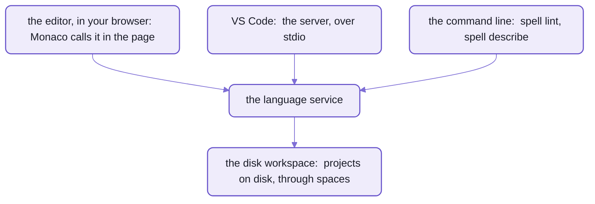

# The language server

A LANGUAGE SERVER is the program behind an editor's red squiggles, hover text and completions.
Editors talk to it over the [Language Server Protocol](https://microsoft.github.io/language-server-protocol/) (LSP),
so one server serves every editor that speaks it;
VS Code's [Language Server Extension Guide](https://code.visualstudio.com/api/language-extensions/language-server-extension-guide)
shows the shape.

Spell has ONE language service, which knows everything an editor asks about a spell file,
and runs it in three places:  the editor in your browser, VS Code, and the command line.
So the command line and the editor can't disagree:  `spell lint` lists exactly the errors the editor underlines.

What it does:

| Feature | What you see |
| --- | --- |
| diagnostics | errors underlined as you type, in every file a change affects, not only the one you edited |
| hover | what a word is:  its type, its docs, the spell that declared it |
| completion | the words that can come next, from the rules and from what your project declares |
| definition, references | jump to where something's declared, and find everywhere it's used |
| rename | rename a type, property or phrase everywhere it's used |
| outline, folding | a file's types and what's in them;  fold a type or a block |
| formatting | tidy a file's whitespace, as `spell format` does |

- It also edits the `<css>` blocks inside a type as CSS, with CSS's own completions and errors.
- It offers a quick fix for a phrase nobody declared yet:  "Define `to <phrase>`".



_One service, three places it runs;  on node, it reads projects from disk the same way everywhere._

## The pieces

| Piece | What it does |
| --- | --- |
| [`SpellLanguageService`](src/lsp/SpellLanguageService.ts) | answers every question:  diagnostics, hover, completion and the rest;  safe in a browser |
| [`SpellLanguageServer`](src/lsp/SpellLanguageServer.ts) | wires the service and a workspace to an LSP connection |
| [`SpellDiskWorkspace`](src/lsp/SpellDiskWorkspace.ts) | loads projects from disk, through [spaces'](README-spaces.md) disk reader;  node only |
| [`ScopeExplorer`](src/lsp/ScopeExplorer.ts) | the tree of what a project declares, for the Type Explorer and `spell describe` |
| [`ScopesSource`, `ScopePack`](src/lsp/ScopesSource.ts) | scope packs, `<Project>.scopes.js`:  the same tree, for a page with no parser |

- The server runs every document change through ONE queue, in order:
  a request waits for the changes before it, so it always sees the text you see.
- Diagnostics go out a moment (50 ms) after a change, so a burst of typing publishes once.
- Scope packs let `<spell-app>` show its Type Explorer without loading spell's parser:
  the server writes one after each clean compile, and `yarn lsp:scopes` writes them by hand.

## Where it runs

Start the server yourself, over stdio, the way an editor would, in spell-app's folder:

```sh
yarn lsp:start
```

- It talks the protocol on standard input and output, so it prints nothing for a person to read;
  an editor starts it and talks to it.
- The language service, [`SpellLanguageService`](src/lsp/SpellLanguageService.ts), is in this folder,
  imported as `spell-app/lsp`.
  - It moves to spell-lang with the work behind the language's commands, since `spell lint` and `spell describe`
    need it there:  still to come, after epic `repo-split` P13 moved the commands themselves.

## In VS Code

The Spell extension, in spell-app's [vscode/](vscode/) folder,
starts this server for every window with a `.spell` file open.
It runs the server from YOUR checkout's source, so one install works from the main checkout and from every worktree.

- Which checkout's server, in this order:
  1. the `spell.parserRoot` setting, if you set it
  2. else the window's folders, a worktree's before the main checkout's
  3. else the checkout the extension was built in
- The extension's output says which it picked;  restart the server to pick up a change to it.
- Installing the extension, its commands and settings, and hacking on it:
  [the kit's VS Code page](../README-vscode.md).

## Working on it

```sh
yarn lsp:start                                           # the server, over stdio
yarn lsp:scopes [--compile] <address...>                 # write projects' scope packs
yarn lsp:scopes --compile @spell/examples/drawable-solitaire
```

- It must stay safe to run in a browser:  the editor's Monaco calls the same service in the page.
  The node-only files (the disk workspace, the server's process) are left out of its entry.
- It uses spell-lang and spaces;  it never imports the app or the command line.
- Its tests are in [tests/lsp/](tests/lsp/);  `yarn vp test run --project lsp` runs them.
- The rules for working in the folder:  [lsp's AGENTS.md](src/lsp/AGENTS.md).
- How parsing works, which the service stands on:
  "Language server" in [spell-lang's PARSING.md](../spell-lang/src/spell/PARSING.md).

## See also

- [The Spell app](README.md):  this repo's front page
- [The editor and the runners](README-app.md):  Monaco, which calls the service in the page
- [Spaces](README-spaces.md):  the disk reader the workspace uses
- [The kit's VS Code page](../README-vscode.md) and [the command line](../README-cli.md)
- [spell-lang](../spell-lang/README.md):  the parser the service is built on
- [The kit](../README.md)
- Also beside it:  [README-examples.md](README-examples.md) · [README-page-server.md](README-page-server.md)
