# spell-app's page server

```json
"routes": [
  "src/page-server/pageServerRoutes.ts",
  "../spell-epic/src/tools/detailsRoutes.ts",
  "../spell-epic/src/tools/choicesRoutes.ts",
  "../spell-epic/src/tools/commentsRoutes.ts",
  "../spell-epic/src/tool/reviewRoutes.ts",
  "../spell-epic/src/tool/epicRoutes.ts",
  "../spell-epic/src/tool/linkRoutes.ts",
  "../spell-epic/src/list/runningRoutes.ts",
  "../spell-epic/src/tools/agentRoutes.ts",
  "../spell-epic/src/tools/showRoutes.ts",
  "../spell-epic/src/tools/airplaneRoutes.ts",
  "src/spaces/server/node/routes/appRoutes.ts"
]
```

_The first key of the `"pageServer"` block in spell-app's [package.json](package.json), as it stands._

Twelve file paths in a JSON list.
They're why one port, 4747, serves Spell's docs site, every epic page, the component docs and the editor's API.
The kit's page server reads the list as it starts, and imports each file by its path.

Ten of those files are spell-epic's, and spell-app doesn't import a line of spell-epic.
In an Express app you `import` a router and `app.use()` it, so the app's package depends on the router's.
Here the arrow points the other way:  each route module imports the kit's server, and the server imports NONE of them.

- The kit's page server is generic.
  Started from the kit's own folder, it serves the kit's files and nothing more:  no tabs, no component docs, no editor.
- What makes it Spell's is that block in spell-app's `package.json`, and the files the block names.
- Nothing checks a path until the server starts, and then nothing stops for one:
  a module that fails to load is logged in `.spell-server.log`, and the server starts without it.

## What one port serves, and who answers

A request meets the route modules first, in the order of that list.
Whatever they don't answer is a file, from spell-app, the content folder or a folder the settings name;
spell-app's own come first.

```mermaid
%%{init: {"theme":"base","themeVariables":{"fontFamily":"-apple-system, BlinkMacSystemFont, Segoe UI, Helvetica, Arial, sans-serif","fontSize":"15px","primaryColor":"#EFECFB","primaryBorderColor":"#6550CA","primaryTextColor":"#1A1C27","secondaryColor":"#F4F1E9","tertiaryColor":"#F7F6FC","lineColor":"#7F6FD6","textColor":"#7F6FD6","clusterBkg":"#F7F6FC","clusterBorder":"#B9B0E8","titleColor":"#1A1C27","edgeLabelBackground":"#F7F6FC","actorBkg":"#EFECFB","actorBorder":"#6550CA","actorTextColor":"#1A1C27","actorLineColor":"#9C90DE","signalColor":"#7F6FD6","signalTextColor":"#7F6FD6","labelBoxBkgColor":"#EFECFB","labelBoxBorderColor":"#6550CA","labelTextColor":"#1A1C27","loopTextColor":"#7F6FD6","noteBkgColor":"#F1E7D4","noteBorderColor":"#C9B48A","noteTextColor":"#1A1C27","activationBkgColor":"#DCD6F7","activationBorderColor":"#6550CA","sequenceNumberColor":"#FFFFFF"},"flowchart":{"curve":"basis","padding":12,"nodeSpacing":40,"rankSpacing":44}}}%%
flowchart LR
  settings["spell-app's pageServer settings"]
  server["the kit's page server, port 4747"]
  subgraph modules ["route modules, in list order"]
    own["spell-app's own:<br/>bundles, offline highlight.js"]
    epic["spell-epic's ten:<br/>/api/epics/, /api/docs/, /saga/"]
    app["spaces' app routes:<br/>/api/, /spaces/, /element/, /editor"]
  end
  subgraph files ["then the files"]
    checkout["spell-app's own files"]
    content["the content folder:<br/>/epics/, /guides/, /sagas/, /pages/"]
    sets["component sets:<br/>/components/ui/, /epics/, /app/"]
    engine["spell-epic's folders:<br/>/_epic/, /templates/"]
  end
  settings -. read as it starts .-> server
  server --> modules
  modules -- "not answered" --> files
  %% the Spell look:  yarn mermaid:pretty
  classDef default fill:#EFECFB,stroke:#6550CA,stroke-width:1.5px,color:#1A1C27,rx:8px,ry:8px
```



_Routes first, files after:  the settings fill every box, and the kit's server knows none of them by name._

Try it on a running server (`yarn start`, or `spell server start`, from spell-app's folder):

```sh
curl -s http://127.0.0.1:4747/hello
# {"message":"Hello from the API!"}
curl -s http://127.0.0.1:4747/ui/
# /ui/ moved:  see /components/ui/
curl -s -o /dev/null -w "%{http_code}\n" http://127.0.0.1:4747/_epic/assets/highlight.min.js
# 200
```

Three answers, from three places:  spaces' app routes, spell-app's own module, and a folder of spell-epic's.

### Pages and files

Read the right-hand column first:  when an address misbehaves, it says where to look.

| Address | What it serves | Who answers |
| --- | --- | --- |
| `/` | a redirect to the home page, `/pages/index.html` | the kit |
| `/epics/`, `/guides/`, `/sagas/`, `/pages/`, `/goals/` ... | the content folder, `spell.epics/` (named in spell-app's [epic settings](.epic/config.json5)), after spell-app's own files;  the Epics list gets each running epic's card as it's served | spell-epic's `runningRoutes` |
| `/worktrees/<w>/...` | an epic's worktree, with the same addresses inside;  on the main checkout's server only | `runningRoutes` |
| `/components/ui/`, `/components/epics/`, `/components/app/` | the component sets' docs pages, with Spell UI's site bundle laid over each at `_assets/` | the settings' `componentSets` |
| `/_epic/assets/`, `/_epic/pack/`, `/templates/` | spell-epic's page scripts and styles, its elements' pack, its templates | the settings' `engineRoutes` |
| `/_beside/<folder>/` | each folder beside spell-app that the settings name, mounted alone:  `/_beside/spell-ui/docs/` | the kit, from the settings |
| `/saga/<saga>[/<epic>]` | a redirect to that saga's or epic's page, keeping the `#id` | `linkRoutes` |
| `/spaces/<project>/<file>` | a project's file, by its address | spaces' `appRoutes` |
| `/element/...` | the editor's element bundles, from `app/dist-element/` | `appRoutes`;  on the epic server, the settings' `engineRoutes` |
| `/editor` | a redirect to the running editor;  while it isn't up, a 503 page that says so | `appRoutes` |
| `/hello` | `{"message":"Hello from the API!"}`:  is the API up? | `appRoutes` |
| `/ui/...` | a 404 with the new address, never a redirect | spell-app's `pageServerRoutes` |
| anything else | spell-app's own files, e.g. `/app/docs/index.html` | the kit |

### Calls under `/api/`

The prefix says whose a call is.
`/api/epics/` and `/api/docs/` are spell-epic's;  the kit keeps three;
the rest of `/api/` is the editor's:  spaces' module is listed last, and sees every call nobody before it answered.

<details>
<summary>Every call, and which module answers it</summary>

| Address | What it does | Who answers |
| --- | --- | --- |
| `/api/server` | the server's facts:  pid, port, branch, worktrees, content folder | the kit |
| `/api/files`, `/api/pages` | saving, making, moving and deleting files;  a page's source, and saving one section of it:  only in the writable folders | the kit |
| `/api/epics/running` | every running epic, as JSON | `runningRoutes` |
| `/api/epics/review/...` | an epic page's review inbox:  its marks, notes, test results and screenshots, and its Send | `reviewRoutes` |
| `/api/epics/new`, `favorite`, `pages`, `tests`, `saga` | the Epics page's New epic and its stars;  an epic's See also;  the epics waiting to test;  a saga's epics | `epicRoutes` |
| `/api/epics/agents` | an epic's running agents, and a note that redirects one | `agentRoutes` |
| `/api/epics/target` | what an `<epic-link>` points at:  its title and short form | `linkRoutes` |
| `/api/docs/details/...` | a details page's answers and drafts | `detailsRoutes` |
| `/api/docs/choices/...` | a choices page's answers and drafts | `choicesRoutes` |
| `/api/docs/comments`, `/api/docs/comments/send` | comments on any docs page or epic page, and their Send | `commentsRoutes` |
| `/api/docs/show` | shows a page in VS Code's side bar, or in Chrome | `showRoutes` |
| `/api/projects/...`, `/api/compile/...`, `/api/people/...` | the editor's API, bodies in JSON5 ([README-spaces.md](README-spaces.md)) | `appRoutes` |

</details>

- `airplaneRoutes` answers no address:  it tells every page, as it's served, when airplane mode is on
  (`window.SPELL_SERVER.airplane`).
- Every write from a page needs the server's per-run token and the server's own origin.
  The editor's API is the exception, with no token:
  [its one check](README-spaces.md#the-servers--an-api-that-nothing-starts) is the origin.
- What epic pages, details pages and comments are:  [spell-epic's pages](../spell-epic/README-pages.md).

## spell-app's own module:  bundles, and pages that load on a plane

Here is all of it, from [pageServerRoutes.ts](src/page-server/pageServerRoutes.ts):

```ts
const pageServerRoutes: RouteModule = {
  name: "page-server",
  setup({ root, router, web, onStop }) {
    const bundles = new BundleBuild({ root })
    router.use(bundles.wait)
    bundles.start()
    onStop(() => bundles.stop())

    web.files.html.push(localHighlight)
    const home = componentSets(pageServerSettings(root))[0]?.prefix ?? ""
    for (const path of MOVED_OUT) {
      router.use(path, (_request, reply) => reply.status(404).send(`${path}/ moved:  see ${home}/`))
    }
  }
}
export default pageServerRoutes
```

Three jobs, in that order.

**It builds the bundles the server serves.**
Spell UI's site bundle, which every component set's pages load, isn't committed:  the server builds it.
- As the server starts, [BundleBuild.ts](src/page-server/BundleBuild.ts) runs `spell bundle --stale` as a child
  process, which rebuilds only a bundle whose sources changed.
  A start with nothing changed builds nothing.
- It runs the checkout's OWN `spell`, the kit's as this checkout's install finds it, never the one on your PATH:
  so a worktree's server builds with the worktree's code.
- Its output goes to the server's log, each line starting `bundles:  `.
- A request for a bundle's file that isn't there yet waits for the build, up to two minutes.
  Then it's answered as things stand:  a 404, if the file is still missing.
  A file that's there is served at once.
- When the build ends, live reload reloads the pages that load the bundle.
- Only this checkout's bundles wait, for `GET` and `HEAD`;  a request under `/worktrees/<w>/` never does.
  A build that fails is logged, and leaves the bundle stale until the next start.

**It keeps pages loading offline.**
Older pages load highlight.js from cdnjs, with a plain, blocking `<script>`.
On a plane, the wifi's "pay first" page held that tag, and every script behind it, for tens of seconds,
while the page showed raw markup.
`localHighlight()` points the tag at spell-epic's copy, `/_epic/assets/highlight.min.js` (11.9.0, the same file),
on every page it serves.
It swaps that one URL, exactly:  a page loading highlight.js from anywhere else is left alone.

**It answers an old address with "not found".**
The content folder still holds an old copy of Spell UI's docs under `ui/`, for older checkouts.
Here `/ui/...` answers 404, `/ui/ moved:  see /components/ui/`, so nobody reads the stale copy.
No old address redirects, by decision:  every link to one was rewritten when its pages moved.

## Adding a route

A route is a file and one line.

1. Write a route module:  a file whose default export is `{ name, setup() }`, a `RouteModule` from
   `spell-kit/server/page`.
   `setup()` runs once, before the server listens, and gets the router, the write guard, live reload and the server.
   - spell-app's own, above, is the shortest real one.
   - Everything `setup()` gets:  [the kit's page server](../README-server.md).
2. Put it with the code it serves, and add its path to `routes` in spell-app's [package.json](package.json),
   written from spell-app's folder.
   - The editor's API lives in spaces, `src/spaces/server/node/routes/`;  page serving in `src/page-server/`.
   - Routes run in list order, all before any file:  an early module can shadow a later one's address.
   - A module in another repo is a path beside spell-app (`../spell-epic/...`).
     spell-epic is in spell-app's `runs` in the kit's [repos.json5](../repos.json5), so `yarn clone spell-app`
     brings it, and so does CI;  a route from another repo needs the same.
3. Restart the server.
   The next `spell server start`, or anything that opens a page, restarts a server older than its code:
   the newest `.ts`, `.js` or `.mjs` file in the kit's server or in any route module's folder.
   - A change to the settings alone isn't code:  `spell server stop`, then `spell server start`.
4. Test it with no port and no other modules, the way spell-app's own test does
   ([pageServerRoutes.test.ts](tests/page-server/pageServerRoutes.test.ts)):

   ```ts
   server = new PageServer({ root })
   await pageServerRoutes.setup(server.routeContext())
   await server.start({ port: 0, routes: false, pidFile: false })
   port = server.info.port
   // ...
   const answer = await ask(port, "GET", "/docs/offline.html")
   ```

   - `root` is a temporary folder with a `package.json` of its own;  `ask()` comes from `spell-kit/server/test/serve`.

<details>
<summary>Adding something that isn't a route</summary>

Most of what the server serves is a setting, not code:  one entry, then a restart (step 3).

| To add | Where | And |
| --- | --- | --- |
| a component set | one entry in `componentSets`:  its id, name, pages' folder and site bundle | usually a tab in `siteTabs` too |
| a tab | one entry in `siteTabs`, in the order the header shows it | update [siteTabs.test.ts](tests/page-server/siteTabs.test.ts), which pins the order |
| a folder served under a fixed prefix | one entry in `engineRoutes`:  the prefix, then the folder | the same copy is served under every worktree's address |
| a script on every page | one entry in `pageScripts`:  its URL, its file, the prefixes to skip | it's added only while its file exists |
| a folder pages may save into | one entry in `writable` | a folder of the content folder |
| a bundle built on demand | its output folder in `bundles` | and its build in [the kit's bundle list](../src/server/server.types.ts):  a folder no bundle builds into is an error |

</details>

## Running it

Day to day, `yarn start` in spell-app's folder is all you need:
a fresh page server and the editor, printing the editor's address ([spell-app's setup](README.md#setup-from-zero)).
`spell app serve [project]` does the same without the install, and opens the editor in your browser.

To see what's up, `yarn serve`, which is `spell server start all`:
it starts whatever of this checkout's web servers isn't running, waits until each answers, and prints one row each.

```text
Spell servers of ~/www/spell/spell-app:
  page server            4747  http://127.0.0.1:4747/                docs, epics, /api                 running
  editor                 3000  http://localhost:3000/                the spell app (vite)              running
  Spell UI's docs site   4747  http://127.0.0.1:4747/components/ui/  static pages, by the page server  running
```

- A row says `started` instead of `running` for a server it had to start.
- `start all` and `stop all` find spell-app from anywhere in the kit;  plain `spell server start` doesn't look,
  so from the kit's root it starts the kit's own server, the generic one at the top of this page.
- The rest, `stop`, `status`, `url <file>`, and building the bundles by hand with `spell bundle`:
  [the kit's commands](../README-cli.md#the-kit).

## Where it stops

All three come from one fact:  a setting is a path, read from the checkout the server runs in.

- **Without spell-epic beside spell-app, ten of the twelve route modules fail to load.**
  The server starts anyway, and serves no epic pages and no guides:
  the content folder is served by one of spell-epic's modules, so it goes too.
- At `/worktrees/<w>/`, the main server shows ITS copy of any folder beside spell-app:
  there, a worktree's Spell UI docs are the main checkout's spell-ui.
  The worktree's own page server shows its own.
- A folder further up than spell-app's parent can't be named:  `../../x` throws a `TypeError` as the server starts.

## The settings, key by key

Everything else the server serves is a value in the same block.
The kit's `pageServerSettings()` reads it as the server starts;  [the kit's page server](../README-server.md) says
what each key means for any checkout.
These are spell-app's values, from its [package.json](package.json), which holds the full list:

| Key | spell-app's value | What it does |
| --- | --- | --- |
| `routes` | the twelve route modules at the top of this page | loaded in order;  each one's `setup()` runs once, before the server listens |
| `componentSets` | `ui`, `epics`, `app` (below) | each set's docs pages at `/components/<set>/`, its site bundle laid over at `_assets/` |
| `siteTabs` | the tabs below | the site header's tabs, in order, handed to every page as `SPELL_SERVER.siteTabs` |
| `engineRoutes` | `/_epic/assets/` → `../spell-epic/src/tools/_assets`;  `/_epic/pack/` → `../spell-epic/src/components/__pack`;  `/templates/` → `../spell-epic/templates` | a URL prefix served from a folder, the same copy under every worktree's address |
| `bundles` | `../spell-ui/site/_assets`:  the bundle `spell bundle` calls `ui-site` | bundles built on demand, by output folder;  `spell bundle` reads the same list |
| `pageScripts` | `/element/spell-language.js`, from `app/dist-element/`, skipping `/components/` | a module script before every page's `</body>`:  this one colours blocks of Spell on the docs pages |
| `watch` | `../spell-epic/src/tools/_assets`, `../spell-epic/src/components/__pack` | the folders live reload watches, beyond the component sets, engine routes and content folder, which it watches anyway |
| `writable` | `epics`, `guides`, `pages` | the folders of the content folder that `/api/files` and `/api/pages` may write |

- Folders outside spell-app are named from its folder (`../spell-ui/docs`),
  and the server mounts each one on its own, at `/_beside/...`:  never the whole kit.
- `spell-language.js` is added only while its file exists:
  a checkout that hasn't run `yarn build:element` serves its pages without it, and no 404.

<details>
<summary>The component sets</summary>

| Id | Name | Served at | Its pages |
| --- | --- | --- | --- |
| `ui` | Spell UI | `/components/ui/` | [spell-ui's docs/](../spell-ui/docs/) |
| `epics` | Epic UI | `/components/epics/` | [spell-epic's src/docs/](../spell-epic/src/docs/) |
| `app` | App UI | `/components/app/` | [app/docs/](app/docs/), this repo's own ([README-app.md](README-app.md)) |

- Every set's site bundle is Spell UI's, `../spell-ui/site/_assets`:
  its pages load `site.js` and `site.css` from their own `_assets/`.
  What's in it:  [Spell UI's site](../spell-ui/README-site.md).
- `/components/ui` without its slash redirects to `/components/ui/`, so the pages' relative links hold.

</details>

<details>
<summary>The tabs</summary>

| Tab | Its home | Lit on |
| --- | --- | --- |
| Guides | `guides/index.html` | pages under `guides/` |
| Sagas | `sagas/index.html` | pages under `sagas/` or `goals/` |
| Epics | `epics/index.html` | pages under `epics/` |
| Epic/UI | `/components/epics/` | the `epics` set, and spell-epic's docs folder |
| Spell/UI | `/components/ui/` | the `ui` set, and spell-ui's docs and site folders |
| App | `/editor/` | `/editor`;  it opens in a browser tab of its own |
| App/UI | `/components/app/` | the `app` set, and `app/docs/` in any checkout or worktree |
| Templates | `templates/index.html` | pages under `templates/` |

- A tab whose home starts with `/` exists only when served:  it's greyed out on a `file://` page.
- A component set or a path pattern lights a tab first;  a page's folder (`guides/` ...) only when none does.
- The header's code names no tab:  they're data.
  [siteTabs.test.ts](tests/page-server/siteTabs.test.ts) pins the order, and which tab lights for 58 page paths.

</details>

## Working on it

- The code is [src/page-server/](src/page-server/), `spell-app/page-server`, namespace `PS`:
  the route module, `BundleBuild`, `localHighlight()` and their constants.
- It imports `spell-kit/server` and `spell-kit/server/page`, and nothing imports it:  the page server loads it by path.
- Its tests are in [tests/page-server/](tests/page-server/):  `BundleBuild`'s, the route module's and the tabs'.
  - `yarn vp test run --project page-server` runs them.
  - They use `spell-kit/server/test/serve` (`serveHandler`, `ask`), as the kit's server tests do.
- The rules for working in the folder:  [page-server's AGENTS.md](src/page-server/AGENTS.md).

## See also

- [The kit's page server](../README-server.md):  every setting in general, a request's path, live reload,
  editing in place, and everything a route module's `setup()` gets
- [Spaces](README-spaces.md):  the editor's API, the last route module in the list, call by call
- [spell-epic's pages](../spell-epic/README-pages.md):  what the ten epic route modules are for
- [The command line](../README-cli.md):  every verb and flag of `spell server` and `spell bundle`
- [Working on Spell](../README-development.md):  worktrees, the checks, and where to hack on what
