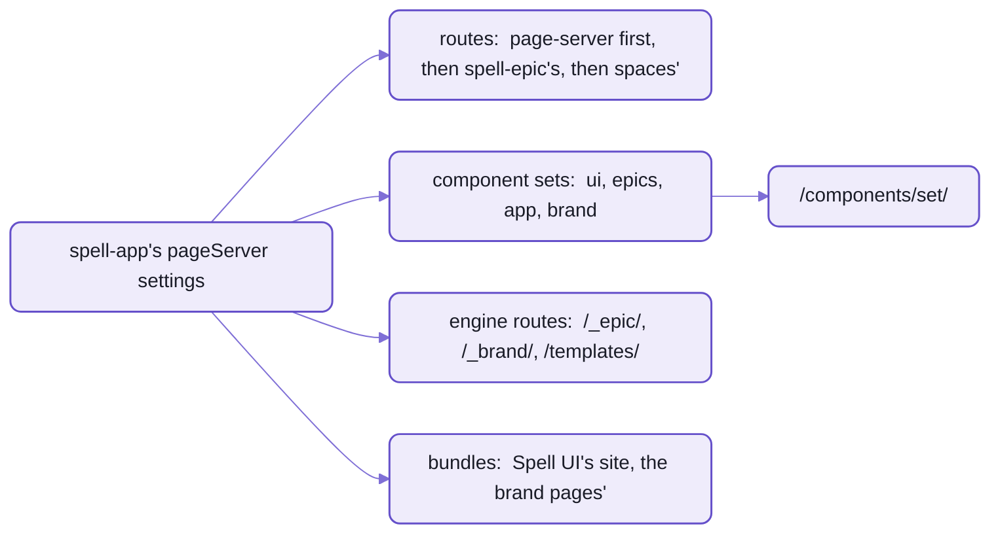

# spell-app's page server

The [kit's page server](../README-server.md) is generic:  it serves a checkout's pages on one port, with live reload,
and knows nothing of Spell's repos.
spell-app makes it Spell's, two ways:
- the SETTINGS in spell-app's [package.json](package.json), its `"pageServer"` block:
  which component sets it serves and where, the routes of the other repos, the top bar's tabs
- the [page-server](page-server/) folder:
  one ROUTE MODULE (a file the server loads by its path, from those settings),
  which builds the bundles the server serves, and keeps pages loading offline

The kit itself has no settings of its own:
run from spell-app, the page server is Spell's whole docs site, the editor's API and the epic pages, on one port.



_The page server reads the settings once, as it starts;  each setting names folders by their path from spell-app._

## What this module does

[pageServerRoutes.ts](page-server/src/pageServerRoutes.ts), listed first in the routes,
does three things as the page server starts:

1. **Builds the bundles** it serves, which aren't committed:
   Spell UI's site bundle (every component set's pages load it) and the brand pages'.
   - It runs this checkout's own bundle build (`spell bundles build --stale`) as a child process
     ([BundleBuild.ts](page-server/src/BundleBuild.ts)), logging its output as `bundles:  ...`.
   - A request for a file of a bundle that isn't built yet waits for it, up to two minutes.
   - When the build ends, live reload reloads the pages that load it.
2. **Keeps pages loading offline:**  every page's highlight.js tag, from a CDN, is pointed at a local copy.
3. **Bridges old addresses:**  folders the shared pages used to load from still answer, from their new places;
   the ones that moved out answer "not found" with where they went.

## The settings

The `"pageServer"` block of spell-app's [package.json](package.json), read by the kit's `pageServerSettings()`.
A short excerpt:

```json
"pageServer": {
  "routes": [
    "page-server/src/pageServerRoutes.ts",
    "../spell-epic/src/tools/detailsRoutes.ts",
    "spaces/src/server/node/routes/appRoutes.ts"
  ],
  "writable": ["epics", "guides", "pages", "brand"],
  "componentSets": {
    "ui": { "name": "Spell UI", "dir": "../spell-ui/docs", "assets": "../spell-ui/site/_assets" },
    "app": { "name": "App UI", "dir": "app/docs", "assets": "../spell-ui/site/_assets" }
  },
  "engineRoutes": { "/_epic/pack/": "../spell-epic/src/components/__pack" }
}
```

| Key | What it says |
| --- | --- |
| `routes` | the route modules, in order:  this folder's first, then spell-epic's (epic pages, details pages, comments, review ...), then spaces' (the editor's API) |
| `watch` | more folders live reload watches:  spell-epic's assets and pack, the brand's |
| `writable` | the content folders a page may save into, editing in place |
| `bundles` | the bundles this module builds:  Spell UI's site, the brand pages' |
| `pageScripts` | scripts added to every page:  `spell-language.js`, which colours spell blocks |
| `componentSets` | each set of elements and their docs pages, served at `/components/<set>/`, with Spell UI's site laid over at `_assets/` |
| `siteTabs` | the top bar's tabs, in order, and which pages light each one |
| `engineRoutes` | addresses served straight from another repo's folder:  `/_epic/assets/`, `/_epic/pack/`, `/templates/`, `/_brand/assets/` |

- The component sets:

  | Set | Served at | Its pages |
  | --- | --- | --- |
  | Spell UI | `/components/ui/` | [spell-ui's docs/](../spell-ui/docs/) |
  | Epic UI | `/components/epics/` | [spell-epic's docs/](../spell-epic/src/docs/) |
  | App UI | `/components/app/` | [app's docs/](app/docs/), this repo's own |
  | Brand | `/components/brand/` | [spell-brand's docs/](../spell-brand/docs/) |

- Folders outside spell-app are named from its root (`../spell-ui/docs`),
  and the server mounts each one on its own:  never the whole kit.
- A checkout without spell-epic beside it (as in CI) loads no epic routes.
- The tabs are pinned by a test, [siteTabs.test.ts](tests/page-server/src/siteTabs.test.ts).

## Commands

| Command | What it does |
| --- | --- |
| `yarn start` | the page server and the editor, printing the editor's address ([setup](README.md#setup-from-zero)) |
| `yarn serve` | every web server of this checkout (page server, editor, Spell UI's docs), each with its port and state |
| `spell server start`, `stop`, `status` | this checkout's page server alone |
| `spell server url <file>` | the address a file is served at |
| `spell bundles build [--stale]`, `spell bundles check` | build the bundles by hand, or check they're current |

`yarn serve` prints one row per server:

```text
Spell servers of ~/www/spell/spell-app:
  page server            4747  http://127.0.0.1:4747/                docs, epics, goals, /api                 running
  editor                 3000  http://localhost:3000/                the spell app (vite)                     running
  Spell UI's docs site   4747  http://127.0.0.1:4747/components/ui/  static pages, served by the page server  running
```

<details>
<summary>Until repo-split P13 lands:  today's spellings</summary>

- `spell dev server start | stop | status | url <file>`, or `yarn server ...` in spell-app.
- `spell dev server start --all` is `yarn serve`.
- `spell dev bundles build [--stale]`, `spell dev bundles check`.
- `yarn start` and `yarn serve` keep their names.

</details>

## Working on it

- Its tests are in [tests/page-server/](tests/page-server/):  `yarn spell-folders test page-server`.
- It uses the kit's server (`spell-kit/server`), and nothing imports it:  the page server loads it by its path.
- The rules for working in the folder:  [page-server's AGENTS.md](page-server/AGENTS.md).
- The page server itself (routes, live reload, editing in place, the site header):
  [the kit's server page](../README-server.md).

## See also

- [The Spell app](README.md):  this repo's front page, and who serves what while the editor runs
- [Spaces](README-spaces.md):  the editor's API, the other route module of spell-app's
- [The editor and the runners](README-app.md):  App UI, the component set this repo serves
- [The kit's page server](../README-server.md), and [the kit](../README.md)
- Also beside it:  [README-examples.md](README-examples.md) · [README-lsp.md](README-lsp.md)
