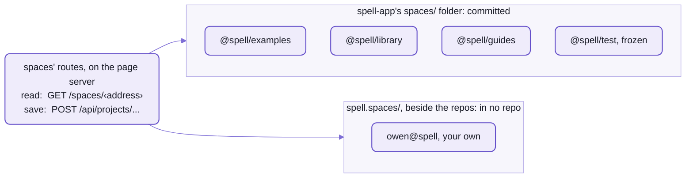
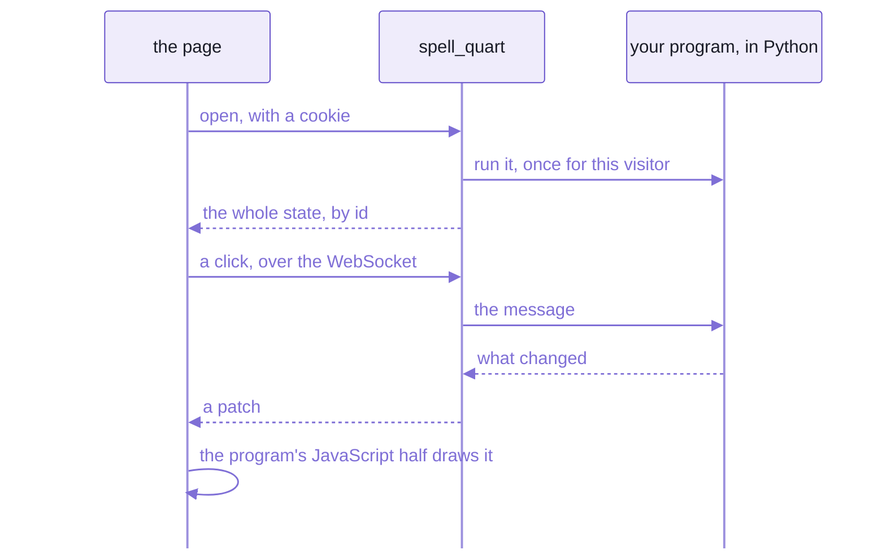

# Spaces:  where projects and people live

```text
@spell/examples/Solitaire/Solitaire.spellx
└──── group ──┘ └project─┘ └──── file ──┘
```

_A Spell address:  one file of the Solitaire example, named by what it is rather than where it is._

Every project and every file in Spell has an address like that one, and it's the same address everywhere:

| Where | What you write |
| --- | --- |
| the editor | `http://localhost:3000/edit/@spell/examples/Solitaire/Solitaire.spellx` |
| the command line | `spell run @spell/examples/Solitaire` |
| another project, importing a library | `{ "path": "@spell/library/people", "import": ["Person"] }` |
| the server, reading the file | `GET /spaces/@spell/examples/Solitaire/Solitaire.spellx` |

None of them is a path on disk.
One function turns an address into a folder, [`SpellUrls.folderFor()`](https://github.com/spell-app/spell-parser/blob/main/src/spell/SpellUrls.ts),
and everything that reads a project goes through it:  so the editor, the command line and the compiler
can't disagree about where a project is.

If you know npm, `@spell/library/people` reads like a scoped package, `@org/name`, and it's meant to:
whose it is, then what.
The difference is that there's no registry and no install.
The address alone says which folder holds the project, so a library on your disk is importable the moment it exists.

A SPACE is a person's or an organization's folder of projects:
`@spell` is Spell's own, and `owen@spell` is a person's, at Spell.
spell-app's [spaces](src/spaces/) is everything around them:
- the built-in projects, in [spaces/](spaces/)
- the models and the server the editor changes them through
- a web server for programs compiled to Python
- the people and organizations themselves



_Five groups in two folders, and one way in:  the server takes an address and works out the folder itself._

## Addresses:  the folder is in the name

An address is a group, then a project's name, then a file, with a slash between each.
Only the group is looked up;  everything after it is a folder or a file inside the group's folder.

```text
address  = group "/" project [ "/" path ]
group    = "@" org "/" domain            built-in:  @spell/examples, @spell/library, @spell/test
         | person "@" org                a person's own:  owen@spell
project  = name                          one part, no dot;  lower-kebab by convention:  todos-form-based
path     = file | folder "/"             a file has a dot:  todo.spell;  a folder ends in a slash
here     = "@here"                       on the command line:  the project in the folder you're in
```

| Address | What it is |
| --- | --- |
| `@spell/examples` | a group:  the example projects |
| `@spell/examples/Solitaire` | a project |
| `@spell/examples/Solitaire/Solitaire.spellx` | a file in it |
| `@spell/examples/Solitaire/assets/` | a folder in it:  the slash at the end says so |
| `owen@spell/hello` | a project in a person's own group |

- A group belongs to a space:  `@spell/examples` to `@spell`, an organization;
  `owen@spell` to a person at that organization.
- A page of a running app, `owen@spell/solitaire/rules`, has neither a dot nor a slash at the end:
  it's not a file, so it's no address.
- On the command line, a group or a whole space (`@spell`) stands for its projects:
  `spell` asks which one, or `--all` takes them all ([the command line](https://github.com/spell-app/spell/blob/main/README-cli.md)).
- The full rules, with every part of an address by name:
  `SpellLocation`, in spell-parser's [SpellLocation.ts](https://github.com/spell-app/spell-parser/blob/main/src/spell/SpellLocation.ts).

The groups, and where each one's folder is:

| Group | In the editor | Its folder | What's in it |
| --- | --- | --- | --- |
| `owen@spell` | Projects | `spell.spaces/@spell/owen@/`, beside the repos, in no repo | your own projects:  where `spell app create` makes one |
| `@spell/examples` | Examples | [spaces/@spell/examples/](spaces/@spell/examples/), committed | the eleven example apps ([README-examples.md](README-examples.md)) |
| `@spell/library` | Libraries | [spaces/@spell/library/](spaces/@spell/library/), committed | projects other projects import:  people |
| `@spell/guides` | Guides | [spaces/@spell/guides/](spaces/@spell/guides/), committed | twelve guides, each a Spell program that reads as prose:  a first walkthrough, A tour of Spell, and how each example works ([README-examples.md](README-examples.md#guides--programs-that-read-as-prose)) |
| `@spell/test` | Test fixtures, listed only in dev | [spaces/@spell/test/](spaces/@spell/test/), committed and frozen | the 7 projects the tests in [tests/spell/](tests/spell/) compile and compare against snapshots;  the examples and the guides are tested as they are |

- `spell projects` lists them, with how many projects each holds ([README-cli.md](https://github.com/spell-app/spell/blob/main/README-cli.md#spell-app)).
- A project in no group still runs:  `spell` makes up a group for it on the spot, `@local/<folder>`,
  named after the folder it's in.
  The editor lists none of those.

### Your own group is owen@spell, whoever you are

Your own projects live in `owen@spell`, the editor's "Projects" list, and that's its name on every machine.
- It's fixed today:  `LOCAL_PERSON` in [projectGroups.ts](src/spaces/models/projectGroups.ts), the part before the
  `@`, is the one person a machine has, until a machine can have more than one.
- So your projects' addresses start `owen@spell/` too, in your own spaces folder:  nobody else's files are in it.

## Setting up spaces for your own project

Your spaces folder is `spell.spaces`, beside the repos:  `~/www/spell/spell.spaces/`.
It's ONE folder for the main checkout and every worktree, and it's in no git repo.
A new checkout doesn't have one, and nothing makes it for you, so that's the first step.

The commands run from the kit's folder, `~/www/spell`, after [setup](https://github.com/spell-app/spell/blob/main/README.md#setup-from-zero),
with `spell` on your PATH ([setting it up](https://github.com/spell-app/spell/blob/main/README-cli.md#setting-it-up)).
What each printed on a real run is under it.

1. Make your own group's folder.

   ```sh
   cd ~/www/spell
   mkdir -p spell.spaces/@spell/owen@
   ```

   - It prints nothing.
   - Skip it, and the next step stops at `No such folder:  .../spell.spaces/@spell/owen@`.
   - `SPELL_SPACES_DIR=<folder>` puts your spaces somewhere else, for every program that reads them.

2. Make a project.

   ```sh
   spell app create hello
   ```

   <details>
   <summary>What it printed</summary>

   ```text
   spell.spaces/@spell/owen@/hello
   Made hello:  try  spell run spell.spaces/@spell/owen@/hello
   ```

   </details>

   It writes two files, and that's the whole project:

   ```text
   hello/
     __project.json5     the project file:  one import, /hello.spell
     hello.spell         // hello:  a new spell project
                         print "hello from hello"
   ```

   - It's careful with names and folders:  `spell app create "My Thing"` answers
     `'My Thing' won't do as a project name`, and a second `spell app create hello` says `... already holds a project`.
   - The editor's "New Project" takes any name, and makes the folder's name from it:
     "Todos - Form Based" becomes `todos-form-based`, with "Todos - Form Based" kept as the project's title.

3. Run it, by its address, from any folder.

   ```sh
   spell run owen@spell/hello
   ```

   <details>
   <summary>What it printed</summary>

   ```text
   ✓ Compiling owen@spell/hello
   hello from hello
   ```

   </details>

   Its folder works too, `spell run spell.spaces/@spell/owen@/hello`, and so does `spell run` alone, inside it:
   each one says `Compiling owen@spell/hello`.

4. Open it in the editor.

   ```sh
   spell app serve owen@spell/hello
   ```

   <details>
   <summary>What it printed</summary>

   ```text
   ✓ Starting the page server  http://127.0.0.1:4747/
   ✓ Starting the editor  http://localhost:3000/  (/api on the page server)
   http://localhost:3000/edit/owen@spell/hello
   The spell app is at http://localhost:3000/edit/owen@spell/hello;  docs, epics, goals and Spell UI at http://127.0.0.1:4747/ -- Ctrl-C to stop
   ```

   </details>

   - It opens your browser at `http://localhost:3000/edit/owen@spell/hello`;  `Ctrl-C` stops what it started.
     Its options:  [the command line's page](https://github.com/spell-app/spell/blob/main/README-cli.md#spell-app).
   - In an editor that's already open:  Home (the house icon), then "Projects".

5. Add a file:  "New File" in the editor, or any file you make in the project's folder.

   ```sh
   echo 'print "and more"' > spell.spaces/@spell/owen@/hello/more.spell
   spell run owen@spell/hello
   ```

   <details>
   <summary>What it printed</summary>

   ```text
   ✓ Compiling owen@spell/hello
   hello from hello
   and more
   ```

   </details>

   - A project's files are the `.spell`, `.css`, `.js` and `.jsx` files in its folder,
     and its property editor pages, `.editor.html`.
   - The next time the project is opened, a new file joins the end of its project file's `imports`,
     which is the order they run in;  a file that's gone leaves it.

6. Use a library:  add another project to the front of `imports`, by its address, naming what you want from it.

   ```json5
   {
     "imports": [{
       "path": "@spell/library/people",
       "active": true,
       "import": ["Person"]
     }, {
       "path": "/hello.spell",
       "active": true
     }, {
       "path": "/more.spell",
       "active": true
     }]
   }
   ```

   Then use it, at the end of `hello.spell`:

   ```spell
   set the friend to a new person
   set the nickname of the friend to "Sam"
   print the nickname of the friend
   ```

   ```sh
   spell run owen@spell/hello
   ```

   <details>
   <summary>What it printed</summary>

   ```text
   ✓ Compiling owen@spell/hello
   hello from hello
   Sam
   and more
   ```

   </details>

   - The first time, it compiles the library too, into spell-app's `build/` folder.

7. Keep it in git.
   Your spaces folder is in no repo, so `git init` in your project's folder (or in `spell.spaces` itself),
   and push it wherever you like.

   - Commit everything in the folder:  there's nothing to ignore.
   - What a compile writes goes in spell-app's `build/` folder, never beside your source:
     the compiled program, `hello.declarations.json5` (what it declares, for projects that import it)
     and `hello.en.js`, its words.
   - Every target's files, and where each goes:  [spell-parser's README-targets.md](https://github.com/spell-app/spell-parser/blob/main/README-targets.md).

Somewhere else on disk:  `spell app create hello --in <folder>` makes it there, and `spell run <folder>/hello` runs
it, as `@local/<folder>/hello`.
It's in none of the editor's lists, so `spell app serve` on it opens the project chooser instead.

<details>
<summary>The project file's fields</summary>

`__project.json5`, at the top of the project's folder (`ProjectFileJSON`,
in [server.types.ts](src/spaces/server/node/projects/server.types.ts)):

| Field | What it is | Default |
| --- | --- | --- |
| `imports` | the files it compiles, in order, and other projects it imports | every file in the folder, added as it's opened |
| `title` | its name for people, when its folder's name can't say it:  `"Todos - Form Based"` | made from the folder's name |
| `description` | what it shows, one line:  the examples page's table reads it | none |
| `version` | its version, `"1.2.0"`, copied into its declarations for projects that import it | none |
| `exports` | the names it offers projects that import it | everything it declares |
| `targets` | the languages it compiles to, besides JavaScript:  `["ts/solid"]`, `["py"]`, `["ts/lib"]` | `["js/solid"]` |
| `listsStartAt` | where its lists start counting:  `1`, or `0` as JavaScript and Python do | `1` |

Each entry of `imports`:

| Key | What it is |
| --- | --- |
| `path` | a file of this project, `/Card.spell`, or another project's address |
| `active` | `false` leaves it out of the compile |
| `import` | from another project:  the names to take, `["Card", "Deck"]` |
| `version` | from another project:  the range of its versions to accept, `"^1.0.0"` |
| `source` | from another project:  `true` reads its source rather than its declarations |

- The editor's "Settings" changes four of them:  `title`, `version`, `targets` and `listsStartAt`.
- Its comments survive every rewrite:  the file is edited in place, never regenerated.

</details>

## The models:  making projects, not compiling them

[spell-parser](https://github.com/spell-app/spell-parser/blob/main/README.md) compiles projects, but it never lists them:  it starts with no groups at all.
The groups, and every change to what's in them, are spaces' models:
plain classes in [src/spaces/models/](src/spaces/models/), safe in a browser, imported as `spell-app/spaces`.

| Model | What it does |
| --- | --- |
| `PROJECT_GROUPS` | Spell's project groups:  their addresses, titles and icons;  loading it tells Spell about them |
| `SpellProjectRoot` | one group's list of projects:  make, copy, rename and delete a project, and save its settings |
| `ProjectFiles` | one project's files:  make, copy, rename and delete a file |
| `TypeSchemas` | a type's properties, read from its project's declarations, for the property editor |
| `SPACE_NAMES` | spaces' own file names, `__project.json5`, `__me.json5`, `__org.json5` ...:  never one of a project's files |
| `SpaceStorage` | the one interface every space file goes through:  read, write, list, remove, watch |
| `PersonView`, `MeAnswer` ... | what the app and the server say about people:  types only |

So a program that reads an address must load the groups first, and there are three ways in:
- through `spell-app/spaces`, as the editor does
- through spaces' disk reader, `installDiskFetch()`:  the [language server](README-lsp.md) and `spell` do this
- or `spell-app/spaces/models/projectGroups` alone, as `<spell-viewer>` does to stay clear of the parser

The line between the two repos is sharp.
A project's own reading, compiling and saving is its `SpellProject`
([README-spell.md](https://github.com/spell-app/spell-parser/blob/main/README-spell.md));  making, copying and renaming projects happens here.
Each model asks the server, and throws with what it was doing ("renaming file") for the editor to show.

- The node side, `spell-app/spaces/server/node/...`, is imported by its path, never from the entry:
  it's the part that touches the disk.
- **Not yet:**  a second storage.
  The disk is the only one behind `SpaceStorage`;  the interface is there so another can stand in, and none has.

## The servers:  an API that nothing starts

If you know Express, the editor's API will look familiar:  a router, `api.get("/projects/list/*", ...)`.
What's different is that nothing starts it.
It's a ROUTE MODULE:  a file the [page server](https://github.com/spell-app/spell/blob/main/README-server.md) loads by its path,
named in spell-app's own part of the page server's settings ([README-page-server.md](README-page-server.md)),
and the page server is the one program running.

| Path | What [appRoutes.ts](src/spaces/server/node/routes/appRoutes.ts) serves there |
| --- | --- |
| `/api/...` | the app's API (below), its bodies read as JSON5, up to 10 MB |
| `/spaces/<address>` | a project's file, which is how Spell reads every file |
| `/element/...` | `<spell-viewer>`'s and `<spell-editor>`'s bundles, from the app's `dist-element/` |
| `/editor` | the site header's "Editor" link, redirected to wherever the editor is |
| `/hello` | a liveness check |

Two things run beside it, and stop with it.

The EDITOR is Vite's dev server for the app, which the page server starts as its child once it listens
([EditorServer.ts](src/spaces/server/node/routes/EditorServer.ts)).
So however the page server starts, the "Editor" link works;  `SPELL_NO_EDITOR=1` skips it.

BUILDS happen on demand ([ProjectBuild.ts](src/spaces/server/node/routes/ProjectBuild.ts)).
Ask for a compiled file that isn't there yet, `/spaces/<project>/<project>.spell.js`, and its project compiles
first, in a child process running the checkout's own `spell compile`, so the page server keeps serving meanwhile.
- A request waits a minute at most;  then it gets a 404, and the compile carries on.
- As the page server starts, `spell compile --stale --all @spell/examples @spell/library` runs in the background,
  so the demo pages and App UI's live examples find their programs.
- What it builds goes in spell-app's `build/` folder, mirroring each project's path, never committed:
  `build/spaces/@spell/examples/Solitaire/` holds that project's compiled program and its scope pack
  (`.scopes.js`, what the Type Explorer reads).
- A file already built is served as it is, even when its sources changed since:
  the startup compile and `spell compile --stale` are what catch those.

`yarn start:server`, at spell-app's root, runs the API alone, on port 3001, with no page server
([cli.ts](src/spaces/server/node/routes/cli.ts)).

This API writes files, so its one check matters:
a write whose `Origin` isn't this machine gets a 403, `wrong origin`.
There's no token, so it keeps out other web sites, not other programs on your machine.

<details>
<summary>The API's routes</summary>

Each route's contract is on its handler, in [project-utils.ts](src/spaces/server/node/projects/project-utils.ts);
the table is [api.ts](src/spaces/server/node/routes/api.ts), and
[api.test.ts](tests/spaces/server/node/routes/api.test.ts) pins it over HTTP.

| Route | What it does |
| --- | --- |
| `GET /spaces/<address>` | one file, as it is on disk;  a compiled one from `build/`, compiled first if it's missing |
| `GET /api/projects/list/<group>` | a group's projects:  each address, and its title if it has one |
| `GET /api/projects/index/<project>` | a project's files and imports;  adds new files to its project file, drops gone ones |
| `POST /api/projects/file/<address>` | save a file |
| `POST /api/projects/create/project` | make a project |
| `POST /api/projects/rename/project`, `.../duplicate/project` | rename or copy one |
| `DELETE /api/projects/remove/project` | delete one |
| `POST /api/projects/settings/project` | save a project's settings, into its project file |
| `POST /api/projects/create/file`, `.../rename/file` | make or rename a file |
| `DELETE /api/projects/remove/file` | delete a file |
| `GET`, `POST /api/compile/file` | compile a file that's in no project |
| `GET /api/people/me`, `POST /api/people/me` | this machine's person, their orgs and roles;  their changes |
| `GET /api/prefs/load`, `POST /api/prefs/save`, `GET /api/prefs/keys`, `POST /api/prefs/forget` | the person's preferences, one store at a time (below, "Preferences") |
| `GET /api/test`, `/api/missing`, `/api/not-authorized`, `/api/error` | canned answers for testing the client:  200, 404, 403, and a 500 that says "No soup for you!" |

- Anything else under `/api` is a 404, `API routine not defined on server`.
- A caller's mistake that a handler throws as `SRV.HttpError` answers with its status (a bad store name, 400);
  anything else thrown is a 500.
- Every save goes through the page server's file operations:  under a file lock, written all at once.
- A URL is split by its group and its project before any path on disk is made, each part decoded on its own,
  and a `.` or `..` part is refused:  it's the one place a URL becomes a path.
- `/editor` before the editor is up answers 503, with a page saying it takes a few seconds:  reload.

</details>

<details>
<summary>The environment variables</summary>

| Variable | What it sets | Default |
| --- | --- | --- |
| `SPELL_SPACES_DIR` | the spaces folder;  the page server's `--spaces <dir>` sets it too | `spell.spaces`, beside the main checkout |
| `SPELL_BUILTINS_DIR` | the built-in projects' folder, the frozen test projects' too | spell-app's `spaces/` |
| `SPELL_BUILD_DIR` | where compiled output goes | spell-app's `build/` |
| `SPELL_EDITOR_PORT` | the editor's port;  `spell app serve --port` sets it | 3000, else any free one |
| `SPELL_NO_EDITOR` | `1`:  the page server doesn't start the editor | |
| `PORT` | the API alone's port, `yarn start:server` | 3001 |
| `SPELL_PAGE_ASSETS` | where the Python server finds the page side | the app's `dist-page/` |

- The tests set the first four, so they never write into the repo.
- [environment.ts](src/spaces/server/node/environment.ts) reads the first four and the API's port:
  it's the map of where everything is on disk.

</details>

## The Python server

Compile a Spell program to Python, and it can still be a web page:
the program runs on the server, and the page only draws what it's told.
That's `spell_quart`, a [Quart](https://quart.palletsprojects.com/) app (Flask's asyncio twin),
in spaces' [Python folder](src/spaces/server/py/).

```sh
spell run @spell/examples/Solitaire --target py
```

1. It compiles the project to Python, on `spell_core` (spell-parser's Python runtime), into a temporary folder:
   nothing is written into the project.
2. It builds the page side (`yarn build:page`, the app's `dist-page/`) if it's older than what it's built from:
   a few seconds, shown as a line of its own.
3. It starts the app on Quart, under uv, on a free port, prints the address and opens it, until `Ctrl-C`.



_The page holds no program:  it draws what the server's copy says, one patch at a time._

One visitor, one game.
A visitor is a browser, known by a cookie, and each gets a game of their own:
the program runs once for them, on a core of its own.
Their tabs share it, so a click in one shows in every one,
and a patch goes down after each message and at each pause, so a game animates.
That game lives in the server's memory, though:  restart the server, and every game ends.

- A message that fails is logged, and the page carries on.
- `--seed <n>` deals the same game every run.
- A program that doesn't draw runs in the terminal instead, as `python -m spell_core.run`.
- It needs Python 3.12 or later, and [uv](https://docs.astral.sh/uv/), which fetches it.
- How it differs from the page server:
  the page server serves files and the editor's API, and never runs your program;
  `spell_quart` runs one program per visitor, and serves only its page.
- Its tests:  pytest and ruff, through uv, in spell-app's `yarn test` and `yarn lint`;
  [quartApp.test.ts](tests/cli/quartApp.test.ts) plays Solitaire through a compiled app, in headless Chromium.
- What compiling to Python writes beside your source, the app itself among it:
  [spell-parser's README-targets.md](https://github.com/spell-app/spell-parser/blob/main/README-targets.md).

## People and orgs:  the schema is a Spell file

People and organizations are things in Spell too, declared in Spell, in the people library.
Here is what an organization is, and what it means to belong to one:

```spell
an org is a thing where:
	- it is saved in its own file
	- it has a name as text
	- its "members" is a list of memberships

a membership is a thing where:
	- it has a person as a person
	- its "role" is one of guest, member, admin, spell-admin
```

_From [People.spell](spaces/@spell/library/people/People.spell), the whole people library, 47 lines:
it also declares the person ([the front page](README.md#spaces--every-project-has-an-owner-and-an-address) shows
it), dated events, notes, relationships and friend lists._

No schema file, no ORM:  those sentences are the schema.
The library, [`@spell/library/people`](spaces/@spell/library/people/), compiles to TypeScript (its `ts/lib`
target, `people.lib.ts`), and the app, the people store and `spell` import that.

"Saved in its own file" means one JSON5 file each, with an id built in:
- a person, `Person#owen@spell`, is `__me.json5` in their space
- an organization, `Org#spell`, is `__org.json5` in its folder, with its members inside it

```text
spell.spaces/@spell/__org.json5              Org#spell:  the org, with its members
spell.spaces/@spell/owen@/__me.json5         Person#owen@spell:  the person
spell.spaces/@spell/owen@/hello/             owen@spell/hello:  one of their projects, beside them
```

Everything else is saved inside what holds it:  a person's notes, dated events and lists of friends.
The one exception is a friend, who has a file of their own:
saved as a reference, `{ "$ref": "Person#matt@three-degrees" }`, never into their file.

The people store ([PeopleStore.ts](src/spaces/server/node/people/PeopleStore.ts)) reads and writes them,
one file at a time, keeping every comment.
- The first time, it writes you a starter `__me.json5`, with your name and email from git,
  and two comment lines saying what the file is.
- Each file is checked against its class, and read anyway:
  `{ "$type": "Person", "id": "bad", "names": 7 }` loads, with one problem, `names is text, not a number`.
- The editor's "You" panel shows this machine's person, their orgs and their file's problems,
  and saves changes to their names, nickname, emails and dates, through `/api/people/me`.
  Their orgs and roles are read only.
- Spaces' own names, `__me.json5` among them, are known by a list, never by the `__` alone:
  so they never list as a project's files, and Python's `__init__.py` still does.

## Preferences:  each person's, in a file in their space

```ts
const prefs = new PrefStore("owen@spell/hello", { place: ServerPlace.shared })
await prefs.save("theme", "dark")
await prefs.update<number>("games", (games) => (games ?? 0) + 1)
```

```text
spell.spaces/@spell/owen@/__prefs/owen@spell/hello.json5
{
  "theme": "dark",
  "games": 1
}
```

_A pref store named for your hello project, on the page server's place:
what it saves lands in your space, as a file you can open._

`localStorage` keeps a preference in one browser, out of sight.
This keeps it in a file:  every browser that talks to this page server reads the same one,
and you can read it, change it, or comment it by hand.

- One JSON5 file per store, each pref a key of it:  a comment you write in it stays.
- A store named like a project is a folder and a file, as above.
  One named `spellEditor` is just `__prefs/spellEditor.json5`.
- The kit's pref store reaches it through its server place, `ServerPlace` ([README-util](https://github.com/spell-app/spell/blob/main/README-util.md)),
  under `/api/prefs`:  load, save, list a prefix's keys, forget a prefix (the routes, above).
- [SpacePrefs.ts](src/spaces/server/node/prefs/SpacePrefs.ts) keeps them, one change at a time to each file,
  so two saves at once both land.

**Real today:**  the server's side, and the place a store asks it through.

**Not yet:**  nothing asks it unless told to.
- The editor keeps its own preferences in the browser, `spellEditor:mode` and the rest.
- So does a running app, for the props it remembers, until whatever runs it hands it `ServerPlace.shared`.

The rest of the edges:
- Whose:  this machine's person, `owen@spell`, until sign-in.
  One function says whose (`prefsPersonFor()`, [prefsRoutes.ts](src/spaces/server/node/prefs/prefsRoutes.ts)), and sign-in replaces it.
- A store name with a part starting with a dot, an empty part, a colon or a backslash answers 400:
  nothing reaches outside your `__prefs/`.
- Values travel as JSON, so plain data only;  a `Blob` or a file handle stays in the browser's database.

## 🌱 Coming:  spaces for organizations, sign-in and permissions

Today every space is on your own machine, and nobody is refused a save:  the roles above are stored, not enforced.
What's planned:  spaces for organizations, sign-in and invites, and permissions that use those roles.
Then sharing, several people in one project, which [the front page](README.md#-several-people-in-one-project)
lays out in its two stages.

Where it stands:  the people and organizations are built;  sign-in, permissions and sharing are planned, not started.

## See also

- [The Spell app](README.md):  this repo's front page, and where spaces sit among its folders
- [The editor](README-app.md):  what calls these models and saves through this API
- [The example apps](README-examples.md):  what's in `@spell/examples`, and ideas for a project of your own
- [The command line](https://github.com/spell-app/spell/blob/main/README-cli.md#spell-app):  every option of `spell app create`, `spell app serve` and
  `spell projects`
- [spell-parser's README-spell.md](https://github.com/spell-app/spell-parser/blob/main/README-spell.md):  `SpellProject`, which reads, compiles and saves
  the projects that live here
