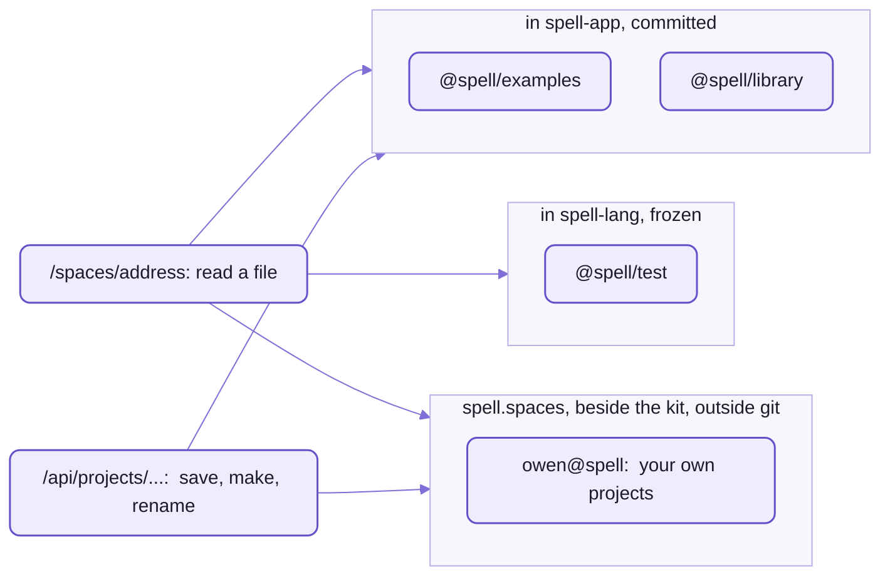
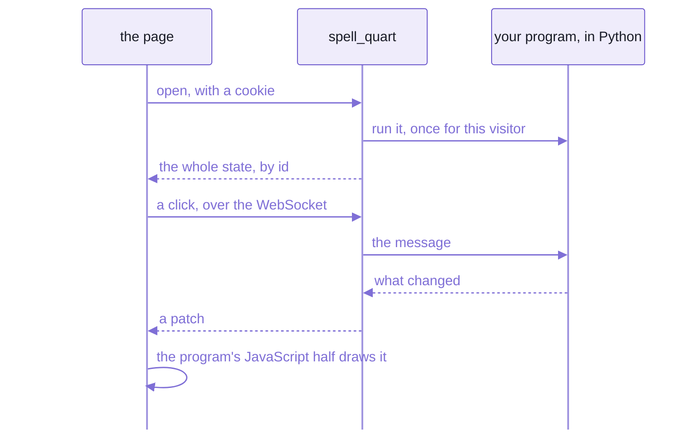

# Spaces:  where projects and people live

A SPACE is a person's or an organization's folder of projects.
Every project and every file in one has an ADDRESS, like `@spell/examples/drawable-solitaire/Card.spell`,
which the editor, the command line and other projects use to name it.

The [spaces](spaces/) folder holds what makes that work:
- the built-in projects, Spell's own space:  the examples and the libraries
- the models of groups and projects, safe to run in a browser,
  which the editor uses to make, copy, rename and delete them
- the servers that serve them:  the editor's API on the page server, and Python's web server
- people and organizations, saved as readable files

If you know npm:  an address is a bit like a scoped package name, `@org/name`, with a group and a file after it.



_Every group lives in a folder of its own;  the same two kinds of address read and write them all._

## Addresses

An address is a group, then a project's name, then a file, with a slash between each:

```text
address  = group "/" project [ "/" path ]
group    = "@" org "/" domain            built-in:  @spell/examples, @spell/library, @spell/test
         | person "@" org                a person's own:  owen@spell
project  = name                          one part, lower-kebab:  todos-form-based
path     = file | folder "/"             a file has a dot:  todo.spell;  a folder ends in a slash
here     = "@here"                       on the command line:  the project in the folder you're in
```

| Address | What it is |
| --- | --- |
| `@spell/examples` | a group:  the example projects |
| `@spell/examples/drawable-solitaire` | a project |
| `@spell/examples/drawable-solitaire/Card.spell` | a file in it |
| `@spell/examples/drawable-solitaire/assets/` | a folder in it |
| `owen@spell/errors` | a project in a person's own group |

- A group belongs to a space:
  - `@spell/examples` to `@spell`, an organization
  - `owen@spell` to a person at that organization
- Each group's folder comes from its address, so nothing needs looking up beyond the group.
- A page of a running app, `owen@spell/solitaire/rules`, has neither a dot nor a slash at the end:  it's not a file.
- The full rules:  `SpellLocation`, in [spell-lang's SpellLocation.ts](../spell-lang/src/spell/SpellLocation.ts).

### Your own projects group

Your own projects live in your own group, `<you>@spell`:
`spell app create` makes projects there, and it's the editor's "Projects" list.

- Today the name is fixed, `owen@spell`, after the maintainer:
  one person per machine, until a machine can have more than one.
  - The code:  `LOCAL_PERSON`, in [projectGroups.ts](src/spaces/models/projectGroups.ts).
- So on your machine, your projects' addresses start `owen@spell/` too, in your own folder:
  nobody else's files are in it.

## Setting up spaces for your own project

Your spaces folder is `spell.spaces`, beside the kit's folders (`~/www/spell/spell.spaces/`):
one folder for the main checkout and every worktree, outside git.
A new checkout doesn't have it yet, so make it first.

1. Make your own group's folder:

   ```sh
   mkdir -p ~/www/spell/spell.spaces/@spell/owen@
   ```

   - It prints nothing.
   - `SPELL_SPACES_DIR=<folder>` puts the spaces somewhere else, for every program that reads them.
2. Make a project, from spell-app's folder (or anywhere, once `spell` is on your PATH):

   ```sh
   spell app create hello
   ```

   ```text
   ../spell.spaces/@spell/owen@/hello
   Made hello:  try  spell run ../spell.spaces/@spell/owen@/hello
   ```

   It writes two files:

   ```text
   hello/
     __project.json5     the project file
     hello.spell         // hello:  a new spell project
                         print "hello from hello"
   ```

3. Run it:

   ```sh
   spell run owen@spell/hello
   ```

   ```text
   ✓ Compiling owen@spell/hello
   hello from hello
   ```

4. Open it in the editor:  `yarn start` in spell-app, then `http://localhost:3000/edit/owen@spell/hello`,
   or pick it under "Open or Create...", in "Projects".
5. Add files in the editor ("New File"), or in your own editor:
   a project lists every `.spell`, `.css` and `.js` file in its folder,
   and adds a new one to its project file the next time it's opened.
6. Use a library:  add another project to `imports`, by its address, naming what you want from it:

   ```json5
   { "path": "@spell/library/cards", "active": true, "import": ["Card", "Deck", "Pile"] }
   ```

7. Keep it in git:  your spaces folder isn't in any repo,
   so `git init` in your project's folder (or in `spell.spaces` itself), and push it wherever you like.
   What spell builds goes in spell-app's `build/` folder, never beside your source, so there's nothing to ignore.

- Elsewhere on disk:  `spell app create hello --in <folder>` makes it there;  `spell run <folder>` runs it.
  It has no address then (`@local/<folder>` while the editor has it open), and it isn't in the editor's lists.

<details>
<summary>The project file's fields</summary>

`__project.json5`, at the top of the project's folder (spaces' `ProjectFileJSON`,
in [server.types.ts](src/spaces/server/node/projects/server.types.ts)):

| Field | What it is | Default |
| --- | --- | --- |
| `imports` | the files it compiles, in order, and other projects it imports | every file in the folder, added as it's opened |
| `title` | its name for people, when its folder's name can't say it:  `"Todos - Form Based"` | made from the folder's name |
| `description` | what it shows, one line:  the examples page's table reads it | none |
| `version` | its version, `"1.2.0"`, copied into its declarations for projects that import it | none |
| `exports` | the names it offers projects that import it | everything it declares |
| `targets` | the languages it compiles to, besides JavaScript:  `["ts/solid"]`, `["py"]`, `["ts/lib"]` | `["js/solid"]` |
| `listsStartAt` | where its lists start counting:  `1`, or `0` as JavaScript and Python do | `1` |

Each entry of `imports`:

| Key | What it is |
| --- | --- |
| `path` | a file of this project, `/Card.spell`, or another project's address |
| `active` | `false` leaves it out of the compile |
| `import` | from another project:  the names to take, `["Card", "Deck"]` |

</details>

## The models

The editor makes and changes projects through spaces' models, in [src/spaces/models/](src/spaces/models/):
plain classes, safe in a browser, imported as `spell-app/spaces`.

| Model | What it does |
| --- | --- |
| `PROJECT_GROUPS` | Spell's project groups:  their addresses, titles and icons;  loading it tells spell about them |
| `SpellProjectRoot` | one group's list of projects:  make, copy, rename and delete a project |
| `ProjectFiles` | one project's files:  make, copy, rename and delete a file |
| `SPACE_NAMES` | spaces' own file names, `__project.json5`, `__me.json5` ...:  never listed as a project's files |
| `SpaceStorage` | the one interface every space file goes through:  read, write, list, remove, watch |

- spell-lang reads and compiles projects, but never holds one:  the groups are spaces', and spell starts with none.
  So every program that reads an address loads spaces' groups first.
- A project's own reading, compiling and saving is spell-lang's `SpellProject`;  making and renaming them is here.

## The servers

The editor saves and loads through the page server:
spaces adds its routes there, as a ROUTE MODULE
(a file the [page server](../README-server.md) loads by its path, from spell-app's settings).

- [appRoutes.ts](src/spaces/server/node/routes/appRoutes.ts) serves:
  - `/api/...`:  the app's API, below
  - `/spaces/<address>`:  reading a file
  - `/element/...`:  the web components, from the app's `dist-element/`
  - `/editor`:  a link to the editor
- It starts the editor (Vite) as the page server's child once the page server listens, and stops it with it.
- It BUILDS on demand:
  a request for a compiled file that isn't there yet (`/spaces/<project>/<project>.spell.js`) compiles its project first.
  - As the page server starts, it compiles `@spell/examples` and `@spell/library` in the background,
    so the demo pages and App UI's live examples are ready.
  - What it builds goes in spell-app's `build/` folder, never committed:
    `build/spaces/@spell/examples/drawable-solitaire/`.
- `yarn start:server` runs the API alone, on port 3001, with no page server.

<details>
<summary>The API's routes</summary>

Each route's contract is on its handler, in [project-utils.ts](src/spaces/server/node/projects/project-utils.ts);
the table is [api.ts](src/spaces/server/node/routes/api.ts).

| Route | What it does |
| --- | --- |
| `GET /spaces/<address>` | one file, as it is on disk;  a compiled one from `build/`, compiled first if it's missing |
| `GET /api/projects/list/<group>` | a group's projects:  each address, and its title if it has one |
| `GET /api/projects/index/<project>` | a project's files and imports;  adds new files to its project file |
| `POST /api/projects/file/<address>` | save a file |
| `POST /api/projects/create/project` | make a project |
| `POST /api/projects/rename/project`, `.../duplicate/project` | rename or copy one |
| `POST /api/projects/settings/project` | save a project's settings, its project file |
| `POST /api/projects/create/file`, `.../rename/file` | make or rename a file |
| `GET`, `POST /api/compile/file` | compile a file |
| `GET /api/people/me`, `POST /api/people/me` | this machine's person, their orgs and roles;  their changes |

- Every save goes through the page server's file operations:  under a file lock, written all at once.
- A URL is split by its group and its project before any path on disk is made, each part decoded on its own.

</details>

<details>
<summary>The environment variables</summary>

| Variable | What it sets | Default |
| --- | --- | --- |
| `SPELL_SPACES_DIR` | the spaces folder | `spell.spaces`, beside the main checkout |
| `SPELL_BUILTINS_DIR` | the built-in projects' folder | spell-app's `spaces/` |
| `SPELL_TESTS_DIR` | the frozen test projects' folder | spell-lang's `tests/spaces/` |
| `SPELL_BUILD_DIR` | where compiled output goes | spell-app's `build/` |
| `SPELL_NO_EDITOR` | `1`:  the page server doesn't start the editor | |
| `SPELL_PAGE_ASSETS` | where Python's web server finds the page side | the app's `dist-page/` |

The tests set the first four, so they never write into the repo.

</details>

<details>
<summary>What's committed beside a project's source, and what isn't</summary>

| File | Where | Committed |
| --- | --- | --- |
| `<Project>.declarations.json5` | beside the source | yes:  what it declares, for projects that import it |
| `<Project>.en.js` | beside the source | yes:  its words, how the explorers name its members in spell |
| `<Project>.lib.ts` | beside the source | yes, for a library (`ts/lib`) |
| `<Project>.spell.js`, `.spell.tsx`, `.spell.py` | `build/` | no:  compiled again whenever it's needed |
| `<Project>.scopes.js` | `build/` | no:  the scope pack the Type Explorer reads |

- Opening a project in the editor compiles it, which may rewrite its declarations and words:
  look at `git status` after.

</details>

## The Python server

A spell program can be compiled to Python and served as a web app,
with the page drawn in the browser and the program running on the server:
`spell_quart`, in spaces' [Python folder](src/spaces/server/py/).

```sh
spell run @spell/examples/outline-solitaire --target py
```

1. `spell run` compiles the project to Python, on `spell_core` (spell-lang's Python runtime), into a temporary folder.
2. It builds the page side (the app's `yarn build:page`), if it's out of date.
3. It starts the app on [Quart](https://quart.palletsprojects.com/), under uv, and opens the page, until `Ctrl-C`.



_The page holds no program:  it draws what the server's copy says, one patch at a time._

- One program per visitor, each on a core of its own;  a patch after each message, and at each pause.
- It needs Python 3.12 or later, and [uv](https://docs.astral.sh/uv/), which fetches it.
- How it differs from the page server:
  the page server serves files and the editor's API, and never runs your program;
  `spell_quart` runs one program per visitor, and serves only its page.
- Its tests:  pytest, through uv, in `yarn test`;
  the command line's tests play solitaire through a compiled app in headless Chromium.

## People and orgs

People and organizations are things in spell too:
the people library, [`@spell/library/people`](spaces/@spell/library/people/),
written in spell and compiled to TypeScript the app imports.

- Every thing has an id, built in, and a file you can read:
  - a person, `Person#owen@spell`:  `__me.json5` in their space, `@spell/owen@/__me.json5`
  - an organization, `Org#spell`:  `__org.json5` in its, with its members inside it,
    each a person and a role (guest, member, admin or spell-admin)
- A person keeps notes, dated events and lists of friends;  a friend is saved as a reference, never into their file.
- The people store ([PeopleStore.ts](src/spaces/server/node/people/PeopleStore.ts)) reads and writes them,
  one file at a time, keeping every comment.
  - The first time, it writes a starter `__me.json5` from git's name and email.
- The editor's "You" panel shows and edits this machine's person, through `/api/people/me`.

## 🌱 Coming:  spaces for organizations, sign-in and sharing

Today every space is on your own machine, and nobody is refused a save.
What's planned:  spaces for organizations, sign-in and invites, and SHARING, in two stages.

1. Everyone on a local network in one running program, kept in step by patches from the editor's server,
   as the Python server already does for one visitor.
2. Then the source itself, so several people write one project together.

Where it stands:  the people and organizations are built;  sign-in, permissions and sharing are planned, not started.

## See also

- [The Spell app](README.md):  this repo's front page
- [The editor and the runners](README-app.md), [the example apps](README-examples.md),
  [the language server](README-lsp.md), [spell-app's page server](README-page-server.md)
- [spell-lang](../spell-lang/README.md):  `SpellProject`, the compiler, and the Python runtime
- [The kit](../README.md), and [its page server](../README-server.md), which the servers here run on
