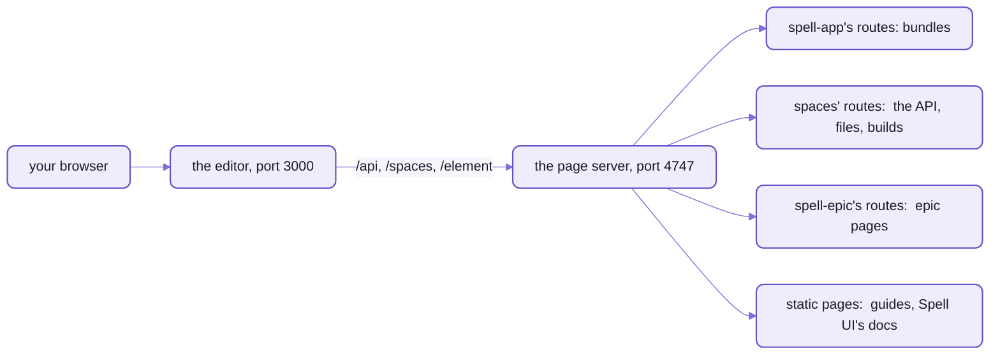
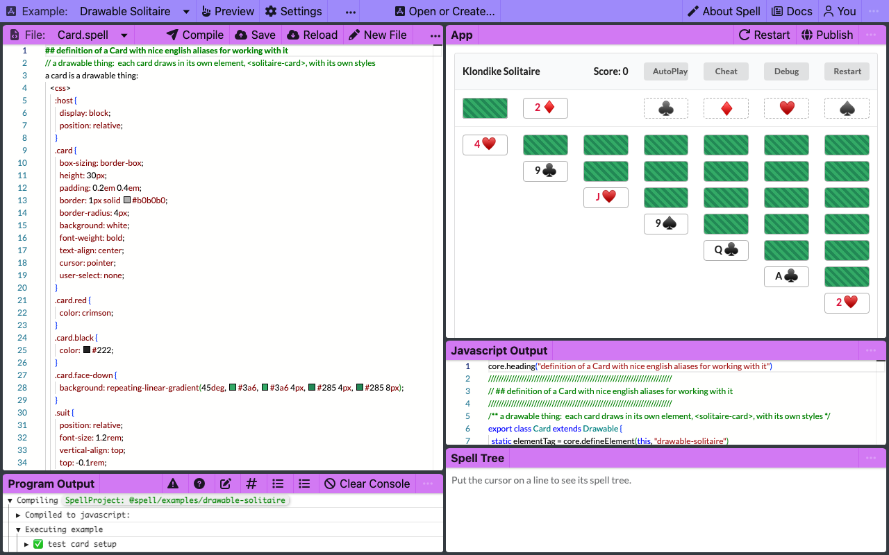
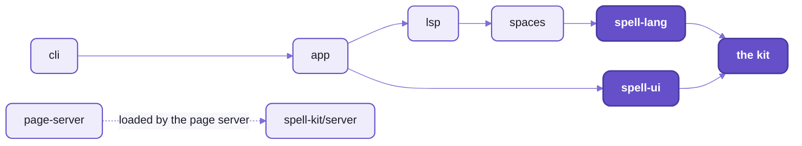

# The Spell app

Spell's editor is a place to make real software for people who don't call themselves programmers.
You write a program in English sentences, or ask an AI to write it for you,
and it runs right beside the text as you type.

What the AI made isn't a black box:  it's sentences you can read, check and change.

```text
a task is a thing
a task has a title as text
a task "is complete" if its completed is yes
```

- That's real spell, from the [to-do list example](README-examples.md):
  it says what a task is, and the app it's part of draws and saves tasks by itself.
- Change a sentence, and the running app changes with it, a couple of seconds later, without starting over.
- The editor is a web page:  it runs in your browser, and on any page that wants a Spell program in it.


This repo, spell-app, holds the editor and what it stands on:
where projects live, the language server that powers its red squiggles and hints,
and Spell's extension for VS Code.
The language itself is [spell-lang](../spell-lang/README.md);
the components every page draws with are [Spell UI](../spell-ui/README.md);
all of them sit in [the kit](../README.md).

## Spaces, organizations and people

Everything you make in Spell lives in a SPACE:  a person's, or an organization's, folder of projects.
Every project has an address, so you can name it anywhere:  in the editor's address bar, on the command line,
or in another project that uses it.

| Address | What it names |
| --- | --- |
| `@spell/examples/todos-form-based` | the to-do list example, in Spell's own space |
| `@spell/examples/todos-form-based/todo.spell` | one file of it |
| `@spell/library/cards` | a library:  a project other projects import |
| `owen@spell/errors` | a project in a person's own space (here, the maintainer's) |

- People and organizations are things in Spell too, with ids, saved in files you can read.
- Your own space is where `spell app create` puts a new project, and where the editor's "Projects" list looks.
- The [spaces page](README-spaces.md) says how addresses work, how to set up your own, and how the servers serve them.
- 🌱 Sharing a space, with sign-in and invites, is coming:  [below](#the-ambition).

## The live loop

What happens between your typing and the app changing, in eight steps:


_An edit recompiles the program and carries the running things over._

```mermaid
%%{init: {"theme":"base","themeVariables":{"fontFamily":"-apple-system, BlinkMacSystemFont, Segoe UI, Helvetica, Arial, sans-serif","fontSize":"15px","primaryColor":"#EFECFB","primaryBorderColor":"#6550CA","primaryTextColor":"#1A1C27","secondaryColor":"#F4F1E9","tertiaryColor":"#F7F6FC","lineColor":"#7F6FD6","textColor":"#7F6FD6","clusterBkg":"#F7F6FC","clusterBorder":"#B9B0E8","titleColor":"#1A1C27","edgeLabelBackground":"#F7F6FC","actorBkg":"#EFECFB","actorBorder":"#6550CA","actorTextColor":"#1A1C27","actorLineColor":"#9C90DE","signalColor":"#7F6FD6","signalTextColor":"#7F6FD6","labelBoxBkgColor":"#EFECFB","labelBoxBorderColor":"#6550CA","labelTextColor":"#1A1C27","loopTextColor":"#7F6FD6","noteBkgColor":"#F1E7D4","noteBorderColor":"#C9B48A","noteTextColor":"#1A1C27","activationBkgColor":"#DCD6F7","activationBorderColor":"#6550CA","sequenceNumberColor":"#FFFFFF"},"flowchart":{"curve":"basis","padding":12,"nodeSpacing":40,"rankSpacing":44}}}%%
flowchart LR
  open["1 Open a project"] --> type["2 Type"]
  type --> compile["3 Compile, in the browser"]
  compile --> runtime["4 Load the runtime"]
  runtime --> run["5 Run"]
  run --> keep["6 Keep the game going"]
  keep --> draw["7 Draw"]
  draw --> inspect["8 Inspect"]
  inspect -. "the next edit" .-> type
  %% the Spell look:  yarn mermaid:pretty
  classDef default fill:#EFECFB,stroke:#6550CA,stroke-width:1.5px,color:#1A1C27,rx:8px,ry:8px
```

<details>
<summary>As text</summary>



</details>

1. **Open a project** by its address:  the editor loads its files from your space.
2. **Type.**  The red squiggles, hover text and completions come as you type,
   from the same language service the command line uses;  two seconds after you stop, the editor compiles.
3. **Compile, in the browser.**  Your sentences are turned into JavaScript
   (COMPILING:  translating a program into another language a computer can run).
   No server does it:  the page does.
4. **Load the runtime**:  the small library every compiled program runs on,
   Spell's own copy, separate from the editor's.
5. **Run** the compiled program.
6. **Keep the game going.**  When you change the program, the things it made carry over to the new version:
   the cards on the table, the tasks in the list.
   So a game in progress survives your edit;  Restart starts afresh.
7. **Draw.**  The app draws itself on the page;
   a thing declared `drawable` draws as its own element, `<solitaire-card>`.
8. **Inspect.**  The console shows what the program printed;
   the Thing Explorer shows every thing it made, in spell's words, and the Type Explorer what each type is.

<details>
<summary>Who serves what while the editor runs</summary>

Two servers run on your machine, and the editor talks to the second through the first:



_The editor is a Vite dev server;  everything it saves or loads goes to the page server._

- The editor:  Vite, on port 3000, or any free one;  its address is in `.spell-server.editor.json`,
  its log in `.spell-server.editor.log`.
- The page server:  the kit's, one per checkout, on port 4747 if it's free
  ([README-page-server.md](README-page-server.md), [the kit's server page](../README-server.md)).
  It starts the editor as its child;  `SPELL_NO_EDITOR=1` skips that.

</details>

## What you can do today

- **Write in sentences, or in outlines.**  `a card has a suit`, or `a "card" is a thing where:` and its facts as bullets
  ([the outline solitaire](README-examples.md#outline-solitaire--the-outline-style-and-things-that-draw-themselves)).
- **See mistakes as you type:**  errors, hover text and completion,
  from the [language server](README-lsp.md) that VS Code and the command line use too.
- **Run a program as a page.**  Each drawable thing is its own element on the page,
  styled by a `<css>` block in its own definition.
- **Inspect it while it runs:**  the things it made, and the types it declares.
- **Compile it to other languages:**  JavaScript always, and TypeScript or Python when the project asks
  ([spell-lang's output targets](../spell-lang/README.md)).
- **Put a running program on any web page**, with one tag:

  ```html
  <script type="module" src="/element/spell-app.js"></script>
  <spell-app project="@spell/examples/calculator" toolbar></spell-app>
  ```

- **Run it from the command line:**  `spell run @spell/examples/fizzbuzz`, or `spell app serve` to open the editor
  ([the command line](../README-cli.md)).

What it doesn't do yet:  the editor has no AI of its own.
Today an AI (a coding agent) writes spell like any other code, and spell's point is that you can read what it wrote.

## The ambition

The editor is the start of something bigger.
Three pieces are planned, each standing on what's built.

### 🌱 Coming:  build by dragging things around

Build a program the way you'd lay out a slide:
drop [Spell UI](../spell-ui/README.md) components onto a page, set their properties in a panel, and attach spell to them.
HyperCard's three levels come back as modes:  browse (use it), author (lay it out), script (write the spell).

- It stands on what's built:  spell's types are already real web components (`a card is a drawable thing`),
  and `<spell-app>` is laid out in plain HTML.
- A property editor drawn from a type's description is built, but not merged yet.

### 🌱 Coming:  editing together

Several people in one project at once, each copy kept in step.
It comes in two stages:

1. Everyone on a local network in one RUNNING program (one game, one app),
   kept in step by patches from the editor's server.
2. Then the source itself, so several people write one project together.

- It stands on the Python target's web apps,
  which already send a game's whole state to a page when it opens, then a patch after each move.

### 🌱 Coming:  AI in the editor

Explain this line, write the next part, fix this error, translate it into another language:
in the editor, beside the text.

- Today:  coding agents write spell, and the language server's completions and quick fixes help you write it.

## The example apps

Five example apps ship with the editor, simplest first, and two libraries:

| Example | What it shows |
| --- | --- |
| [FizzBuzz](spaces/@spell/examples/fizzbuzz/) | a loop, `if` and `otherwise`, and `print`, in eight lines |
| [Calculator](spaces/@spell/examples/calculator/) | an app with buttons whose clicks are spell |
| [Todos - Form Based](spaces/@spell/examples/todos-form-based/) | types, phrases, a filtered list and a form |
| [Outline Solitaire](spaces/@spell/examples/outline-solitaire/) | Klondike solitaire in the outline style, with animation |
| [Drawable Solitaire](spaces/@spell/examples/drawable-solitaire/) | each card its own web component |
| [Cards](spaces/@spell/library/cards/), [People](spaces/@spell/library/people/) | libraries other projects import |



The [examples page](README-examples.md) has a picture of each one running, three walkthroughs,
and eight ideas for a project of your own.

---

**If you want to work on Spell itself**, the rest of this page is for you:
what's in this repo, setting it up, and where to start.

## The folders

spell-app is one npm package, `spell-app`, of five folders, each its own TypeScript program;
the VS Code extension sits beside them as a project of its own.

| Folder | Imported as | What it is | Its page |
| --- | --- | --- | --- |
| [app](app/) | `spell-app/app` | the editor web app, the runners, and four web components:  `<spell-app>`, `<spell-editor>`, `<spell-code>`, `<spell-markdown>` | [README-app.md](README-app.md) |
| [spaces](spaces/) | `spell-app/spaces` | where projects and people live:  the built-in projects, the models, the editor's server and Python's | [README-spaces.md](README-spaces.md) |
| [lsp](lsp/) | `spell-app/lsp` | the language server, and the folder of projects on disk it reads | [README-lsp.md](README-lsp.md) |
| [cli](cli/) | `spell-app/cli` | spell-app's commands for the `spell` command line, `spell app create \| serve \| vscode` and `spell projects`;  and the work behind spell-lang's commands, which find projects the app's way | [the kit's README-cli.md](../README-cli.md) |
| [page-server](page-server/) | `spell-app/page-server` | spell-app's layer on the kit's page server:  the bundles it builds, its settings | [README-page-server.md](README-page-server.md) |
| [vscode](vscode/) | the extension `spell-language` | the Spell language for VS Code:  colours, the language server, Run Project | [the kit's README-vscode.md](../README-vscode.md) |

Dependencies flow one way, down:



_Each folder uses only what's to its right;  the page server loads spell-app's layer by its path, from its settings._

- spell-app is the highest repo:  it uses spell-lang, spell-brand, Spell UI and the kit, and nothing uses it.
- It RUNS spell-epic's page routes through its page server's settings, but never imports it.
- Each folder's `AGENTS.md` holds the rules for working in it:
  [app](app/AGENTS.md), [spaces](spaces/AGENTS.md), [lsp](lsp/AGENTS.md), [cli](cli/AGENTS.md),
  [page-server](page-server/AGENTS.md);  the repo's own, [AGENTS.md](AGENTS.md).

## Setup from zero

The kit holds the one install for every repo, so start there:
[the kit's setup](../README.md) installs Node, clones the kit and runs the install.
Then, to have spell-app and what it needs:

```sh
cd ~/www/spell
yarn clone spell-app    # spell-app, and spell-lang, spell-brand and spell-ui with it, then one install
```

Start the editor, in spell-app's folder:

```sh
cd ~/www/spell/spell-app
yarn start
```

It prints where everything is, then stays running until `Ctrl-C`:

```text
✓ Starting the page server  http://127.0.0.1:4747/
✓ Starting the editor  http://localhost:3000/  (/api on the page server)
http://localhost:3000/
The spell app is at http://localhost:3000/;  docs, epics, goals and Spell UI at http://127.0.0.1:4747/ -- Ctrl-C to stop
```

Open the editor's address, `http://localhost:3000/`, and pick an example under "Open or Create...".
FizzBuzz is the first to open:  `http://localhost:3000/edit/@spell/examples/fizzbuzz`.

Then, once:

```sh
cd ~/www/spell
yarn cli:install    # the kit's:  puts `spell` on your PATH -- spell run, spell app serve, spell app create ...
cd spell-app
yarn vscode         # builds the Spell extension for VS Code and installs it
```

- `yarn cli:install` links `spell` into the first folder on your PATH it can write to.
  `SPELL_BIN_DIR=<folder>` picks the folder instead.
  - The folders it tries, in turn:  `~/.local/bin`, npm's global folder, `/usr/local/bin`, `/opt/homebrew/bin`.
  - Then `spell app serve` does what `yarn start` does, and opens your browser.
- `spell` is the kit's command;  spell-app adds its own commands to it, from its `cli/` folder.
- The Python parts (the Python output target, and its web server) need [uv](https://docs.astral.sh/uv/),
  which fetches the Python they ask for (3.12 or later).
  spell-app's `yarn test` and `yarn lint` run them.
- Your own projects go in your own space, outside git:
  [setting it up](README-spaces.md#setting-up-spaces-for-your-own-project).

## Working on it

- The checks, at spell-app's root, each run folder by folder:

  ```sh
  yarn ts    yarn lint    yarn format    yarn test    yarn review
  ```

  - `yarn review` runs them all, and FIXES lint and formatting as it goes.
  - One folder's, or a few:  `yarn spell-folders test spaces lsp`.
  - `yarn vitest` is one run over every folder;  `yarn vitest --project spaces` one folder's.
- Tests live in `tests/<folder>/`, at the same paths as the code they test:
  [projectGroups.ts](spaces/src/models/projectGroups.ts) is tested by
  [projectGroups.test.ts](tests/spaces/src/models/projectGroups.test.ts).
  The app's browser tests (`*.browser.test.tsx`) run in headless Chromium.
- App UI, the docs pages of the app's components, is at `http://127.0.0.1:4747/components/app/`
  while the page server runs:  one page per component, with live examples and pictures.
- Where to hack on what, across every repo, the one install, imports and worktrees:
  [the kit's development page](../README-development.md).
- The house style every repo shares:  WWOD, "What Would Owen Do?", in [agents/wwod/](agents/wwod/WWOD.md);
  the three logs (papercuts, suspected bugs, code debt) beside it in [agents/](agents/).

<details>
<summary>Every yarn script, one line each</summary>

All of them are spell-app's root `package.json`'s, run from its root (the folders have none of their own).

| Script | What it does |
| --- | --- |
| `ts`, `test`, `lint`, `lint:fix`, `format`, `format:check` | each check, folder by folder (`spell-folders`) |
| `review` | `ts`, `lint:fix`, `format` and `test`, in turn |
| `test:watch` | Vitest in watch mode, over every folder |
| `start` | stop any page server, then `spell app serve --headless`:  the page server and the editor, printing the editor's address |
| `stop` | stop the editor's Vite:  an orphan, or the page server's |
| `start:dev` | the editor's Vite alone, with no page server |
| `start:server`, `start:server:prod` | the app's API alone, on port 3001 (the first restarts on a change) |
| `build` | the editor app, into `app/dist/` |
| `build:runner` | `app/dist-runner/`:  VS Code's Run Project panel |
| `build:element` | `app/dist-element/`:  the four web components, `spell-language.js` and their pack, `spell.pack.js` |
| `build:page` | `app/dist-page/`:  the page side of a Python spell app |
| `preview` | Vite's preview of the built app |
| `site:data` | App UI's data:  each component's props, attributes and uses, from the code |
| `site:pictures` | App UI's pictures:  headless screenshots of the running editor |
| `examples:readme` | [README-examples.md](README-examples.md)'s table and its pictures, from the example projects |
| `clean` | delete the app's `.cache/` and `build/` |
| `lsp:start` | the language server, over stdio |
| `lsp:scopes` | write projects' scope packs, `<Project>.scopes.js` |
| `spell` | the kit's `spell` command (the kit's `yarn cli:install` puts it on your PATH) |
| `vscode`, `vscode:build`, `vscode:install` | `spell app vscode`:  build the VS Code extension and install it, or one step |
| `server` | `spell server`, the page server's command:  `start`, `stop`, `status`, `url <file>` ... |
| `serve` | `spell server start all`:  every web server of this checkout (page server, editor, Spell UI's docs), and where each is |
| `dev`, `dev:ts`, `dev:py` | `spell run` the project in the folder you're in, as JavaScript, TypeScript or Python |
| `epic`, `ask`, `window` | the epic tools, handed to `epic` |
| `commands:check` | check every script, command and skill against the commands page |

</details>

## License

[MIT](https://opensource.org/licenses/MIT).

## See also

- [The editor and the runners](README-app.md):  `<spell-app>`, `<spell-editor>`, the live loop in detail
- [Spaces](README-spaces.md):  addresses, your own projects, the servers, Python's web server
- [The example apps](README-examples.md):  each one running, walkthroughs, ideas
- [The language server](README-lsp.md):  one language service, three places it runs
- [spell-app's page server](README-page-server.md):  component sets, bundles, routes
- [The kit](../README.md):  every repo, setup from zero;
  [the command line](../README-cli.md), [VS Code](../README-vscode.md), [working on Spell](../README-development.md)
- [spell-lang](../spell-lang/README.md), the language;  [Spell UI](../spell-ui/README.md), the components

<details>
<summary>More in the docs site</summary>

These guides are pages of the docs site, at `http://127.0.0.1:4747/`.
It needs a checkout with the content folder beside it, and the page server running:
`yarn start`, or `spell server start`.

- "spell Command Line":  `/guides/cli.html`
- "Page Server":  `/guides/server.html`
- "People and Orgs":  `/guides/people-and-orgs.html`
- "The Python Target":  `/guides/python-target.html`
- "Outline Spell":  `/guides/outline-spell.html`
- "Drawable Things":  `/guides/drawable-thing.html`
- "Commands":  `/guides/dev/commands/commands.html`
- "Spell on Solid 2":  `/guides/solid/solid-2.html`

</details>

