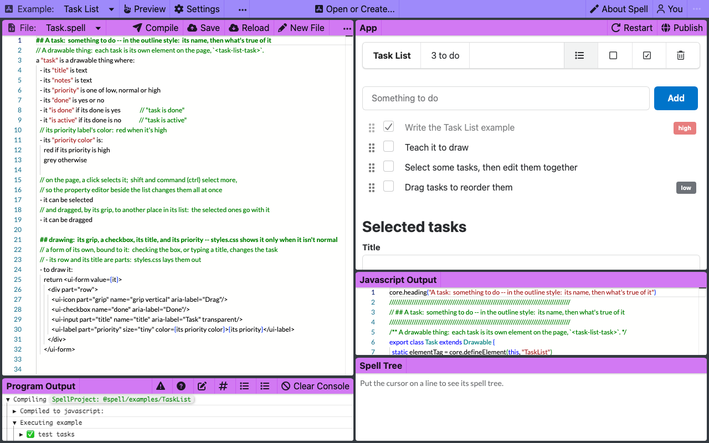
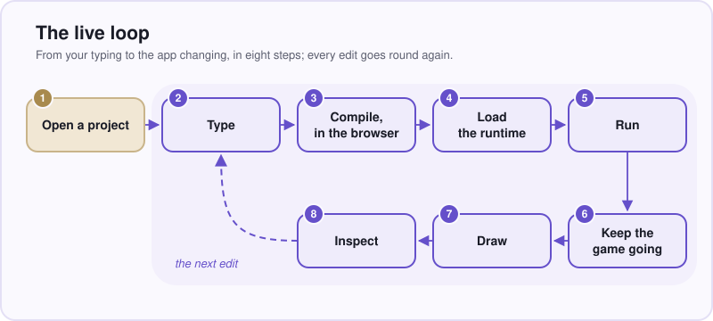
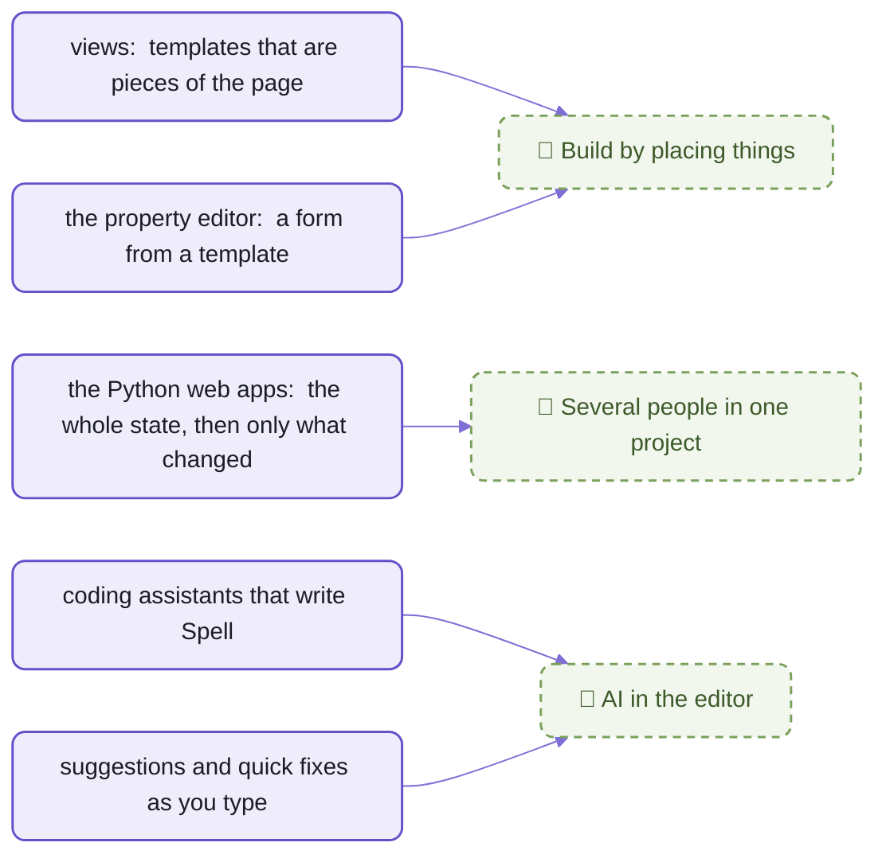
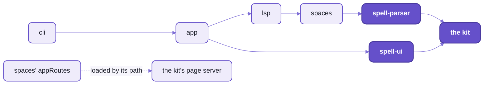
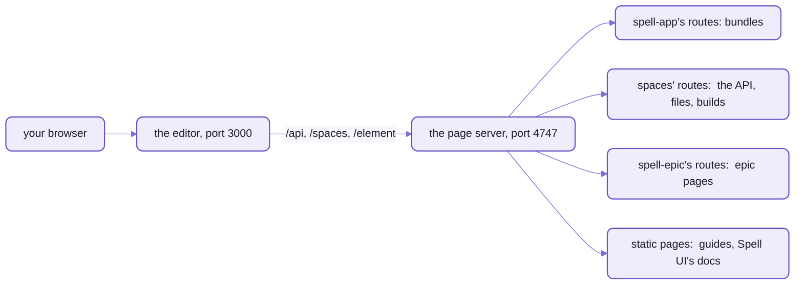

# The Spell app



_Task List in the Spell editor:  the program on the left, the app it makes on the right, running._

The left half of that picture is the program.
Here is what a task is, the seven lines at the top of its file, their comments left out:

```spell
a "task" is a view where:
	- its "title" is text
	- its "notes" is text
	- its "priority" is one of low, normal or high
	- its "done" is yes or no
	- it "is done" if its done is yes
	- it "is active" if its done is no
```

Read them once, and you know what a task is in this app:
it has a title, notes and a priority, it's done or it isn't, and "done" and "active" are two ways of saying which.
Change a sentence, and two seconds after you stop typing the app on the right follows,
with the same tasks in it, ticked or not, drawn by the new version.

Spell's editor is a place to make real software for people who don't call themselves programmers.
You write a program in plain English, or ask an AI to write it, and it runs beside the text as you type.

What the AI made isn't a black box.
It's sentences like those seven, on the left, beside the app they make on the right:
read one and you know what the app does;  change one and watch the app change.

<details>
<summary>What the browser runs instead:  those seven lines, as JavaScript</summary>

```js
export class Task extends View {
  static elementTag = core.defineElement(this, "TaskList")

  // - its "title" is text
  static { this.declareProp("title", { type: "text" }) }
  get title() { return this.getProp("title") }
  set title(value) { this.setProp("title", value) }

  // ... its notes, the same way

  // - its "priority" is one of low, normal or high
  static Priorities = ["low", "normal", "high"]
  static { this.declareProp("priority", { oneOf: Task.Priorities }) }
  get priority() { return this.getProp("priority") }
  set priority(value) { this.setProp("priority", value) }

  // - its "done" is yes or no
  static { this.declareProp("done", { type: "choice" }) }
  get done() { return this.getProp("done") }
  set done(value) { this.setProp("done", value) }

  /** "task is done" */
  get isDone() {
    return this.done
  }

  /** "task is active" */
  get isActive() {
    return !this.done
  }
}
```

- Real output:  `spell compile @spell/examples/TaskList --stdout`, trimmed to those seven lines.
- `view` makes each task an element of its own on the page, `<task-list-task>`:  that's `elementTag`.
- The whole Task List is 144 lines of Spell in two files, and about 270 of JavaScript, its styles among them.
- The editor shows it too, under the app, and you never have to read it.

</details>

**Not yet:  the editor has no AI of its own** ([below](#-ai-in-the-editor)).
Today the AI is a coding assistant, such as Claude Code, working in your project's folder:
it writes Spell the way it writes any code, and you open the result here.

This is the editor's home, `spell-app`:  its code, its examples, and the parts it stands on.
Those parts are where projects are kept, the checker that spots mistakes as you type,
and Spell for VS Code, a code editor many programmers use.
The editor itself is a web page, so it runs in your browser, and on any page that wants a Spell program in it.
The language has a home of its own, [spell-parser](https://github.com/spell-app/spell-parser/blob/main/README.md);
so do the buttons, lists and forms every page draws with, [Spell UI](https://github.com/spell-app/spell-ui/blob/main/README.md);
and all of them sit in [the kit](https://github.com/spell-app/spell/blob/main/README.md#the-five-repos), with one setup for everything.
Here to run it?  [Setup](#setup-from-zero) is near the end.

## Spaces:  every project has an owner and an address

Everything you make in Spell lives in a SPACE:  a person's or an organization's folder of projects.
Every project has an address, so you can name it anywhere:
in the editor's address bar, on the command line, or inside another project that uses it.

| Address | What it names |
| --- | --- |
| `@spell/examples/TaskList` | Task List above, in Spell's own space |
| `@spell/examples/TaskList/TaskList.spell` | one file of it |
| `@spell/library/people` | a library:  a project other projects use, here people |
| `owen@spell/errors` | a project in a person's own space |

Even the people who own the spaces are written in Spell.
This is what a person is, from [the people library](spaces/@spell/library/people/) the editor itself uses:

```spell
a person is a thing:
	- it is saved in its own file
	- it has names as text
	- it has a nickname as text
	- its "emails" is a list of text
	- its "dates" is a list of dated-events
	- its "friend-lists" is a list of friend-lists
	- its "notes" is a list of notes
```

That's an OUTLINE:  a heading, then what's true of it, as bullets.
So is the task at the top of this page.
The Calculator says the same kind of thing in sentences, and Spell reads both.

- `@spell` is an organization's space, Spell's own;  `owen@spell` is a person's, at that organization.
- Each person and organization has an id, and a file of its own that you can open and read.
  The editor's "You" panel, top right in the picture above, shows yours and lets you change it.
- Your own space is where a new project goes, and what the editor's "Projects" list shows.
- **Not yet:**  every space is on your own machine, one person to a machine,
  and yours is called `owen@spell`, whoever you are:  a name fixed in the code until a machine can hold more people.
  🌱 Sign-in, invites and sharing a space are planned ([below](#-several-people-in-one-project)).
- How addresses work, and how to set up your own projects:  [the spaces page](README-spaces.md).

## The live loop:  from a keystroke to the app changing



_An edit recompiles the program and carries the running things over._

```mermaid
%%{init: {"theme":"base","themeVariables":{"fontFamily":"-apple-system, BlinkMacSystemFont, Segoe UI, Helvetica, Arial, sans-serif","fontSize":"15px","primaryColor":"#EFECFB","primaryBorderColor":"#6550CA","primaryTextColor":"#1A1C27","secondaryColor":"#F4F1E9","tertiaryColor":"#F7F6FC","lineColor":"#7F6FD6","textColor":"#7F6FD6","clusterBkg":"#F7F6FC","clusterBorder":"#B9B0E8","titleColor":"#1A1C27","edgeLabelBackground":"#F7F6FC","actorBkg":"#EFECFB","actorBorder":"#6550CA","actorTextColor":"#1A1C27","actorLineColor":"#9C90DE","signalColor":"#7F6FD6","signalTextColor":"#7F6FD6","labelBoxBkgColor":"#EFECFB","labelBoxBorderColor":"#6550CA","labelTextColor":"#1A1C27","loopTextColor":"#7F6FD6","noteBkgColor":"#F1E7D4","noteBorderColor":"#C9B48A","noteTextColor":"#1A1C27","activationBkgColor":"#DCD6F7","activationBorderColor":"#6550CA","sequenceNumberColor":"#FFFFFF"},"flowchart":{"curve":"basis","padding":12,"nodeSpacing":40,"rankSpacing":44}}}%%
flowchart LR
  open["1 · Open a project"] --> type["2 · Type"]
  type --> compile["3 · Compile, in the browser"]
  compile --> runtime["4 · Load the runtime"]
  runtime --> run["5 · Run"]
  run --> keep["6 · Keep the game going"]
  keep --> draw["7 · Draw"]
  draw --> inspect["8 · Inspect"]
  inspect -. "the next edit" .-> type
  %% the Spell look:  yarn mermaid:pretty
  classDef default fill:#EFECFB,stroke:#6550CA,stroke-width:1.5px,color:#1A1C27,rx:8px,ry:8px
  classDef step fill:#EFECFB,stroke:#6550CA,stroke-width:1.5px,color:#1A1C27,rx:16px,ry:16px
  class open,type,compile,runtime,run,keep,draw,inspect step
```

<details>
<summary>As text</summary>



</details>

1. **Open a project** by its address:  the editor loads its files from your space.
2. **Type.**  Red underlines, a note when you hover over a word, and suggestions come as you type.
   VS Code and the command line check a program with the same code, so the three never disagree.
   Two seconds after you stop, the editor compiles.
3. **Compile, in the browser.**  Your sentences are turned into JavaScript, the language web pages run.
   Compiling is that translation, from a language people read to one a computer runs,
   and no server does it here:  the page itself does.
4. **Load the runtime:**  the small set of building blocks every compiled program runs on.
   The program gets a copy of its own, separate from the editor's.
5. **Run** the compiled program.
6. **Keep the game going.**  What the program made carries over to the new version:
   the cards on the table, the tasks in the list.
   So a game in progress survives your edit, and Restart is there for when you want a new deal.
7. **Draw.**  The app draws itself on the page;
   a thing whose template is a `view` draws as an element of its own, a piece of the page with its own name:
   `<solitaire-card>`.
8. **Inspect.**  Switch to Debug, and a panel under the code shows what the program printed;
   the Thing Explorer shows every thing it made, in Spell's words, and the Type Explorer what each type is.

Step 6 has two exceptions, and that panel's Program Output says which one it met.
An edit to the lines that start the program starts it afresh,
and so does one that changes what a property holds, a title `as text` made `as a number`, say,
because the old things no longer fit.
Each step in detail, with the code behind it:  [the editor's page](README-app.md).

## What you can do today

All of this runs now, on your own machine.

- **Write in sentences, or in outlines.**  The Calculator is sentences;  Task List and the person above are outlines.
  [Solitaire](spaces/@spell/examples/Solitaire/) is a whole card game written that way, its cards, deck and piles too.
- **See mistakes as you type.**  On a line Spell can't read at all, it offers to teach Spell the phrase:
  "Define `to <phrase>`".
  The same checker runs in VS Code and on the command line ([the language server](README-lsp.md)).
- **Make an app that draws itself.**  A thing you declare a `view`, like a playing card,
  becomes a piece of the page of its own, with its look written inside its definition
  ([Solitaire](spaces/@spell/examples/Solitaire/), below).
- **Watch it while it runs:**  the things it made, and the kinds of thing it declares,
  and the program written as TypeScript or Python, in Debug's panel under the code
  ([Run, Edit and Debug](README-app.md#run-edit-and-debug--the-app-and-the-program-panel)).
- **Learn by changing a guide.**  Twelve guides are Spell programs that read as prose:
  a first walkthrough, A tour of Spell, and how each example works ([the guides](README-examples.md#guides--programs-that-read-as-prose)).
- **Pick a theme.**  Glass, frosted panels over a wallpaper, is the default;  Studio and Spell's own are the other looks,
  among 28 themes, each light or dark, and the code is always Shades of Purple ([themes](README-app.md#themes-and-purple-code)).
- **Turn it into other programming languages:**  JavaScript always, and TypeScript or Python when the project asks
  ([spell-parser's targets](https://github.com/spell-app/spell-parser/blob/main/README-targets.md)).
- **Put a running program on any web page**, with two lines of HTML, the code web pages are written in:

  ```html
  <script type="module" src="/element/spell-app.js"></script>
  <spell-app project="@spell/examples/calculator" toolbar></spell-app>
  ```

  What else it takes, and what it costs:  [four elements, for any page](README-app.md#four-elements-for-any-page).
- **Run it from a terminal**, the window where you type commands:
  `spell run @spell/examples/fizzbuzz`, or `spell app serve` to open the editor ([the command line](https://github.com/spell-app/spell/blob/main/README-cli.md#spell-app)).
- **Build it as plain files**, a public preview anyone can try with nothing installed:
  `spell app preview build`, then `spell app preview serve` to see it as a web host would
  ([the public preview](README-app.md#the-public-preview--the-editor-as-plain-files)).
  **Not yet deployed anywhere:**  today it builds on your machine.

## The ambition

Today you build a program by typing it.
The plan is to build it the way people already make slides and spreadsheets:
by placing things, by working on one together, and by asking for help.
Three pieces are planned, none of them started, and each stands on something already built.



_What each planned piece stands on:  everything on the left runs today._

### 🌱 Build by placing things, not only by typing

Lay a program out the way you'd lay out a slide:
drop [Spell UI](https://github.com/spell-app/spell-ui/blob/main/README.md) components on a page, buttons and lists and forms,
set their properties in a panel, and attach Spell to them.
HyperCard, the Mac program that let people build their own apps from cards and buttons, had three levels,
and they come back as modes:  browse (use it), author (lay it out) and script (write the Spell).

- **Where it stands:**  planned, not started.
  The first question it has to answer is what a drop writes into your program:  Spell, page markup, or a layout file.
- **What it stands on**, all built:
  - Spell's templates are real page elements already:  a card that's a `view` is a `<solitaire-card>` on the page.
  - `<spell-app>` is laid out in plain HTML.
  - Spell UI has a property editor, a form drawn from a kind of thing, one field for each fact about it,
    still marked in progress ([its row in the components table](https://github.com/spell-app/spell-ui/blob/main/README-components.md)).
    The editor already makes one for a template in your program, with "New Property Editor..." among its file actions:
    a page of plain markup, `Card.editor.html`, which `spell lint` checks still fits the template.

### 🌱 Several people in one project

Several people working in one project at once, each one's copy kept in step with the others'.
It comes in two stages:

1. Everyone on a local network in one RUNNING program, one game or one app,
   kept in step by patches from the editor's server.
2. Then the source itself, so several people write one project together.

- **Where it stands:**  planned, not started.
  Decided so far:  the editor's server keeps the shared copy, on one machine or a local network,
  with no outside service and no accounts.
- **What it stands on:**  the Python target's web apps already send a game's whole state to a page when it opens,
  then a patch, just what changed, after each move ([the Python server](README-spaces.md#the-python-server)).

### 🌱 AI in the editor

Explain this line, write the next part, fix this error, translate the program into another human language:
in the editor, beside the text.

- **Where it stands:**  an idea, with one thing decided:
  you'd choose how much it teaches you, from "do it all for me" to "walk me through every change".
- **What it stands on:**  coding assistants write Spell today,
  and the language server's suggestions and quick fixes help you write it yourself.

## The example apps:  ten to open, two to build on

Ten example apps come with the editor, simplest first:
FizzBuzz, which counts to 100;
a calculator whose buttons run Spell;
Tic-Tac-Toe, its rules written as sentences;
Bill Splitter, a form whose sums follow every keystroke;
Flash Cards, a deck of Spanish words to quiz yourself on;
Habit Tracker, a week of checkboxes for each habit;
Task List, at the top of this page, and Lista de tareas, the same list in Spanish;
and Klondike solitaire, written in outlines, every card a piece of the page of its own;
and Solitario, the same game in Spanish.
A library comes with them, of people, for your own projects to build on.


_Solitaire, dealt:  every card on the table is a `<solitaire-card>`, inside the pile that holds it._

[The examples page](README-examples.md) has each one running and taken apart,
and six ideas for a project of your own.

---

**If you want to work on Spell itself**, the rest of this page is for you:
what's in this repository, setting it up, and checking a change.

## The folders, and the page for each

`spell-app` is one npm package, and all its code is in ONE folder, [src/](src/), a folder per part.
A file is imported by the package's name and its path under `src/`, with no extension:
`spell-app/app/solid` (a folder's `index.ts`), `spell-app/spaces/models/projectGroups`.
It's the same name inside spell-app as from any other repo.

| Page | The folder it covers | What's on it |
| --- | --- | --- |
| [README-app.md](README-app.md) | [src/app/](src/app/), `spell-app/app`;  its build folder, [app/](app/) | <ul><li>four elements for any page:  `<spell-app>`, `<spell-editor>`, `<spell-code>`, `<spell-markdown>`</li><li>one runner in three places;  a runtime per program;  a recompile that keeps what the program made</li><li>the editor:  one object behind every pane;  three looks;  the explorers' tabs</li><li>the public preview:  the editor as plain files</li><li>the builds, one Solid per page;  App UI, a page per component</li></ul> |
| [README-spaces.md](README-spaces.md) | [src/spaces/](src/spaces/), `spell-app/spaces` | <ul><li>addresses:  the folder is in the name</li><li>setting up spaces for your own project, in seven steps</li><li>the models, the editor's API, and the Python server</li><li>people and orgs, declared in Spell;  🌱 sign-in</li></ul> |
| [README-examples.md](README-examples.md) | [spaces/@spell/](spaces/@spell/):  data, not code | <ul><li>ten apps, simplest first, each running</li><li>twelve guides, programs that read as prose</li><li>the four parts of every app, and why the Calculator's wording counts</li><li>FizzBuzz, Task List and the two solitaires, line by line</li><li>ideas for your own;  the frozen test projects</li></ul> |
| [README-lsp.md](README-lsp.md) | [src/lsp/](src/lsp/), `spell-app/lsp` | <ul><li>one service in three places:  the browser, VS Code, the command line</li><li>it reads the parse the compiler already made;  one queue</li><li>what it answers, request by request</li><li>scope packs;  where it stops</li></ul> |
| [README-page-server.md](README-page-server.md) | its part of the kit's page server, in [package.json](package.json);  its route module is in spaces | <ul><li>the three settings spell-app adds to the kit's page server</li><li>what its route module serves:  the editor, its API, `/element/`</li><li>the editor's record;  running it</li></ul> |
| [the kit's README-cli.md](https://github.com/spell-app/spell/blob/main/README-cli.md#spell-app) | [src/cli/](src/cli/), `spell-app/cli` | <ul><li>spell-app's commands:  `spell app create \| serve \| preview \| vscode`, `spell projects`</li><li>the work behind spell-parser's commands, which find projects the app's way</li></ul> |
| [the kit's README-vscode.md](https://github.com/spell-app/spell/blob/main/README-vscode.md) | [vscode/](vscode/):  the extension `spell-language`, a yarn project of its own | <ul><li>the Spell language for VS Code:  colours, the language server, Run Project</li><li>custom elements in JSX, HTML and CSS files:  slot, part and attribute help, and Spell UI's HTML and CSS data</li></ul> |

Beside them:  [app/](app/), the editor's build folder (its Vite configs, `index.html`, App UI's docs pages and its
builds);  the tests, in [tests/](tests/);  and the configs.

Dependencies flow one way, down:



_Each folder uses only what's to its right;  the kit's page server loads spaces' route module by its path,
from spell-app's settings._

- spell-app is the top repo:  it uses spell-parser, Spell UI and the kit, and nothing uses it
  ([the map of the repos](https://github.com/spell-app/spell/blob/main/README.md#the-five-repos)).
- It names spell-epic nowhere:  spell-epic declares its own part of the kit's page server, as spell-app does.
- Each folder's `AGENTS.md` holds the rules for working in it:
  [app](src/app/AGENTS.md), [spaces](src/spaces/AGENTS.md), [lsp](src/lsp/AGENTS.md), [cli](src/cli/AGENTS.md);
  the repo's own, [AGENTS.md](AGENTS.md).

## Setup from zero

The kit holds the one install for every repo, so start with [its setup](https://github.com/spell-app/spell/blob/main/README.md#setup-from-zero).
It clones spell-app with the rest, puts `spell` on your PATH, and names uv, which the Python parts need.
Cloned only part of it?  Bring spell-app, with every repo it needs or runs:

```sh
cd ~/www/spell
yarn clone spell-app
```

Start the editor, in spell-app's folder:

```sh
cd ~/www/spell/spell-app
yarn start
```

It prints where everything is, then stays running until `Ctrl-C`:

```text
✓ Starting the page server  http://127.0.0.1:4747/
✓ Starting the editor  http://localhost:3000/  (/api on the page server)
http://localhost:3000/
The spell app is at http://localhost:3000/;  docs, epics, goals and Spell UI at http://127.0.0.1:4747/ -- Ctrl-C to stop
```

Open the editor's address, `http://localhost:3000/`, and pick an example on its landing page (Home, the house icon in the top bar).
Start with FizzBuzz, the simplest:  `http://localhost:3000/edit/@spell/examples/fizzbuzz`.

- `yarn start` runs the install first, and stops the kit's page server, so you always get a fresh pair.
- The addresses it prints are the real ones:  each server takes another free port when its own is in use.
- With `spell` on your PATH, `spell app serve` does what `yarn start` does, without the install,
  and opens your browser.

<details>
<summary>Two servers, and who serves what</summary>

The editor talks to the second server through the first:



_The editor is a Vite dev server;  everything it saves or loads goes to the page server._

- The editor:  Vite, on port 3000, or any free one;  its address is in `.spell-server.editor.json`,
  its log in `.spell-server.editor.log`.
  The page server starts it, as its child ([the servers](README-spaces.md#the-servers--an-api-that-nothing-starts)).
- The page server:  the kit's, one per kit, started from its root, on port 4747 if it's free
  ([what spell-app adds to it](README-page-server.md), [the kit's](https://github.com/spell-app/spell/blob/main/README-server.md)).

</details>

Then, once, the Spell extension for VS Code.
It needs `spell` on your PATH, the kit's `yarn cli:install` ([Setting it up](https://github.com/spell-app/spell/blob/main/README-cli.md#setting-it-up)),
and VS Code's `code` command ([README-vscode.md](https://github.com/spell-app/spell/blob/main/README-vscode.md)):

```sh
cd ~/www/spell/spell-app
spell app vscode    # builds the Spell extension for VS Code, and installs it
```

- `spell` is the kit's command;  spell-app adds its own commands to it, from [src/cli/](src/cli/).
- The Python parts, the Python output target and its web server, need [uv](https://docs.astral.sh/uv/),
  which fetches the Python they ask for (3.12 or later).
  spell-app's `yarn test`, `yarn lint` and `yarn format` run Python too, and stop at that step without it.
- Your own projects go in your own space, outside git:
  [setting it up](README-spaces.md#setting-up-spaces-for-your-own-project).

## Working on it

The checks, at spell-app's root, each over the whole repo:

```sh
yarn ts    yarn lint    yarn format    yarn test    yarn review
```

- `yarn review` runs them all, and FIXES lint and formatting as it goes.
- `yarn test` is one Vitest run, a project per folder, then spaces' Python tests (pytest).
  - One folder's:  `yarn vp test run --project spaces`.
    The projects:  `spaces`, `lsp`, `app:node`, `app:browser`, `cli`, `spell`.
- Tests live in `tests/<folder>/`, at the same paths as the code they test:
  [projectGroups.ts](src/spaces/models/projectGroups.ts) is tested by
  [projectGroups.test.ts](tests/spaces/models/projectGroups.test.ts).
- [tests/spell/](tests/spell/) checks the language on the frozen test projects, [spaces/@spell/test/](spaces/@spell/test/):
  each one's snapshots, what `tsc` and pyright say of it, whole-project parsing.
  - `yarn spell:test:fixtures` runs the snapshot tests;  `yarn spell:test:fixtures:bless` rewrites the snapshots,
    and the diff is the review.
  The app's browser tests (`*.browser.test.tsx`, and `.ts`) run in headless Chromium.
- App UI, the docs pages of the app's components, is at `http://127.0.0.1:4747/components/app/`
  while the page server runs:  one page per component, with live examples and pictures.
- Where to change what, across every repo:  [the kit's development page](https://github.com/spell-app/spell/blob/main/README-development.md).
- The house style every repo shares is WWOD, introduced on [the kit's front page](https://github.com/spell-app/spell/blob/main/README.md#wwod-the-house-style):
  its rules in [agents/wwod/](agents/wwod/WWOD.md), and the three logs beside them in [agents/](agents/),
  papercuts, suspected bugs and code debt.

<details>
<summary>Every yarn script, one line each</summary>

All of them are spell-app's root `package.json`'s, run from its root (the folders have none of their own).
Where a page says more, the row links it.

| Script | What it does |
| --- | --- |
| `ts`, `test`, `lint`, `lint:fix`, `format`, `format:check` | each check, over the whole repo;  `test`, `lint` and `format` run spaces' Python too, through uv |
| `review` | `ts`, `lint:fix`, `format` and `test`, in turn |
| `test:watch` | Vitest in watch mode, over every folder |
| `start` | the install, then stop the kit's page server, then `spell app serve --headless`:  the page server and the editor, printing the editor's address |
| `stop` | stop the servers started in spell-app's folder, the editor's Vite even when it's left running;  never the language server |
| `start:dev` | the editor's Vite alone, with no page server |
| `start:server`, `start:server:prod` | the app's API alone, on port 3001 (the first restarts on a change) |
| `build`, `build:runner`, `build:element`, `build:page` | the four builds, each into a folder of `app/`:  [the builds](README-app.md#the-builds--one-solid-per-page-however-many-bundles) |
| `preview` | Vite's preview of the built app |
| `site:data`, `site:pictures` | App UI's data from the code, and its pictures:  [App UI](README-app.md#app-ui--a-page-for-every-component) |
| `examples:readme` | [README-examples.md](README-examples.md)'s table and its pictures, from the example projects |
| `clean` | delete the app's `.cache/` and `build/` |
| `lsp:start`, `lsp:scopes` | the language server over stdio;  projects' scope packs, `<Project>.scopes.js`:  [README-lsp.md](README-lsp.md#working-on-it) |
| `spell` | the kit's `spell` command (the kit's `yarn cli:install` puts it on your PATH) |
| `vscode`, `vscode:build`, `vscode:install` | `spell app vscode`:  build the VS Code extension and install it, or one step |
| `server`, `serve` | `spell server`, the page server's command;  `spell server start all`, every web server of the kit:  [running it](README-page-server.md#running-it) |
| `dev`, `dev:ts`, `dev:py` | `spell run` the project in the folder you're in, as JavaScript, TypeScript or Python |
| `epic`, `ask`, `window` | the epic tools, handed to `epic` |
| `commands:check` | check every script, command and skill against the commands page |

</details>

## License

[MIT](https://opensource.org/licenses/MIT).

## See also

- [The editor and the runners](README-app.md):  the next page down, the live loop's code,
  `<spell-app>` and its three siblings
- [spell-parser](https://github.com/spell-app/spell-parser/blob/main/README.md):  the language the editor runs, and the three it compiles to
- [Spell UI](https://github.com/spell-app/spell-ui/blob/main/README.md):  the components every Spell app draws with
- [The kit's front page](https://github.com/spell-app/spell/blob/main/README.md#every-readme):  the five repos, setup from zero, and every page of each
- [Working on Spell](https://github.com/spell-app/spell/blob/main/README-development.md):  a change across repos, from a branch to merged

<details>
<summary>More in the docs site</summary>

These guides are pages of the docs site, at `http://127.0.0.1:4747/`.
It needs a checkout with the content folder beside it, and the page server running:
`yarn start`, or `spell server start`.

- "The `spell` Command Line":  `/guides/cli.html`
- "Page Server":  `/guides/server.html`
- "People and Orgs":  `/guides/people-and-orgs.html`
- "The Python Target":  `/guides/python-target.html`
- "Outline Spell":  `/guides/outline-spell.html`
- "Views":  `/guides/drawable-thing.html`
- "Commands":  `/guides/dev/commands/commands.html`
- "Spell on Solid 2":  `/guides/solid/solid-2.html`

</details>
